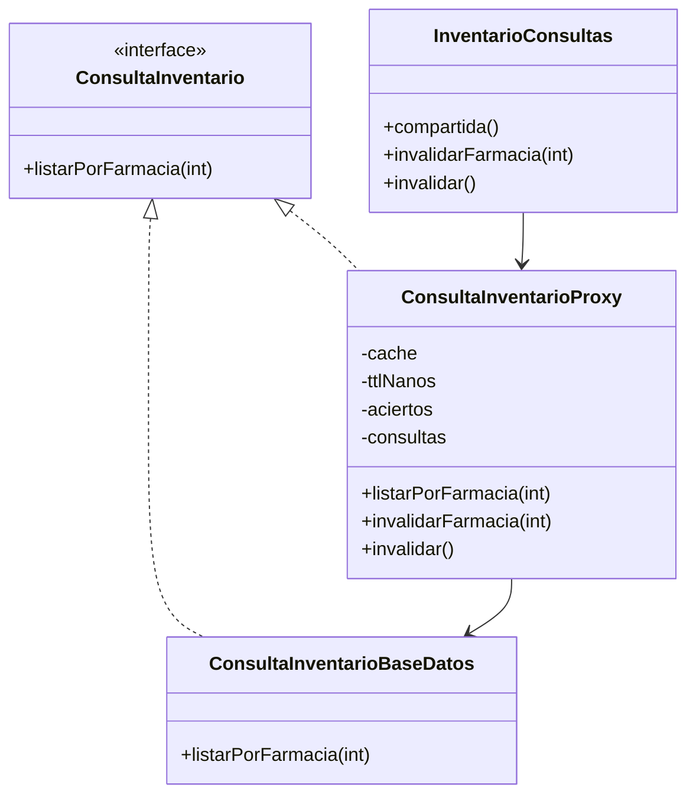

# HU.97 — Validación y documentación del patrón Proxy

**Issue:** [#714](https://github.com/puj-course/FIS_2630_1204_G1/issues/714)

**Proyecto:** CareStock

**Patrón de diseño:** GoF Proxy (Caching Proxy)

## 1. Descripción de la historia

Validar el comportamiento del Caching Proxy implementado
en CareStock y documentar su integración arquitectónica.

El propósito es reducir las consultas repetitivas a PostgreSQL
sin comprometer la seguridad, consistencia y segregación
del inventario por farmacia.

## 2. ¿Qué se implementó?

Se implementó un Caching Proxy que controla las consultas
del inventario unificado de medicamentos, productos de aseo
y maternidad.

Sus funcionalidades principales son:

- Almacenamiento temporal de consultas por farmacia.
- Expiración automática mediante TTL.
- Estrategia LRU para limitar el uso de memoria.
- Validación de autorización por farmacia.
- Invalidación de caché ante cambios de inventario.
- Control de consultas concurrentes redundantes.
- Registro de métricas de aciertos y consultas reales.

## 3. ¿Cómo se implementó?

La implementación utiliza las siguientes clases:

### ConsultaInventario

Interfaz que define el contrato de consulta:

`listarPorFarmacia(int idFarmacia)`

Es implementada tanto por el Proxy como por el DAO.

### ConsultaInventarioBaseDatos

Actúa como RealSubject.

Ejecuta una consulta SQL con UNION ALL sobre las tablas:

- medicamentos
- aseo
- maternidad

Los resultados se restringen mediante id_farmacia.

### ConsultaInventarioProxy

Actúa como Proxy.

Intercepta las solicitudes y determina si debe devolver
información almacenada o consultar nuevamente PostgreSQL.

Configuración:

- TTL predeterminado: 30 segundos.
- TTL configurable: 1 a 3600 segundos.
- Máximo de farmacias en caché: 16.
- Máximo de filas por entrada: 10.000.
- Evita consultas simultáneas redundantes por farmacia.

### InventarioConsultas

Proporciona una instancia compartida del Proxy y
centraliza las operaciones de invalidación.

### SesionUsuario

Proporciona la farmacia del usuario autenticado.

El Proxy verifica la autorización antes de entregar
información, incluso cuando existe un resultado en caché.

## 4. Funcionamiento del caché

### Cache Hit

1. El usuario solicita el inventario.
2. El Proxy verifica la autorización.
3. Busca una entrada vigente para su farmacia.
4. Devuelve los datos sin consultar PostgreSQL.
5. Incrementa el contador de aciertos.

### Cache Miss

1. El usuario solicita el inventario.
2. El Proxy verifica la autorización.
3. No encuentra una entrada vigente.
4. Consulta el DAO.
5. Almacena los resultados si cumplen los límites.
6. Devuelve los productos recuperados.

### Expiración e invalidación

Las entradas expiran al cumplir el TTL establecido.

La aplicación también invalida la caché al cambiar
de sesión y desde operaciones de escritura del inventario.

En la fachada actual, la invalidación ocurre al finalizar
una operación de escritura, incluso si esta falla.
Esto prioriza evitar datos obsoletos.

## 5. Diagrama de clases

## 6. Validación de la implementación

El código permite revisar los siguientes escenarios:

| Escenario | Comportamiento esperado |
|---|---|
| Cache hit | No ejecutar otra consulta al DAO |
| Cache miss | Consultar el DAO |
| TTL expirado | Volver a consultar los datos |
| Farmacia diferente | No reutilizar datos de otra farmacia |
| Sin sesión autorizada | Rechazar el acceso |
| Invalidación | Descartar resultados anteriores |
| Error de conexión | No almacenar resultados fallidos |
| Concurrencia | Evitar consultas redundantes por farmacia |

Estos escenarios describen criterios de validación;
no constituyen evidencia de pruebas ejecutadas.

## 7. Rendimiento

El Proxy dispone de los métodos:

- `aciertos()`
- `consultasReales()`

Estos permiten observar la utilización del caché.

Para demostrar una mejora cuantitativa se requiere
comparar tiempos de respuesta y consultas SQL entre
ejecuciones con y sin caché.

No se registran porcentajes de mejora porque todavía
no se dispone de mediciones reproducibles documentadas.

## 8. Integración arquitectónica

El Proxy se incorpora a la arquitectura MVC de CareStock
sin reemplazar el DAO ni modificar la persistencia.

El controlador solicita datos mediante la fachada o
el acceso compartido al Proxy.

El Proxy verifica la autorización, consulta el caché y
delega en el DAO cuando necesita recuperar datos.

Esta separación mantiene responsabilidades claras
entre presentación, lógica de acceso y persistencia.

## 9. Conclusión

CareStock utiliza el patrón GoF Proxy para reducir
consultas repetitivas al inventario unificado.

La implementación incorpora TTL, LRU, segregación
por farmacia, invalidación y control de concurrencia.

Esta documentación describe la solución existente.
La ejecución y publicación de pruebas funcionales,
de integración y rendimiento sigue pendiente para
completar todos los criterios de la Issue #714.
