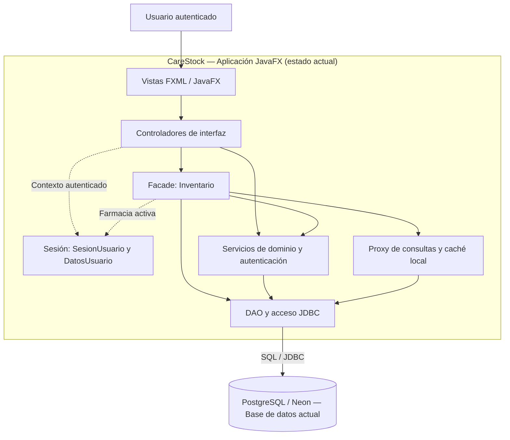

# 🏛️ CareStock —Diagrama de componentes

**Proyecto:** CareStock — Gestión de inventario médico-farmacéutico  
**Tipo de vista:** Arquitectura lógica de componentes y evolución tecnológica  
**Estado:** Prototipo actual + arquitectura objetivo propuesta  
**Tecnología actual:** JavaFX, Java, JDBC y PostgreSQL (Neon)
---

## 1. Arquitectura actual — Prototipo JavaFX

CareStock funciona como una aplicación de escritorio organizada en capas. La interfaz JavaFX invoca controladores que coordinan la lógica del dominio a través de la fachada `Inventario`, servicios y objetos de acceso a datos (DAO). La persistencia se efectúa por JDBC en PostgreSQL/Neon. El contexto de sesión identifica al usuario y la farmacia activa.

**Elementos existentes representados:** clientes JavaFX, controladores, fachada `Inventario`, servicios, DAO/JDBC, sesión y mecanismos de Proxy/caché. El detalle exacto de interfaces y clases DAO debe mantenerse sincronizado con el código de la rama principal después de la refactorización.

---

## 2. Diagrama de componentes — Arquitectura objetivo (visión futura)

El objetivo es desacoplar la presentación de los servicios de negocio, habilitar varios tipos de cliente y sustituir el acceso directo de los clientes a la base de datos por una API. Se propone preservar las reglas existentes de **segregación por farmacia**, trazabilidad de operaciones, control de lotes y consultas de inventario.
flowchart TB
    USER["Usuarios: farmacéutico, administrador y auxiliar"]

    subgraph CLIENTES["1. Capa de presentación"]
        direction LR
        WEB["Cliente Web"]
        MOVIL["Mensaje de Texto"]
        DESKTOP["Cliente JavaFX Existente; integración API propuesta"]
    end

    subgraph ENTRADA["2. Capa de acceso e integración — Propuesta"]
        GATEWAY["API Gateway HTTPS · Enrutamiento · Rate limiting Validación técnica de tokens"]
    end

    subgraph NEGOCIO["3. Servicios de negocio — Propuestos"]
        direction LR
        AUTH["Identidad y acceso OAuth2 / OIDC · JWT · Roles"]
        INVENTARIO["Inventario y catálogo Productos · Farmacias · Lotes Stock · FEFO · Kardex"]
        ALERTAS["Notificaciones y alertas Stock mínimo · Vencimientos"]
        AUDITORIA["Auditoría y trazabilidad Historial de eventos y movimientos"]
    end

    subgraph PLATAFORMA["4. Persistencia, caché y mensajería"]
        direction LR
        DB_AUTH[("PostgreSQL Datos de identidad · Propuesto")]
        DB_INV[("PostgreSQL / Neon Inventario · Evolución del actual")]
        DB_AUDIT[("PostgreSQL Registros de auditoría · Propuesto")]
        REDIS[("Redis Caché distribuida · Propuesto")]
        OUTBOX["Outbox transaccional Publicación confiable · Propuesto"]
        EVENTOS[["RabbitMQ Bus de eventos · Propuesto"]]
    end

    USER --> WEB
    USER --> MOVIL
    USER --> DESKTOP

    WEB -->|"HTTPS / API"| GATEWAY
    MOVIL -->|"HTTPS / API"| GATEWAY
    DESKTOP -->|"HTTPS / API"| GATEWAY

    GATEWAY -->|"Login y gestión de identidad"| AUTH
    GATEWAY -->|"Consultas y movimientos"| INVENTARIO
    GATEWAY -->|"Consulta de alertas"| ALERTAS

    AUTH --> DB_AUTH
    INVENTARIO -->|"Transacciones de inventario"| DB_INV
    INVENTARIO <-->|"Lectura e invalidación"| REDIS
    INVENTARIO -->|"Eventos confirmados"| OUTBOX
    OUTBOX -->|"Publica"| EVENTOS
    EVENTOS -->|"Consume eventos"| ALERTAS
    EVENTOS -->|"Consume eventos"| AUDITORIA
    AUDITORIA -->|"Registra trazas"| DB_AUDIT
**Figura 1.** Propuesta de evolución de CareStock hacia servicios independientes. Las tecnologías indicadas son **candidatas de arquitectura**, no decisiones de implementación cerradas.

### 2.1 Responsabilidades de cada componente

| Componente | Responsabilidad principal | Estado |
|---|---|---|
| Cliente JavaFX | Interfaz de escritorio y flujos de trabajo de farmacia | Actual; consumo de API futuro |
| Portal web (React/Next.js) | Administración central, consulta y paneles | Propuesto |
| Aplicación móvil/POS (Flutter) | Recepción de productos, lectura de códigos y operaciones rápidas | Propuesto |
| API Gateway | Punto de entrada HTTPS, enrutamiento y políticas transversales de acceso | Propuesto |
| Servicio de identidad | Usuarios, roles, autenticación y emisión/validación de credenciales | Propuesto; sustituiría o encapsularía la autenticación local |
| Servicio de inventario | Reglas por farmacia, catálogo, stock, lotes, FEFO y kardex | Propuesto; extraería capacidades del monolito |
| Servicio de notificaciones | Generación y entrega de alertas a partir de eventos | Propuesto |
| Servicio de auditoría | Almacenamiento de eventos de negocio y trazabilidad | Propuesto |
| PostgreSQL/Neon | Persistencia relacional actual; posible origen de la base de inventario futura | Actual / sujeto a migración |
| Redis | Caché compartida de consultas y catálogos | Propuesto; distinto de la caché local del Proxy actual |
| RabbitMQ | Distribución asíncrona de eventos entre servicios | Propuesto |
| Outbox transaccional | Evitar pérdida de eventos al coordinar escrituras y publicación | Propuesto |

---

## 3. Flujo de operación en la arquitectura propuesta

1. **Autenticación:** el usuario ingresa por un cliente y obtiene credenciales emitidas por el servicio de identidad.
2. **Petición:** el cliente consume la API a través del Gateway; el servicio receptor vuelve a aplicar sus propias verificaciones de autorización.
3. **Segregación por farmacia:** inventario determina la farmacia autorizada con base en la identidad y los permisos del usuario; no confía en un `idFarmacia` editable desde el cliente.
4. **Operación de inventario:** el servicio registra una entrada, salida o modificación en una transacción de PostgreSQL, aplicando las restricciones de stock y concurrencia.
5. **Consulta optimizada:** Redis puede atender lecturas frecuentes; tras una escritura debe aplicarse una política de invalidación o actualización de caché por farmacia.
6. **Publicación de eventos:** la misma transacción registra el evento en una tabla *outbox*; un publicador lo entrega a RabbitMQ después de confirmar la operación.
7. **Procesamiento asíncrono:** los servicios de alertas y auditoría consumen eventos con manejo de reintentos, idempotencia y errores.

### 3.1 Eventos de dominio candidatos

- `InventarioActualizado`
- `StockBajoDetectado`
- `LoteProximoAVencer`
- `LoteVencido`
- `MovimientoRegistrado`

Los nombres y contratos de eventos deben definirse cuando se diseñen las APIs y la mensajería; no representan eventos actualmente publicados por CareStock.

---

## 4. Decisiones y restricciones arquitectónicas

| Aspecto | Criterio de diseño |
|---|---|
| Autorización | El Gateway no reemplaza las verificaciones por rol y farmacia realizadas dentro de cada servicio. |
| Datos | Evitar acceso directo de múltiples servicios a las tablas internas de otros servicios. Preferir bases o esquemas con propiedad claramente definida y APIs/eventos para integración. |
| Consistencia de stock | Las entradas y salidas deben ser atómicas, rechazar existencias negativas y soportar concurrencia. |
| FEFO | La selección por fecha de vencimiento pertenece a las reglas del servicio de inventario, con controles de disponibilidad del lote. |
| Auditoría | Eventos trazables, con identificador del usuario, farmacia, marca temporal y operación; restringir modificaciones a registros históricos. |
| Caché | Separar la caché local del Proxy JavaFX de la futura caché distribuida; ambas requieren claves por farmacia e invalidación adecuada. |
| Disponibilidad | Alta disponibilidad exige diseño y operación adicionales: despliegue redundante, observabilidad, backups, monitoreo y pruebas de recuperación. |
| Integración | REST/HTTPS es la propuesta inicial; GraphQL y gRPC quedan como opciones sujetas a necesidad técnica. |
| Identidad | OAuth2/OIDC y JWT son propuestas; políticas de expiración, revocación y control de accesos deberán definirse. |

---

## 5. Ruta de evolución sugerida

**Fase 1 — Fortalecer el monolito:** finalizar la integración de catálogo e inventario, consolidar servicios/DAO, validar la segregación por farmacia, la trazabilidad, las transacciones y el Proxy con caché.

**Fase 2 — Definir contratos API:** documentar endpoints y DTO, introducir una capa de API que reutilice la lógica de negocio sin conectar nuevos clientes directamente a Neon.

**Fase 3 — Extraer servicios cuando exista necesidad real:** priorizar identidad e inventario, establecer propiedad de datos y adaptar JavaFX al consumo de API.

**Fase 4 — Comunicación asíncrona y nuevos canales:** integrar notificaciones, auditoría, mensajería y, de ser necesario, Redis, portal web y aplicación móvil.

**Fase 5 — Operación:** configurar CI/CD, despliegues, observabilidad, copias de seguridad y estrategias de recuperación, evaluando el costo operativo frente al beneficio de distribuir el sistema.

---

## 6. Relación con el diseño de clases de CareStock

La arquitectura actual se basa en los paquetes `controller`, `service`, `facade`, `dao`, `model`, `dto`, `proxy`, `session`, `config` y `exception`. La evolución propuesta busca **conservar las reglas del dominio** y transformar sus puntos de integración, no reescribir indiscriminadamente el sistema.

En particular, `Inventario` (Facade), `ConsultaInventarioProxy`, las clases DAO y el contexto de `SesionUsuario` son referencias importantes para delimitar futuros módulos y responsabilidades. La correspondencia exacta entre diagrama y código debe contrastarse con la versión vigente de `main`.

**Nota académica:** este documento ilustra una **arquitectura objetivo**. No debe confundirse con un diagrama de despliegue real ni con evidencia de microservicios implementados.
