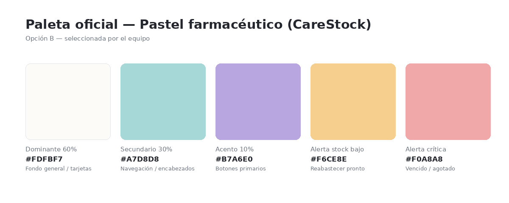
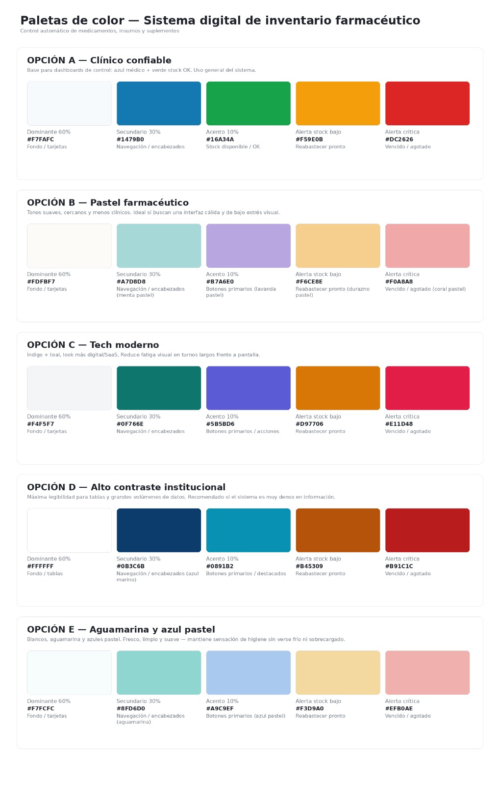
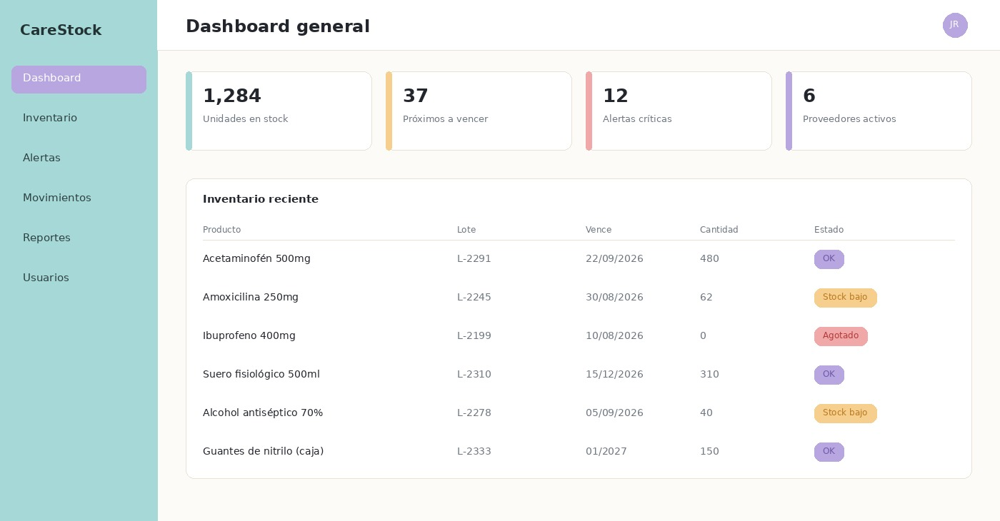
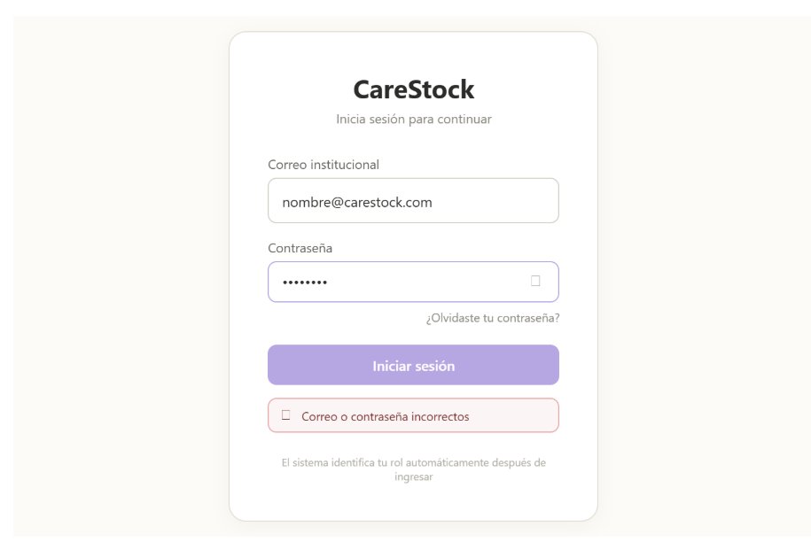
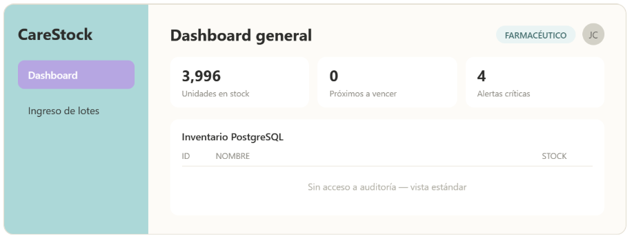
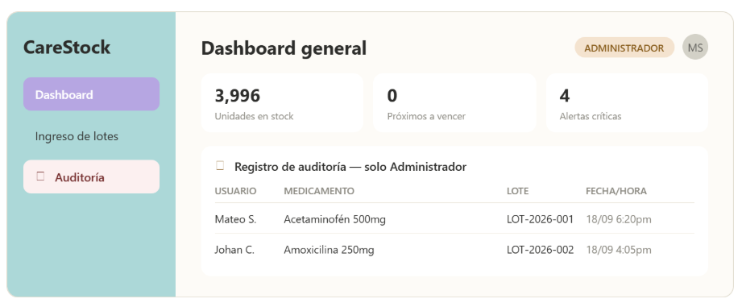

# Documentación de Interfaz Gráfica y Diseño UI - CareStock

Este documento consolida la definición del sistema de diseño, paleta cromática e interfaz de usuario para el sistema **CareStock**.

## 1. Paleta de Colores Oficial

Luego del proceso de evaluación, se seleccionó la **Opción B — Pastel farmacéutico** por sus tonos suaves que reducen el estrés visual y facilitan el uso prolongado en entornos de salud.

### Especificación Cromática

| Rol | Código Hex | Color / Tono | Uso en la Interfaz |
| :--- | :--- | :--- | :--- |
| **Dominante (60%)** | `#FDFBF7` | Marfil suave | Fondo general de la interfaz y tarjetas contenedoras |
| **Secundario (30%)** | `#A7D8D8` | Menta pastel | Navegación, encabezados y barra lateral izquierda |
| **Acento (10%)** | `#B7A6E0` | Lavanda pastel | Botones primarios, elementos activos y acciones principales |
| **Alerta - Stock bajo** | `#F6CE8E` | Durazno pastel | Indicadores de reabastecimiento próximo |
| **Alerta - Crítico** | `#F0A8A8` | Coral pastel | Medicamentos vencidos, agotados o alertas críticas |

---

## 2. Alternativas Evaluadas

Se diseñaron e integraron en la encuesta de decisión 5 alternativas de diseño para el sistema de inventario:

* **Opción A:** Clínico confiable (Azul médico + Verde OK).
* **Opción B:** Pastel farmacéutico *(Seleccionada por el equipo)*.
* **Opción C:** Tech moderno (Índigo + Teal).
* **Opción D:** Alto contraste institucional.
* **Opción E:** Aguamarina y azul pastel.

## 3. Prototipo de Interfaz (Dashboard General)

Vista previa del panel principal aplicando el sistema de diseño y paleta oficial seleccionada:

## 4. Tipografía y Jerarquía de Textos

| Nivel | Tamaño | Peso | Uso |
| :--- | :--- | :--- | :--- |
| **Título principal** | 22px | Bold | Nombre de módulo ("CareStock"), título de vista ("Dashboard general") |
| **Subtítulo** | 16px | Semi-bold | Encabezado de sección ("Inventario reciente"), números grandes en tarjetas ("1,284", "37", "12") |
| **Cuerpo** | 13px | Regular | Texto del menú lateral ("Dashboard"), botón ("+ Agregar Medicamento"), encabezados de tabla ("Código INVIMA", "Producto", "Principio Activo", "Cantidad") y estados ("Tabla sin contenido") |
| **Etiqueta pequeña** | 11px | Regular | Subtextos de tarjetas ("Unidades en stock", "Próximos a vencer", "Alertas críticas") |

**Familia tipográfica:**  
System default de JavaFX (Segoe UI / San Francisco según SO) — no requiere fuente externa, evita problemas de licencias y carga.

## 5. Catálogo de Botones e Inputs

### Botones
| Estado | Color de fondo | Color de texto | Uso / Contexto |
| :--- | :--- | :--- | :--- |
| **Primario - Normal** | `#B7A6E0` | `#FFFFFF` | Botón principal de acción ("+ Agregar Medicamento") |
| **Primario - Hover** | `#A08BD1` | `#FFFFFF` | Estado activo al pasar el cursor sobre botón principal |
| **Primario - Disabled** | `#E0E0E0` | `#9E9E9E` | Acciones no disponibles en el estado actual |
| **Alerta crítica** | `#F0A8A8` | `#7A2E2E` | Botones de eliminación o acciones destructivas |

### Inputs de Texto
| Estado | Borde | Fondo | Uso / Contexto |
| :--- | :--- | :--- | :--- |
| **Normal** | `#D0D0D0` | `#FFFFFF` | Campo de texto en estado reposo |
| **Focus** | `#B7A6E0` | `#FFFFFF` | Campo de texto activo/seleccionado |
| **Error** | `#F0A8A8` | `#FDF5F5` | Campo de texto con validación fallida |

## 6. Catálogo de Badges/Etiquetas de Alerta

| Badge | Color de Fondo | Cuándo se usa |
| :--- | :--- | :--- |
| **Stock OK** | `#A7D8D8` | Stock por encima del mínimo |
| **Próximos a vencer** | `#F6CE8E` | Vencimiento dentro de 30 días |
| **Crítico / Vencido** | `#F0A8A8` | Stock bajo el mínimo o medicamento vencido |

---

## 7. Especificación de Alertas de Vencimiento y Accesibilidad (HU-30)

### Guía de Reglas de Color para Vencimientos
| Estado | Condición | Tono | Código Hex |
| :--- | :--- | :--- | :--- |
| **OK** | Más de 30 días para vencer | Menta pastel | `#A7D8D8` |
| **Próximo a vencer** | Entre 1 y 30 días | Durazno pastel | `#F6CE8E` |
| **Vencido** | Fecha de vencimiento cumplida | Coral pastel | `#F0A8A8` |

### Criterios de Accesibilidad (WCAG 2.1 AA)
- **Contraste Mínimo de Texto (Criterio 1.4.3):** Para garantizar una relación de contraste mínima de 4.5:1 sobre los fondos pastel (`#A7D8D8`, `#F6CE8E`, `#F0A8A8`), se establece el uso obligatorio de tipografía en tonos oscuros (`#1E1E1E` / `#222222`). Se prohíbe el uso de texto blanco sobre estas etiquetas.
- **Uso del Color (Criterio 1.4.1 - Doble Codificación):** El color no debe ser el único medio visual para transmitir la alerta. Cada badge debe integrar texto explícito con el nombre del estado (*OK*, *Próximo a vencer*, *Vencido*) acompañado de su respectivo tono indicador.

## 8. Mensajes de Confirmación y Error (HU-43)

| Situación | Título | Mensaje |
|---|---|---|
| Registro exitoso | Operación exitosa | "El [elemento] se registró correctamente." |
| Error genérico |  No se pudo completar la operación | "No se pudo guardar en la base de datos. Verifica los datos e intenta nuevamente." |
| Fecha bloqueada |  Fecha no permitida | "La fecha de vencimiento ingresada no cumple con la política mínima de CareStock." |

**Tono:** directo, sin tecnicismos, sin culpar al usuario.

## 9. Selector de Ubicación Física (HU-44)

### Estructura del componente
Dropdown (ComboBox de JavaFX) dentro del formulario de registro de lote.
Formato de cada opción: "Bodega [X] - Estante [Y] - Nivel [Z]"
Ej: "Bodega A - Estante 3 - Nivel 2"

### Estados visuales
| Estado | Borde | Comportamiento |
|---|---|---|
| Normal | #D0D0D0 | Placeholder "Selecciona una ubicación" |
| Focus | #B7A6E0 (lavanda oficial) | Despliega la lista |
| Error (vacío al guardar) | #F0A8A8 (coral oficial) | Mensaje: "Debes asignar una ubicación al lote" |

### Flujo de asignación
1. Usuario abre el formulario de registro de lote.
2. Sistema carga automáticamente las ubicaciones físicas disponibles.
3. Usuario selecciona una ubicación de la lista.
4. Si intenta guardar sin seleccionar, se bloquea con el estado de error de arriba.

MockUp Ubicacion

## 10. Reglas de Fecha de Vencimiento Bloqueada (HU-45)

### Reglas de negocio (tomadas de Reglas_Modelo_Negocio.md, sección 2)
| Rango | Color | Comportamiento |
|---|---|---|
| Más de 90 días | Sin alerta | Se guarda normal |
| Entre 16 y 90 días | #F6CE8E (durazno) | Muestra advertencia de confirmación, pero permite guardar |
| 15 días o menos | #F0A8A8 (coral) | Bloqueo absoluto, no permite guardar |

### Estados visuales del campo de fecha
- **Normal:** borde gris estándar.
- **Advertencia (16-90 días):** borde durazno #F6CE8E + ícono ⚠️ + texto "Vida útil corta, confirma para continuar".
- **Bloqueado (≤15 días):** borde coral #F0A8A8 + ícono 🚫 + texto "Fecha no permitida: vida útil mínima de 15 días" + botón Guardar deshabilitado.

MockUp campo de fecha Bloqueado

## 11. Confirmación Visual de Stock Actualizado (HU-55)

### Comportamiento
Al registrar un lote exitosamente, la tarjeta "Unidades en stock" del dashboard muestra un resaltado temporal (2-3 segundos) para confirmar visualmente que el número cambió.

### Estado visual
| Estado | Fondo de la tarjeta | Duración |
|---|---|---|
| Normal | Blanco (#FFFFFF) | — |
| Recién actualizado | Menta claro (#E9F4F4) con borde #A7D8D8 | 2-3 segundos |

### Regla
Se activa únicamente después de un registro exitoso de lote, nunca al solo abrir o refrescar el dashboard.

## 12. Diferenciación Visual por Rol (HU-56)

### Login único
Una sola pantalla de inicio de sesión para todos los roles. El sistema determina el rol después de autenticar.

### Vista Farmacéutico
Dashboard operativo estándar. Etiqueta de rol: fondo menta claro (#E9F4F4), texto "AUXILIAR_FARMACIA".

### Vista Administrador
Todo lo del Farmacéutico, más la sección "Registro de auditoría". Etiqueta de rol: fondo durazno claro (#F6E3D0), texto "ADMINISTRADOR".

### Tabla comparativa
| Elemento | Farmacéutico | Administrador |
|---|---|---|
| Dashboard general | ✅ | ✅ |
| Registrar ingreso de lote | ✅ | ✅ |
| Ver alertas críticas | ✅ | ✅ |
| Registro de auditoría | ❌ | ✅ |

## 13. Migración de la Paleta Oficial al Catálogo de Productos (HU-102)

El catálogo de productos (`catalogo-view.fxml`) usaba un esquema verde-azulado (`#0E7C7B`, `#0B615F`, `#F4FAF9`...) que no correspondía a la paleta oficial pastel de la sección 1. Se migró a la paleta oficial:

| Elemento | Color anterior | Color oficial aplicado |
| :--- | :--- | :--- |
| Fondo general | `#F4FAF9` | Marfil `#FDFBF7` |
| Encabezado | gradiente `#0E7C7B` → `#0B615F` | Menta `#A7D8D8` |
| Botón "Registrar" y "Consulta unificada" (acción primaria) | `#0E7C7B` / `#FFFFFF` | Lavanda `#B7A6E0` |
| Botones secundarios ("Nuevo", "Actualizar", "Actualizar lista") | `#E3F3F2` / `#0E7C7B` | Lavanda claro `#EDE7F7` / `#6B5B95` |
| Botón "Desactivar" (acción crítica) | `#FDECEA` / `#C53030` | Coral `#F0A8A8` con texto `#7A2E2E` |
| Bordes de tarjetas | `#D6E6E4` | `#E3D9F5` (derivado de Lavanda) |
| Bordes de campos de texto y listas | `#D6E6E4` | `#D0D0D0` (sección 5) |

**Contraste:** el encabezado pasó de fondo oscuro a Menta claro, por lo que el texto del título cambió de blanco a `#20302F` para mantener legibilidad (criterio WCAG 2.1 AA).

**Actualización:** el login, el inventario y la consulta unificada se migraron después con esta misma tabla (secciones 14, 15 y 16). El texto del botón "Desactivar" y el borde de los campos se ajustaron a la sección 5 en HU-120. Los colores que el código Java asigna mientras la app corre quedaron fuera de alcance (ver "Fuera de alcance" en las secciones 14, 15 y 16).

## 14. Migración de la Paleta Oficial a la Pantalla de Login (HU-118)

La pantalla de inicio de sesión (`login-view.fxml`) usaba el esquema verde-azulado anterior (`#0E7C7B`, `#0B615F`, `#F4FAF9`...). Se migró a la paleta oficial de la sección 1 editando el FXML:

| Elemento | Color anterior | Color oficial aplicado |
| :--- | :--- | :--- |
| Panel lateral de marca | gradiente `#0E7C7B` → `#0B615F` | Menta `#A7D8D8` |
| Texto del panel lateral | `#FFFFFF` / `#E3F3F2` | `#20302F` / `#2E4A48` |
| Fondo del lado del formulario | `#F4FAF9` | Marfil `#FDFBF7` |
| Borde y sombra de la tarjeta | `#D6E6E4` / sombra verde | `#E3D9F5` / sombra Lavanda |
| Logo (círculo y cruz) | `#E3F3F2` / `#0E7C7B` | `#EDE7F7` / Lavanda `#B7A6E0` |
| Texto secundario | `#6D8683` | `#5B6663` |
| Botón "Iniciar sesión" (acción primaria) | `#0E7C7B` / `#FFFFFF` | Lavanda `#B7A6E0` / `#FFFFFF` |
| Borde de los campos en reposo | `#D6E6E4` | `#D0D0D0` |
| Color de foco y selección (raíz del FXML) | azul por defecto | Lavanda `#B7A6E0` |

**Contraste y accesibilidad:** el panel lateral pasó de fondo oscuro a Menta claro, por lo que sus textos pasaron de blanco a `#20302F` y `#2E4A48` (contraste sobre Menta de 8.8:1 y 6.2:1), según WCAG 2.1 AA.

**Fuera de alcance (código):** `LoginController` aplica por código el borde de los campos con foco (`#0E7C7B`) y los colores de los mensajes de error y éxito (`#FDEDEC` / `#C0392B` y `#EAFAF1` / `#27AE60`). Esos colores no se pueden cambiar desde el FXML y quedan para una historia aparte.

## 15. Migración de la Paleta Oficial a la Pantalla de Inventario (HU-119)

La pantalla de inventario (`inventario-view.fxml`) se migró de la paleta verde-azulada anterior a la paleta oficial editando el FXML:

| Elemento | Color anterior | Color oficial aplicado |
| :--- | :--- | :--- |
| Fondo general | `#F4FAF9` | Marfil `#FDFBF7` |
| Cabecera | gradiente `#0E7C7B` → `#0B615F` | Menta `#A7D8D8` |
| Textos de la cabecera | `#FFFFFF` / `#E3F3F2` / `#BFE3E1` | `#20302F` / `#2E4A48` |
| Tarjetas de sesión (usuario, rol, farmacia) | blanco translúcido | Marfil translúcido |
| Botón "Catálogo", "Actualizar tabla" y "Dispensar medicamento" (acción primaria) | `#0E7C7B` / `#FFFFFF` | Lavanda `#B7A6E0` / `#FFFFFF` |
| Botón "Cerrar sesión" | blanco translúcido | `#20302F` translúcido (igual que el catálogo) |
| Borde de tarjetas y tablas | `#D6E6E4` | `#E3D9F5` |
| Borde de campos (búsqueda, categoría, cantidad) | `#D6E6E4` | `#D0D0D0` |
| Tarjeta "Total de lotes" | `#0E7C7B` | número `#6B5B95`, borde `#E3D9F5` |
| Tarjeta "Lotes vencidos" | `#C53030` | número `#7A2E2E`, borde Coral `#F0A8A8` |
| Tarjeta "Dispensación / Disponibles" | `#2F855A` | texto `#2F6F6F`, borde Menta `#A7D8D8` |
| Color de foco y selección de filas (raíz del FXML) | azul por defecto | Lavanda `#B7A6E0` |

**Accesibilidad:** las tarjetas conservan el texto explícito (por ejemplo "LOTES VENCIDOS") y la columna "Estado" de la tabla muestra el estado en texto, así que el color no es la única señal (WCAG 2.1 AA). Los textos sobre Coral y Durazno son oscuros, nunca blancos.

**Fuera de alcance (código):** `InventarioController` aplica por código el color de las filas de lotes vencidos (`#FED7D7`) y no disponibles (`#FEEBC8`) y el de la etiqueta del lote seleccionado (`#1A365D` / `#4A5568`). Esos colores no se pueden cambiar desde el FXML y quedan para una historia aparte.

## 16. Migración de la Paleta Oficial a la Consulta Unificada y Ajuste del Catálogo (HU-120)

La consulta unificada (`consulta-inventario-view.fxml`) casi no tenía estilos (solo el encabezado en `#0E7C7B`). Se le aplicó la paleta oficial editando el FXML:

| Elemento | Color anterior | Color oficial aplicado |
| :--- | :--- | :--- |
| Fondo general | sin estilo | Marfil `#FDFBF7` |
| Encabezado | `#0E7C7B` | Menta `#A7D8D8` |
| Título del encabezado | `#FFFFFF` | `#20302F` |
| Botones "Volver" y "Cerrar sesión" | sin estilo | `#20302F` translúcido (igual que el catálogo) |
| Botón "Registrar producto" (acción primaria) | sin estilo | Lavanda `#B7A6E0` / `#FFFFFF` |
| Botones "Actualizar datos" y "Editar seleccionado" | sin estilo | Lavanda claro `#EDE7F7` / `#6B5B95` |
| Campos de búsqueda y categoría | sin estilo | borde `#D0D0D0` |
| Tabla | sin estilo | borde `#E3D9F5` |
| Color de foco y selección de filas (raíz del FXML) | azul por defecto | Lavanda `#B7A6E0` |

**Ajuste del catálogo (`catalogo-view.fxml`):** al revisar HU-102 contra la sección 5 de esta guía se encontraron diferencias, corregidas en HU-120:

- El botón "Desactivar" usaba texto blanco sobre Coral; la guía pide `#7A2E2E` (blanco sobre Coral queda prohibido).
- Los campos de texto y listas usaban borde `#E3D9F5`; la guía pide `#D0D0D0` en reposo. Las tarjetas conservan `#E3D9F5`.
- El color de foco y selección de filas usaba el azul por defecto; ahora es Lavanda `#B7A6E0`.

**Fuera de alcance (código):** `ConsultaInventarioController` aplica por código el fondo `#FFF3E0` a la fila de un producto sin existencias. Ese color no se puede cambiar desde el FXML y queda para una historia aparte. La columna "Existencias" mantiene el número, por lo que el color no es la única señal.

**Estado de la migración a la paleta oficial:**

| Pantalla | Archivo | Historia |
| :--- | :--- | :--- |
| Login | `login-view.fxml` | HU-118 |
| Inventario | `inventario-view.fxml` | HU-119 |
| Catálogo de productos | `catalogo-view.fxml` | HU-102 y HU-120 |
| Consulta unificada | `consulta-inventario-view.fxml` | HU-120 |

`hello-view.fxml` es la plantilla vacía de JavaFX y no tiene colores.

**Observación de accesibilidad (pendiente de decisión del equipo):** la sección 5 define el botón primario con texto blanco sobre Lavanda `#B7A6E0`. Ese par tiene un contraste de 2.2:1, por debajo del mínimo de 4.5:1 de WCAG 2.1 AA para texto normal. Si el equipo decide corregirlo, bastaría usar texto `#20302F` (contraste 6.3:1) en los botones primarios de todas las pantallas.

