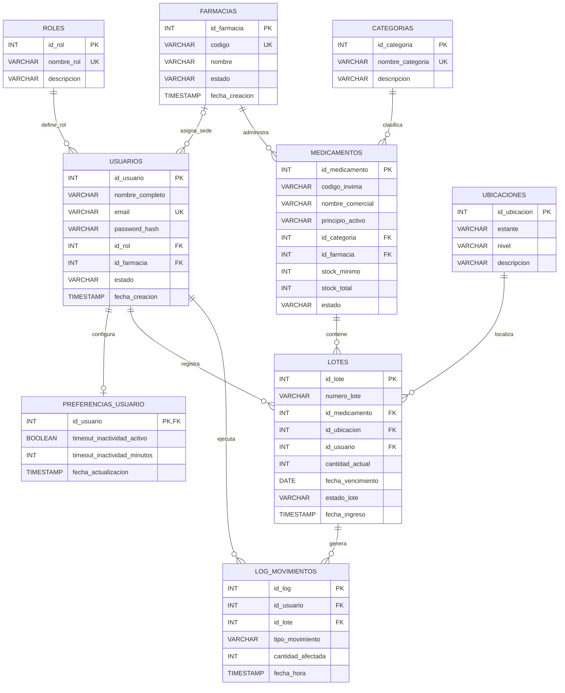
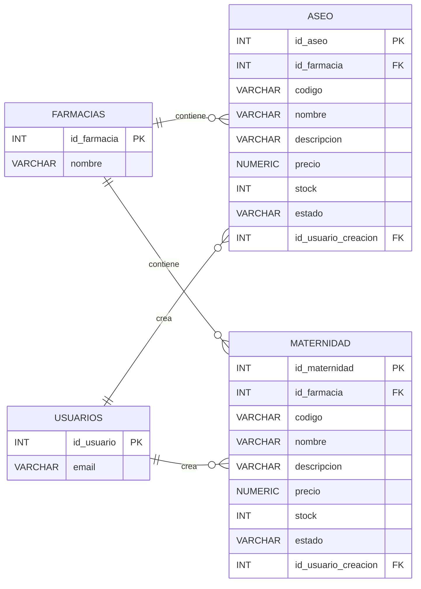
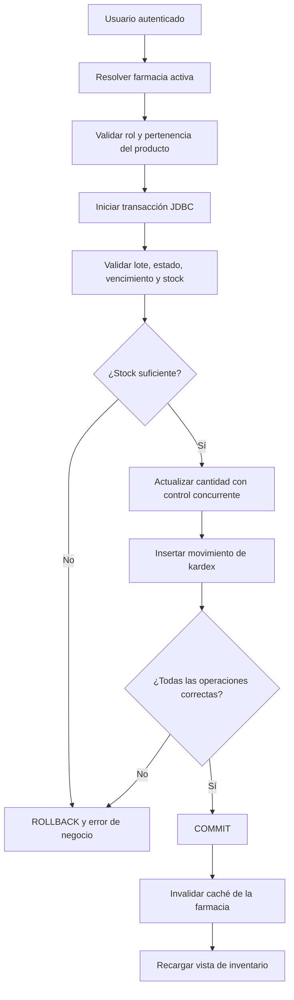

# 🗄️ CareStock — Arquitectura, modelo de datos y operación de PostgreSQL
> **Motor:** PostgreSQL, desplegado en **Neon**. **Cliente:** JavaFX/Java 21 mediante **JDBC** y **HikariCP**.  
> **Alcance de este documento:** descripción del modelo, diagramas entidad-relación, datos iniciales, consultas, control de integridad, migraciones y pruebas. **No modifica la base de datos real.**

## 1. Objetivo y criterios de alcance

CareStock gestiona el inventario por farmacia, los usuarios y sus permisos, los medicamentos, los lotes, las existencias y el historial de movimientos. El catálogo se ha ampliado hacia artículos de **aseo** y **maternidad**. El esquema **base**, las **migraciones** y el **estado efectivamente desplegado en Neon** son conceptos distintos: un script presente en Git no prueba por sí mismo que se haya ejecutado en la instancia.

En consecuencia:

- **Verificado en los SQL de `main`:** roles, usuarios, preferencias, categorías, ubicaciones, medicamentos, lotes, kardex (`log_movimientos`), farmacias y la ampliación multifarmacia para medicamentos.
- **Sustentado por migraciones y trabajo del proyecto, pero pendiente de contrastar con la BD desplegada:** tablas `aseo` y `maternidad`, sus atributos adicionales, movimientos propios de esos productos y/o la variante `productos_comerciales` de HU-76. Estas alternativas **no deben presumirse simultáneamente instaladas**.
- **No corresponde a la BD actual:** Redis, RabbitMQ y bases independientes por microservicio; pertenecen a la visión arquitectónica futura.

## 2. Organización de archivos

La implementación SQL del repositorio está principalmente en `src/sql/`, mientras que esta documentación y los ejemplos de consulta quedan en `docs/database/`.

```text
FIS_2630_1204_G1/
├── src/
│   └── sql/
│       ├── ddl/
│       │   ├── 01_schema_carestock.sql
│       │   ├── 04_multifarmacia_inventario.sql
│       │   ├── 06_crud_inventario_multifarmacia.sql
│       │   └── 08_performance_indexes.sql
│       ├── dml/
│       │   ├── 01_seed_roles_permisos.sql
│       │   └── 02_seed_catalogo_base.sql
│       └── procedures/
│           └── 01_sp_ingreso_lotes.sql
└── docs/
    └── database/
        ├── README.md                        # Este documento
        ├── seed_carestock.sql                # Solo catálogos/roles, idempotente
        ├── queries_reportes.sql              # Consultas de lectura del núcleo
        ├── queries_catalogo_ampliado.sql     # Solo si existen aseo/maternidad
        └── verificar_esquema.sql             # Inventario real de tablas/columnas
```

> Esta estructura separa scripts de **implementación** de SQL de **documentación/diagnóstico**. Puede haber migraciones adicionales en otras carpetas o ramas; confirmar antes de aplicar nada.

## 3. Modelo entidad-relación — Núcleo de CareStock

El diagrama representa el esquema base más el enlace `id_farmacia` incorporado en las migraciones de inventario y referido por las funciones de autorización. Las relaciones `LOTES → MEDICAMENTOS → FARMACIAS` permiten establecer a qué farmacia pertenece un lote sin duplicar el campo en `lotes`.



**Figura 1.** Relaciones principales. Se han omitido columnas accesorias para conservar legibilidad: por ejemplo, `presentacion`, `concentracion`, `forma_farmaceutica`, usuarios y fechas de modificación y `detalle_cambio`. En `MEDICAMENTOS`, la unicidad moderna del código INVIMA se establece **por farmacia** mediante `uq_medicamentos_farmacia_invima`; no globalmente. La relación opcional de farmacia en `USUARIOS` refleja la transición histórica: compruebe la nulabilidad real en Neon.

### 3.1 Diccionario de datos del núcleo

| Tabla | Identificador principal | Responsabilidad | Regla o relación significativa |
|---|---|---|---|
| `roles` | `id_rol` | Control de roles | Roles de referencia: `SUPER_ADMIN`, `ADMINISTRADOR`, `FARMACEUTICO` |
| `usuarios` | `id_usuario` | Identidad, rol, estado y farmacia asignada | Contraseñas guardadas como **hash BCrypt**, nunca en texto plano |
| `farmacias` | `id_farmacia` | Catálogo de sedes | `codigo` único; estado `ACTIVA`/`INACTIVA` |
| `preferencias_usuario` | `id_usuario` | Parámetros de sesión | Relación 1:1 con usuario; inactividad entre 1 y 120 minutos |
| `categorias` | `id_categoria` | Clasificación farmacológica | `nombre_categoria` único |
| `medicamentos` | `id_medicamento` | Registro de medicamento por sede | `(id_farmacia, codigo_invima)` único tras migración; `stock_total >= 0` |
| `ubicaciones` | `id_ubicacion` | Localización física | `(estante, nivel)` único en esquema base |
| `lotes` | `id_lote` | Cantidad, vencimiento y estado por lote | `(numero_lote, id_medicamento)` único, `cantidad_actual >= 0` |
| `log_movimientos` | `id_log` | Kardex/auditoría básica de lotes | Tipos `ENTRADA`, `SALIDA`, `AJUSTE` |

**Nota de diseño:** el stock total del medicamento es un dato almacenado y los lotes almacenan existencias detalladas. Una discrepancia entre ambos debe investigarse; **no actualizar `stock_total` manualmente** para ocultarla. Las escrituras de inventario y kardex deben compartir transacción.

## 4. Ampliación del catálogo: aseo y maternidad

Para evitar mezclar migraciones de distintas ramas, este diagrama es **condicional**: representa la variante con tablas independientes `aseo` y `maternidad` descrita en la migración de catálogo revisada. Comprueba que existan en tu base antes de usar la consulta unificada.



**Figura 2.** Ampliación de inventario de aseo/maternidad, **si está aplicada**. El tipo `NUMERIC` describe el importe de forma conceptual; validar su definición exacta en `information_schema` (la migración citada añade claves y restricciones a tablas preexistentes, no crea todos sus campos).

Existe también una propuesta de la HU-76/Issue #612 con la tabla **`productos_comerciales`** (`id_producto`, `id_farmacia`, `codigo_interno`, `nombre`, `presentacion`, `tipo_producto`, `id_usuario_creacion`, `fecha_creacion`) y categorías `ASEO`/`MATERNIDAD` en una sola tabla. **Es otra variante de modelado.** No debe dibujarse como confirmada ni ejecutarse su migración sin resolver primero cuál de las dos implementaciones utiliza el código integrado en `main`.

En el modelo histórico los lotes están ligados a medicamentos. No se debe afirmar que el lote de aseo/maternidad comparte `lotes.id_medicamento` sin una modificación concreta de esquema. Los movimientos de esos artículos deben corresponder a su propia migración y tablas reales.

## 5. Operación multifarmacia y reglas de integridad

1. **Aislamiento:** cada medicamento pertenece a una farmacia. Toda consulta de stock debe filtrar el `id_farmacia` del usuario autenticado; no basta con filtrar visualmente un `TableView`.
2. **Unicidad contextual:** se puede repetir `codigo_invima` entre farmacias distintas, no dentro de una misma farmacia. Para aseo/maternidad, revisar la unicidad `(id_farmacia, codigo)` tras su migración.
3. **Integridad de stock:** cantidades y mínimos no negativos; una salida no puede exceder las existencias. Emplear bloqueos o actualización condicional en la misma transacción que registra el movimiento.
4. **Trazabilidad:** relacionar el usuario activo, el lote, la cantidad, el tipo y la fecha del movimiento. El registro de una nueva entrada también necesita auditoría.
5. **Caducidad:** impedir dispensar lotes vencidos o retenidos. **FEFO** significa priorizar el vencimiento más próximo entre lotes disponibles; ordenarlos en una consulta no constituye por sí solo una garantía de dispensación FEFO.
6. **Eliminación lógica:** mantener historial usando estados de medicamentos y lotes en lugar de suprimir filas utilizadas por auditoría.
7. **Autorización:** el script histórico `06_crud_inventario_multifarmacia.sql` restringe su función central de gestión a `SUPER_ADMIN` y `ADMINISTRADOR`. Historias más recientes contemplan operaciones para `FARMACEUTICO`: **revisar si esa política fue reemplazada** y comprobarla en el entorno efectivo, no dar ambas como vigentes al mismo tiempo.

### 5.1 Flujo transaccional esperado para una salida



La caché Proxy de CareStock está en la **capa Java**; no es una tabla ni una implementación de Redis. En caso de `ROLLBACK` no debe anunciarse un cambio de inventario como confirmado.

## 6. Datos iniciales y scripts de consulta

### 6.1 `seed_carestock.sql`

Incluye solamente roles, categorías, ubicaciones y sede principal, usando `INSERT ... ON CONFLICT DO NOTHING`. Es reejecutable bajo sus claves únicas **si ya se aplicaron las migraciones correspondientes**. No crea usuarios con contraseñas predecibles ni cambia `stock_total`, lotes o movimientos.

```bash
# Desde la raíz del repositorio, en un entorno de DESARROLLO
psql "$DATABASE_URL" -v ON_ERROR_STOP=1 -f docs/database/seed_carestock.sql
```

La URL para `psql` es una URL PostgreSQL de cliente (por ejemplo, obtenida en Neon) y **no** debe confundirse con la URL JDBC (`jdbc:postgresql://...`) de Java.

### 6.2 `queries_reportes.sql`

Consultas exclusivamente de lectura para existencias mínimas, próximos vencimientos, lotes vencidos, prioridad FEFO, historial de movimientos, aislamiento por farmacia y coherencia entre `medicamentos.stock_total` y el agregado de sus lotes. Requieren las tablas base y la ampliación multifarmacia.

### 6.3 `queries_catalogo_ampliado.sql`

Contiene una consulta unificada `UNION ALL` para medicamentos, aseo y maternidad. **Ejecútala solo después de confirmar que existen las tablas `aseo` y `maternidad` con las columnas esperadas.** No sirve para la alternativa `productos_comerciales` sin adaptar el SQL.

### 6.4 `verificar_esquema.sql`

Consulta `information_schema` y catálogos PostgreSQL para comparar tablas, columnas, claves, índices y funciones **realmente presentes en la conexión activa**. Es el paso necesario para pasar de documentación a verificación de una BD de Neon concreta.

## 7. Estrategia de migraciones

No ejecutar indiscriminadamente los scripts SQL del repositorio. El orden lógico mínimo es **esquema inicial → datos/funciones base → multifarmacia → gestión segura e índices → ampliaciones específicas**; el orden concreto y los números de versiones deben corresponder a las dependencias de cada archivo y al historial de la base.

| Script fuente | Papel | Precaución |
|---|---|---|
| `src/sql/ddl/01_schema_carestock.sql` | Tablas iniciales y preferencias | En una BD existente, `CREATE IF NOT EXISTS` no modifica columnas previamente creadas |
| `src/sql/ddl/04_multifarmacia_inventario.sql` | `farmacias`, `medicamentos.id_farmacia`, índice único contextual | Asigna sede principal a medicamentos históricos sin farmacia |
| `src/sql/ddl/06_crud_inventario_multifarmacia.sql` | Funciones de gestión y trazabilidad de medicamentos/lotes | Comprobar roles y cambios posteriores antes de invocarlas |
| `src/sql/ddl/08_performance_indexes.sql` | Índices para login, sedes, lotes y vencimientos | Usa `CREATE INDEX CONCURRENTLY`: no ejecutarlo dentro de `BEGIN/COMMIT` |
| Migraciones de aseo/maternidad | Productos comerciales y posibles movimientos | Confirmar qué variante se consolidó en `main` y cuál fue aplicada en Neon |

**Procedimiento recomendado:** respaldo/snapshot, inventario de objetos, plan de migración probado en clon de desarrollo, comprobación de datos históricos, aplicación única y pruebas funcionales en JavaFX. Antes de introducir nuevas restricciones `NOT NULL` o `UNIQUE`, detectar registros nulos y duplicados para no atribuir sedes ficticias.

## 8. Rendimiento, índices y caché

- Índices relevantes: búsqueda de usuarios por `LOWER(email)`; medicamentos por `(id_farmacia, estado, nombre_comercial)`; lotes por `(id_medicamento, estado_lote, fecha_vencimiento)`; lotes recientes por `(id_medicamento, fecha_ingreso DESC, id_lote DESC)`.
- Para evaluar consultas usar `EXPLAIN (ANALYZE, BUFFERS)` **solo en entorno de pruebas** para consultas SELECT; no compararlo sin volumen representativo.
- Evitar N+1 consultas (un SELECT por fila) en vistas JavaFX. La consulta unificada por farmacia y el *Caching Proxy* pueden ayudar, siempre que la caché se invalide tras una escritura confirmada y al cambiar de farmacia/sesión.
- El `COMMIT/ROLLBACK` transaccional protege la consistencia de stock más kardex; HikariCP administra conexiones pero no sustituye las transacciones.

## 9. Seguridad y configuración

- Conectar mediante TLS a Neon, usando las credenciales suministradas por el servicio y permisos mínimos para el usuario de la aplicación.
- Mantener URL, usuario y contraseña fuera de Git; no insertar contraseñas en documentación ni scripts públicos. Usar el archivo local de configuración ignorado por Git o variables de entorno soportadas por la versión de la aplicación.
- Guardar únicamente hashes de contraseñas verificados por BCrypt; el ejemplo `$2a$...hash` del documento anterior era **incompleto** y no es una credencial utilizable.
- La columna `id_farmacia` y las validaciones en DAO/servicio no equivalen automáticamente a seguridad a nivel de fila de PostgreSQL (**RLS**). Para aislar datos frente a cualquier consulta SQL arbitraria harían falta políticas y credenciales de BD específicas.
- No exponer `SELECT *` de `usuarios` en reportes ni exportar `password_hash`.

## 10. Plan de verificación y aceptación

| Caso | Prueba | Resultado esperado |
|---|---|---|
| BD-01 | Ejecutar `verificar_esquema.sql` | Objetos presentes/ausentes identificados, sin escritura |
| BD-02 | Repetir `seed_carestock.sql` | Sin duplicaciones de roles, categorías, ubicaciones o sede |
| BD-03 | Crear mismo INVIMA en dos farmacias | Admitido por el índice contextual si el resto de reglas lo permite |
| BD-04 | Duplicar INVIMA en una misma farmacia | Rechazado por restricción de unicidad |
| BD-05 | Consultar productos de farmacia A | No aparecen registros de farmacia B |
| BD-06 | Intentar salida superior a stock | Rechazo; no disminuye existencias ni crea movimiento |
| BD-07 | Forzar error después del UPDATE y antes del INSERT de kardex | ROLLBACK de toda la transacción |
| BD-08 | Consultar próximos vencimientos | Se muestran lotes disponibles dentro de la ventana establecida |
| BD-09 | Crear/consultar aseo y maternidad | Solo si la migración correspondiente está realmente instalada |
| BD-10 | Actualizar stock y volver a consultar desde la GUI | Refleja el valor posterior al COMMIT (caché invalidada) |
| BD-11 | Dos salidas concurrentes del mismo lote | No se admite stock negativo ni doble consumo |
| BD-12 | Revisar coherencia agregada de existencias | Las discrepancias se investigan antes de corregir datos |

> **Estado de validación:** los casos de la tabla son criterios propuestos, no evidencias de ejecución. No se ha accedido a la instancia privada de Neon ni se han ejecutado scripts sobre ella.

## 11. Fuentes en el repositorio

- [Esquema base `01_schema_carestock.sql`](https://github.com/puj-course/FIS_2630_1204_G1/blob/main/src/sql/ddl/01_schema_carestock.sql)
- [Migración multifarmacia `04_multifarmacia_inventario.sql`](https://github.com/puj-course/FIS_2630_1204_G1/blob/main/src/sql/ddl/04_multifarmacia_inventario.sql)
- [Funciones de inventario `06_crud_inventario_multifarmacia.sql`](https://github.com/puj-course/FIS_2630_1204_G1/blob/main/src/sql/ddl/06_crud_inventario_multifarmacia.sql)
- [Índices `08_performance_indexes.sql`](https://github.com/puj-course/FIS_2630_1204_G1/blob/main/src/sql/ddl/08_performance_indexes.sql)
- [Seed de roles](https://github.com/puj-course/FIS_2630_1204_G1/blob/main/src/sql/dml/01_seed_roles_permisos.sql)
- [Seed de categorías y ubicaciones](https://github.com/puj-course/FIS_2630_1204_G1/blob/main/src/sql/dml/02_seed_catalogo_base.sql)

**Mantenimiento:** cada migración que cree o cambie una tabla, FK, vista o restricción debe acompañarse de la actualización del ERD y de las consultas de diagnóstico. Si se adopta definitivamente `productos_comerciales` en lugar de `aseo`/`maternidad`, actualizar el diagrama ampliado y la consulta `UNION ALL` en el mismo Pull Request.
