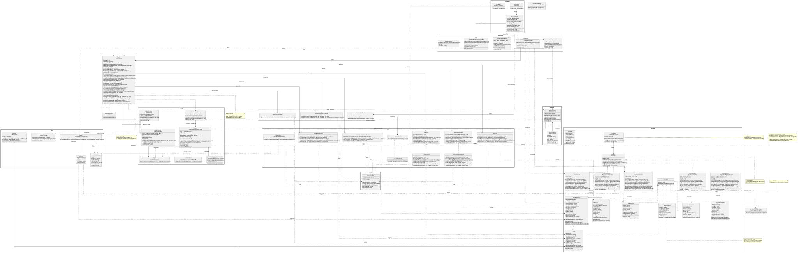

# 📐 Documentación técnica del diagrama de clases — CareStock

> **Referencia:** [Issue #41 — Elaboración del Diagrama de Clases del Sistema CareStock](https://github.com/puj-course/FIS_2630_1204_G1/issues/41)  
> **Autor de la documentación original:** Mateo Salazar Bogotá — Product Owner  
> **Fecha de revisión documental:** 14 de octubre de 2026  
> **Tipo de artefacto:** Diseño estructural orientado a objetos (UML)  
> **Estado:** Documentación ampliada a partir del diagrama aportado; **pendiente de contraste final con el código fuente de la rama vigente**.

## 1. Propósito

Este documento describe y justifica la arquitectura orientada a objetos de **CareStock**, un sistema de gestión de inventarios médico-farmacéuticos con interfaz JavaFX y persistencia relacional mediante JDBC sobre PostgreSQL/Neon. Su propósito es explicar **qué responsabilidad tiene cada paquete**, **cómo colaboran sus clases**, **qué decisiones de diseño sustentan la solución** y **cómo comprobar que los patrones y las reglas de negocio funcionan**.

Este documento y el archivo `Carestock.svg` deben mantenerse en la misma carpeta para que la imagen se visualice correctamente en GitHub. El documento complementa, pero no reemplaza, el código fuente, las pruebas automatizadas, la documentación de base de datos ni los diagramas de comportamiento. En especial, la existencia de una operación o relación en el diagrama **no demuestra por sí sola que esté implementada y probada**.
## 📊 Diagrama UML

  

  🔎 <a href="./Carestock.svg">Abrir el SVG completo en el navegador</a>

> Figura 1. Vista estructural global del sistema, organizada por paquetes.

