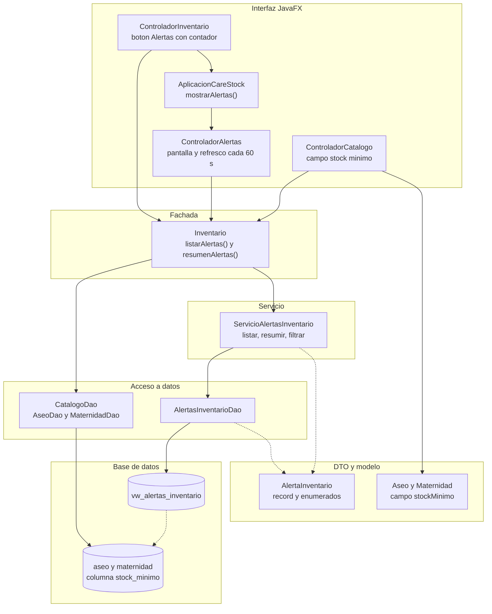
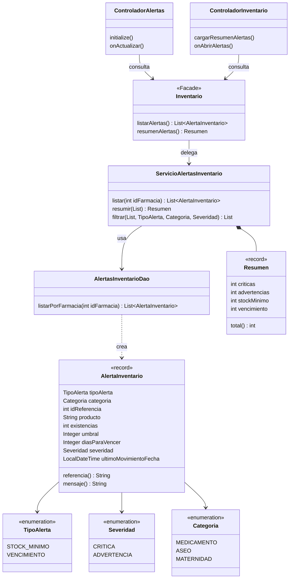

# Alertas de inventario: arquitectura y componentes

Este documento muestra qué clases forman el módulo de alertas, cómo se conectan con la arquitectura que ya existía y qué archivos se tocaron. Complementa el modelo de datos ([ALERTAS_MODELO_DATOS.md](ALERTAS_MODELO_DATOS.md)) y las reglas ([ALERTAS_REGLAS_NEGOCIO.md](ALERTAS_REGLAS_NEGOCIO.md)).

## 1. Vista por capas

Las flechas continuas son llamadas; las punteadas indican uso de un tipo o lectura de datos.

## 2. Diagrama de clases

## 3. Dónde está cada clase

| Clase | Archivo y línea | Responsabilidad |
|---|---|---|
| `AlertaInventario` | `dto/AlertaInventario.java` L8 | Representa una alerta. Valida sus datos al crearse (L74) y arma el texto con `mensaje()` (L104) |
| `TipoAlerta`, `Severidad`, `Categoria` | mismo archivo, L28, L43 y L58 | Enumerados con la etiqueta en español que muestra la pantalla |
| `AlertasInventarioDao` | `dao/AlertasInventarioDao.java` L15 | Ejecuta la consulta sobre la vista (L17) y convierte cada fila (L51) |
| `ServicioAlertasInventario` | `service/ServicioAlertasInventario.java` L14 | Lista las alertas verificando la sesión (L33), las resume (L45) y las filtra (L67) |
| `Inventario` (fachada) | `facade/Inventario.java` | `listarAlertas` L404 y `resumenAlertas` L408 |
| `ControladorAlertas` | `controller/ControladorAlertas.java` L32 | Pantalla de alertas con filtros y refresco |
| `ControladorInventario` | `controller/ControladorInventario.java` | `cargarResumenAlertas` L349, `mostrarResumenAlertas` L369 y `onAbrirAlertas` L383 |
| `AplicacionCareStock` | `AplicacionCareStock.java` | `mostrarAlertas` L255 |
| `ControladorCatalogo` | `controller/ControladorCatalogo.java` | Campos de stock mínimo L79 y L80; resalta filas con `stockMinimoDe` L296 |
| Vista SQL | `src/sql/ddl/16_vista_alertas_inventario.sql` | Define las alertas (ver [ALERTAS_MODELO_DATOS.md](ALERTAS_MODELO_DATOS.md)) |
| Pantalla | `alertas-view.fxml` | Declarada con el controlador `ControladorAlertas` (L7) |

## 4. Cómo se integra con la arquitectura existente

| Patrón o componente | Cómo participa en las alertas |
|---|---|
| **Facade** (`Inventario`) | Las dos pantallas nuevas no conocen ni el DAO ni el servicio: piden las alertas a la fachada. La fachada obtiene la farmacia del usuario con `farmaciaActual()` (L107) y la pasa al servicio (L405) |
| **Template Method** (`CatalogoDao`) | Para guardar el stock mínimo de aseo y maternidad solo hubo que **agregar la columna a los ganchos** `columnasEspecificas`, `asignarCampos` y `construir` de `AseoDao` (L34, L44 y L57) y `MaternidadDao` (L35, L45 y L61). Los métodos plantilla `guardar` (L24) y `actualizar` (L83) no cambiaron |
| **Factory Method** (`FabricaProducto`) | `crear` (L10) valida el producto recién construido, así que `Aseo.validar` (L61) y `Maternidad.validar` (L57) rechazan un stock mínimo negativo tanto al crear desde el formulario como al leer de la base |
| **Proxy de caché** (`ConsultaInventarioProxy`) | **No participa.** Las alertas se consultan siempre en vivo, para no mostrar datos viejos (ver [ALERTAS_FLUJO_ACTUALIZACION.md](ALERTAS_FLUJO_ACTUALIZACION.md)) |
| **Singleton** (`InventarioConsultas`) | No participa |

## 5. Cambios en archivos que ya existían

| Archivo | Qué cambió | Líneas |
|---|---|---|
| `model/Aseo.java` | Campo `stockMinimo`, validación y accesores | L16 y L61 |
| `model/Maternidad.java` | Lo mismo | L12 y L57 |
| `dao/AseoDao.java` y `dao/MaternidadDao.java` | La columna `stock_minimo` en los tres ganchos | ver tabla anterior |
| `facade/Inventario.java` | Servicio de alertas y dos métodos nuevos | L94, L404 y L408 |
| `controller/ControladorInventario.java` | Botón con contador, consulta del resumen y navegación | L42, L114, L457 y L349 |
| `controller/ControladorCatalogo.java` | Campos de stock mínimo en el formulario; la marca de stock bajo ahora aplica a las tres categorías | L79, L850, L874 y L284 |
| `AplicacionCareStock.java` | Navegación a la pantalla de alertas | L255 |
| `inventario-view.fxml` y `catalogo-view.fxml` | Botón de alertas y campos de stock mínimo | L76, L215 y L246 |

## 6. Decisiones de arquitectura

| Decisión | Motivo |
|---|---|
| La lógica de las reglas vive en SQL, no en Java | Una sola definición de "qué es una alerta"; Java solo presenta, filtra y cuenta |
| `resumir` y `filtrar` son métodos estáticos y puros | Se prueban sin base de datos ni sesión |
| El constructor del servicio recibe el DAO | Permite sustituir el acceso a datos en pruebas (L29) |
| La pantalla consulta en un hilo aparte | Una consulta lenta no congela la ventana |
| El refresco usa `Timeline` y no un servicio programado | Se detiene solo al salir de la pantalla (L146), sin hilos que limpiar |
