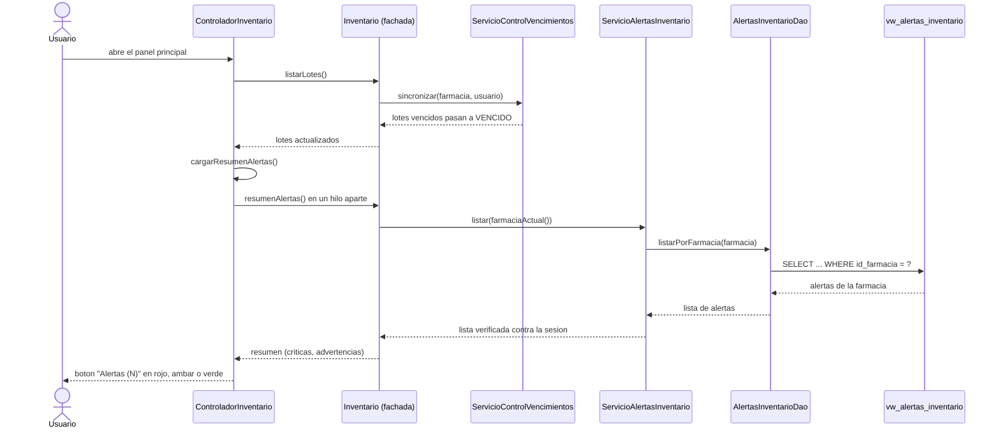
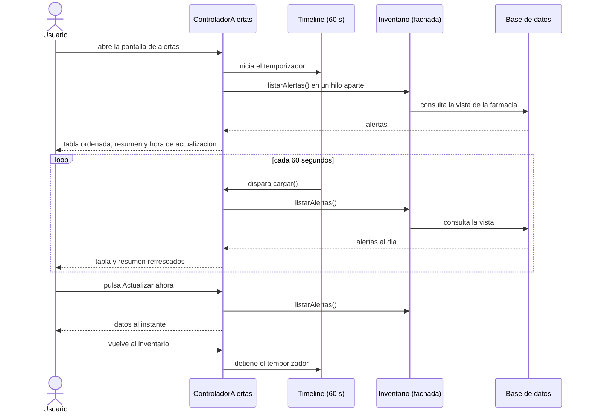
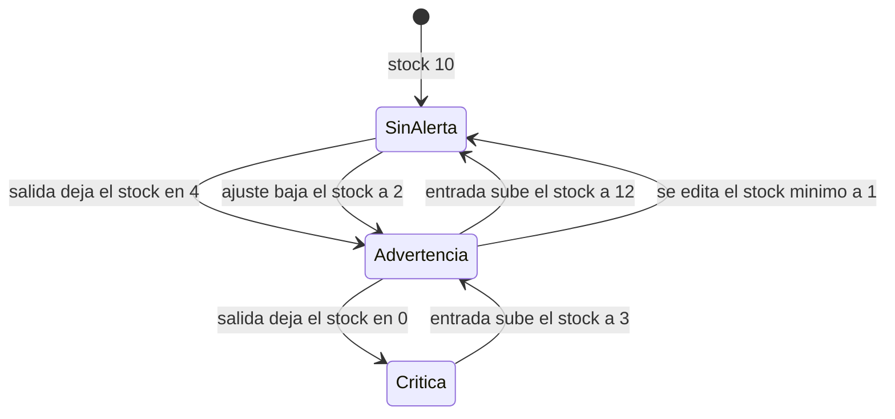

# Alertas de inventario: flujo y actualización de la información

Este documento explica **cuándo se consultan las alertas**, por qué siempre muestran datos al día y cómo cambia una alerta a medida que cambian las existencias.

## 1. Idea central: no hay caché

Las alertas **no pasan por el Proxy de caché** de la consulta unificada. Cada consulta ejecuta la vista `vw_alertas_inventario` directamente en la base de datos, de modo que:

- Una entrada, una salida, un ajuste o la edición de un producto se reflejan en la consulta siguiente.
- No hay nada que invalidar: no existe un dato guardado que pueda quedar viejo.

El costo es una consulta por refresco. Es aceptable porque la vista solo recorre productos activos y lotes disponibles de una farmacia.

## 2. Qué dispara una consulta

| Evento | Qué consulta | Dónde |
|---|---|---|
| Se abre el panel principal | El resumen para el contador del botón "Alertas" | `ControladorInventario.cargarDatosTabla` L437, que llama a `cargarResumenAlertas` en L457 |
| Se pulsa "Actualizar tabla" o se dispensa un lote | El mismo resumen, porque ambos vuelven a cargar la tabla | `cargarDatosTabla` |
| Se abre la pantalla de alertas | La lista completa | `ControladorAlertas.initialize` L67 llama a `cargar` L151 |
| Pasan 60 segundos con la pantalla abierta | La lista completa | `Timeline` en `configurarRefresco` L139 |
| Se pulsa "Actualizar ahora" | La lista completa | `onActualizar` |

## 3. Secuencia al abrir el panel principal

El contador se pide **después** de que la limpieza de lotes vencidos termina, así el número ya excluye los lotes recién deshabilitados.

## 4. Secuencia de la pantalla de alertas con refresco automático

Detalles de implementación (`controller/ControladorAlertas.java`):

| Aspecto | Dónde | Comportamiento |
|---|---|---|
| Intervalo | L35 | 60 segundos |
| Arranque del temporizador | L140 | `Timeline` con repetición indefinida |
| Parada al salir de la pantalla | L146 | Cuando la tabla deja de pertenecer a una escena, el temporizador se detiene |
| Consulta fuera del hilo gráfico | L162 | Una tarea en un hilo aparte evita congelar la ventana |
| Evita consultas superpuestas | L152 | Si ya hay una consulta en curso, la nueva se ignora |
| Error de consulta | L179 | El mensaje aparece abajo y la tabla conserva lo último que mostró |

## 5. Cómo cambia una alerta con los movimientos

Ejemplo con un producto de aseo con stock mínimo 5:

Cada transición se comprobó contra la base de datos real: tras una salida de 6 unidades de un aseo con stock 10 y mínimo 5, la alerta aparece con el último movimiento "SALIDA"; tras una entrada que lo sube a 14, desaparece; tras un ajuste a 2, vuelve a aparecer con el último movimiento "AJUSTE"; al llegar a 0 pasa a crítica. Editar el stock mínimo desde el catálogo también cambia el resultado en la consulta siguiente.

## 6. Latencia máxima

| Situación | Cuánto tarda en verse |
|---|---|
| El usuario está en la pantalla de alertas y otro usuario hace un movimiento | Hasta 60 segundos, o al instante si pulsa "Actualizar ahora" |
| El usuario abre el panel principal o la pantalla de alertas | En el momento de abrirla |
| El usuario ve el contador del panel y se hace un movimiento | Hasta que vuelva a cargar el panel (actualizar tabla, dispensar o reabrirlo) |

## 7. Estados de la pantalla

| Estado | Qué muestra |
|---|---|
| Consultando | "Consultando..." y el botón "Actualizar ahora" deshabilitado |
| Con alertas | "Mostrando X de Y alertas." |
| Sin alertas | "No hay alertas activas para esta farmacia." |
| Error de conexión | "No se pudieron consultar las alertas: ..." con el detalle |
