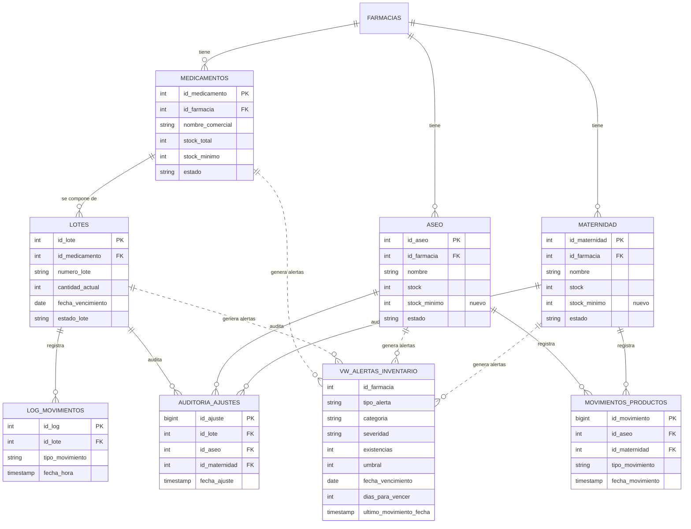

# Alertas de inventario: modelo de datos

Este documento describe qué cambia en la base de datos para que CareStock avise del **stock mínimo** y de los **lotes próximos a vencer**, de qué tablas sale cada alerta y por qué las alertas se calculan en una vista y no se guardan.

## 1. Qué se agregó

| Pieza | Script | Qué hace |
|---|---|---|
| Columna `stock_minimo` en `aseo` | `src/sql/ddl/15_stock_minimo_aseo_maternidad.sql` L3 | Agrega el umbral de aseo, entero no nulo con valor por defecto 0 |
| Columna `stock_minimo` en `maternidad` | `15_stock_minimo_aseo_maternidad.sql` L6 | Lo mismo para maternidad |
| Restricciones `>= 0` | `15_stock_minimo_aseo_maternidad.sql` L12 y L19 | La base rechaza un umbral negativo |
| Vista `vw_alertas_inventario` | `src/sql/ddl/16_vista_alertas_inventario.sql` L3 | Reúne todas las alertas de las tres categorías, con el id de la farmacia |

Los medicamentos ya tenían `stock_minimo` desde el esquema original (`01_schema_carestock.sql`), por eso solo aseo y maternidad necesitaban la columna.

## 2. Orden de ejecución de los scripts

Los scripts 15 y 16 dependen de otros anteriores. En una base nueva el orden es:

```text
01 a 09  esquema base (medicamentos, lotes, usuarios, farmacias, log_movimientos)
12       tablas aseo y maternidad
13       movimientos_productos
14       auditoria_ajustes
15       stock_minimo en aseo y maternidad
16       vista vw_alertas_inventario
```

El script 16 consulta `movimientos_productos` y `auditoria_ajustes` para mostrar el último movimiento de cada producto, así que fallaría si faltan el 13 o el 14. Los scripts 10 y 11 (`movimientos_catalogo`) no intervienen: el código de alertas no los usa. El script 12 debe correr antes que el 10 porque el 10 referencia `aseo` y `maternidad`.

Los scripts 15 y 16 se pueden ejecutar más de una vez sin error: usan `ADD COLUMN IF NOT EXISTS`, comprueban las restricciones antes de crearlas y `CREATE OR REPLACE VIEW`.

## 3. Diagrama entidad-relación



Las líneas punteadas indican que la vista **lee** esas tablas; no hay clave foránea porque una vista no guarda datos.

## 4. La vista `vw_alertas_inventario`

La vista es una unión de cuatro consultas. Cada una produce las mismas columnas, de modo que el código Java las lee igual sin importar el origen.

| # | Origen de la alerta | Dónde está | Condición principal |
|---|---|---|---|
| 1 | Stock mínimo de **medicamentos** | `16_vista_alertas_inventario.sql` L37 a L61 | `stock_total <= stock_minimo`, medicamento activo |
| 2 | Stock mínimo de **aseo** | L81 a L103 | `stock <= stock_minimo`, producto activo |
| 3 | Stock mínimo de **maternidad** | L123 a L145 | `stock <= stock_minimo`, producto activo |
| 4 | **Vencimiento** de lotes | L168 a L193 | lote disponible, con unidades y a 30 días o menos de vencer |

### Columnas

| Columna | Tipo | Significado |
|---|---|---|
| `id_farmacia` | entero | Farmacia dueña del producto; es la columna que segrega los datos |
| `tipo_alerta` | texto | `STOCK_MINIMO` o `VENCIMIENTO` |
| `categoria` | texto | `MEDICAMENTO`, `ASEO` o `MATERNIDAD` |
| `id_referencia` | entero | Id del producto (alertas de stock) o del lote (alertas de vencimiento) |
| `codigo` | texto | Código INVIMA o código del producto |
| `producto` | texto | Nombre del producto |
| `numero_lote` | texto | Solo en alertas de vencimiento; nulo en las de stock |
| `existencias` | entero | Stock del producto o cantidad del lote |
| `umbral` | entero | El stock mínimo; nulo en las de vencimiento |
| `fecha_vencimiento` y `dias_para_vencer` | fecha y entero | Solo en alertas de vencimiento; los días pueden ser cero o negativos |
| `severidad` | texto | `CRITICA` o `ADVERTENCIA` |
| `ultimo_movimiento_fecha`, `_tipo`, `_usuario` | fecha y texto | Último movimiento registrado del producto o lote (ver [ALERTAS_TRAZABILIDAD_Y_PRUEBAS.md](ALERTAS_TRAZABILIDAD_Y_PRUEBAS.md)) |

## 5. Decisiones de diseño

| Decisión | Motivo |
|---|---|
| **Vista, no tabla** | Las alertas se recalculan en cada consulta, así que nunca quedan desactualizadas ni hay que borrarlas cuando se repone el stock |
| **Una sola vista para las tres categorías** | La interfaz y el código Java tratan igual a un medicamento, un aseo y un lote |
| **`id_farmacia` en la vista** | Permite filtrar por farmacia en la propia consulta (ver [ALERTAS_SEGREGACION_FARMACIA.md](ALERTAS_SEGREGACION_FARMACIA.md)) |
| **Umbrales de vencimiento fijos (15 y 30 días)** | Son los mismos de la vista que ya existía, `vw_alertas_vencimiento` (`src/sql/vw_alertas_vencimiento.sql`), para que ambas hablen igual |
| **`stock_minimo` por defecto 0** | Un producto sin umbral definido solo alerta cuando se agota, en lugar de alertar con un valor inventado |
| **Medicamentos comparan `stock_total`** | Es la misma medida que usa el catálogo para su aviso de stock bajo |

## 6. Cómo comprobar el modelo

Alertas de una farmacia:

```sql
SELECT severidad, tipo_alerta, categoria, producto, numero_lote, existencias, umbral, dias_para_vencer
FROM vw_alertas_inventario
WHERE id_farmacia = 1
ORDER BY CASE severidad WHEN 'CRITICA' THEN 0 ELSE 1 END, tipo_alerta, producto;
```

Columnas nuevas de `aseo` y `maternidad`:

```sql
SELECT table_name, column_name, data_type, column_default, is_nullable
FROM information_schema.columns
WHERE table_name IN ('aseo', 'maternidad') AND column_name = 'stock_minimo';
```

Restricciones creadas:

```sql
SELECT conname, pg_get_constraintdef(oid)
FROM pg_constraint
WHERE conname IN ('ck_aseo_stock_minimo', 'ck_maternidad_stock_minimo');
```
