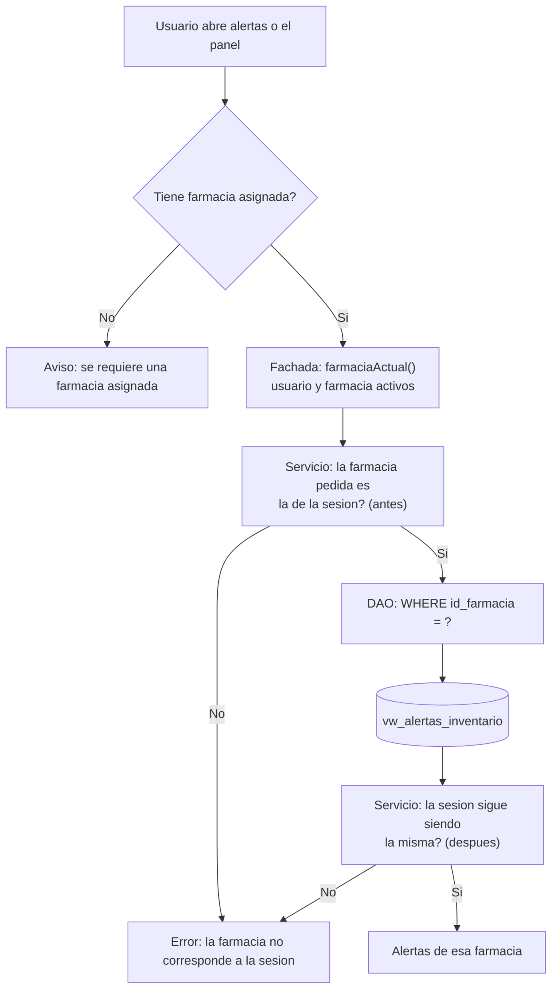

# Alertas de inventario: segregación por farmacia

Cada farmacia debe ver **solo sus alertas**. Este documento explica en qué capas se garantiza, qué pasa si la sesión cambia durante una consulta y qué pruebas lo comprueban.

## 1. Las capas que filtran

| Capa | Dónde | Qué garantiza |
|---|---|---|
| **Base de datos** | `16_vista_alertas_inventario.sql` L3 | Cada fila de la vista lleva el `id_farmacia` de su producto, tomado de `medicamentos`, `aseo` o `maternidad`; un lote hereda la farmacia de su medicamento |
| **DAO** | `dao/AlertasInventarioDao.java` L22 | La consulta siempre lleva `WHERE id_farmacia = ?`; sin farmacia válida (L31) lanza error |
| **Servicio** | `service/ServicioAlertasInventario.java` L38 y L40 | Comprueba que la farmacia pedida sea la de la sesión **antes** y **después** de consultar |
| **Fachada** | `facade/Inventario.java` L405 | No recibe la farmacia de afuera: la obtiene de la base con `farmaciaActual()` (L107), que además exige usuario y farmacia activos |
| **Interfaz** | `ControladorAlertas` L73 e `ControladorInventario` | Solo hablan con la fachada; si el usuario no tiene farmacia, la pantalla no abre (L264) |



## 2. Por qué se verifica la sesión dos veces

Una consulta tarda un instante. Si en ese tiempo la sesión se cierra o cambia de usuario, el resultado ya no pertenece a quien lo pidió. El servicio comprueba la sesión antes de consultar (L38) y de nuevo al recibir el resultado (L40); si cambió, descarta las alertas con el mensaje de la línea L88. Es el mismo criterio que usa el historial de movimientos.

## 3. Qué ve cada rol

| Rol | Botón "Alertas" | Qué alertas |
|---|---|---|
| Administrador con farmacia | Visible | Las de su farmacia |
| Farmacéutico con farmacia | Visible | Las de su farmacia |
| Usuario sin farmacia (por ejemplo, super administrador) | Oculto | Ninguna: la pantalla exige una farmacia asignada |

## 4. Evidencia

Las pruebas se ejecutaron sobre PostgreSQL 16 con los scripts del repositorio y dos farmacias con datos distintos.

| Comprobación | Resultado |
|---|---|
| Farmacia A consulta sus alertas | 11 alertas |
| Farmacia B consulta sus alertas | 3 alertas, ninguna de las de A |
| Un usuario de la farmacia B pide con la fachada | Recibe solo sus 3 |
| El servicio recibe la farmacia B estando la sesión en la A | Rechaza con "La farmacia no corresponde a la sesión activa." |
| Panel principal de la farmacia A | "Alertas (10)" (11 menos el lote ya vencido, que se deshabilita al abrir) |
| Panel principal de la farmacia B | "Alertas (3)" |
| Un farmacéutico de la farmacia A | Ve el aviso con el mismo conteo de su farmacia |
| Pruebas unitarias del servicio | `ServicioAlertasInventarioTest`: rechaza farmacia inválida y exige sesión activa |

## 5. Riesgos que quedan

| Riesgo | Detalle |
|---|---|
| La vista no aplica seguridad por fila | Cualquiera con acceso directo a la base puede leer la vista de todas las farmacias; la segregación depende de que la aplicación filtre. Se mitiga con el filtro obligatorio del DAO |
| Usuarios sin farmacia | No ven alertas; si en el futuro se quiere una vista global para super administradores, requerirá una consulta distinta y su propia documentación |
| Productos sin `id_farmacia` | La columna es obligatoria en las tres tablas; un producto sin farmacia no podría crearse |

## 6. Cómo auditarlo

Alertas que no pertenecen a ninguna farmacia existente (deben ser cero):

```sql
SELECT COUNT(*)
FROM vw_alertas_inventario v
LEFT JOIN farmacias f ON f.id_farmacia = v.id_farmacia
WHERE f.id_farmacia IS NULL;
```

Cantidad de alertas por farmacia:

```sql
SELECT id_farmacia, severidad, COUNT(*) AS alertas
FROM vw_alertas_inventario
GROUP BY id_farmacia, severidad
ORDER BY id_farmacia, severidad;
```
