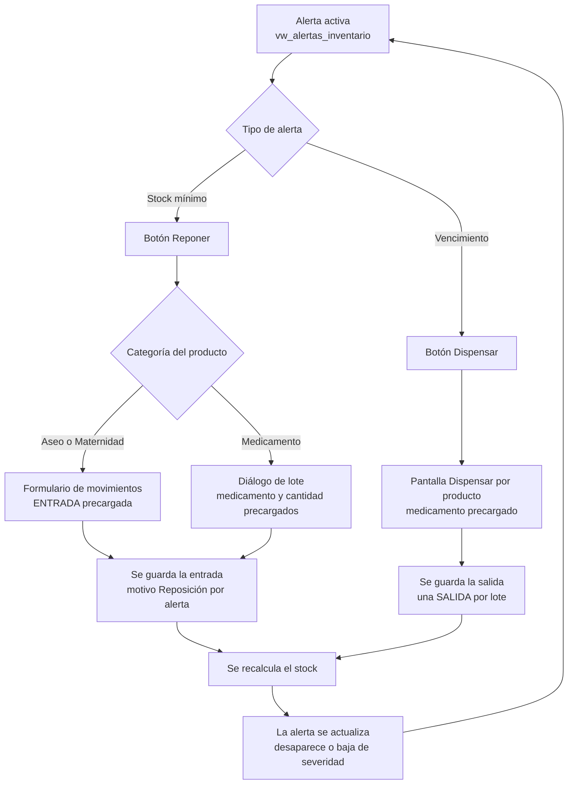
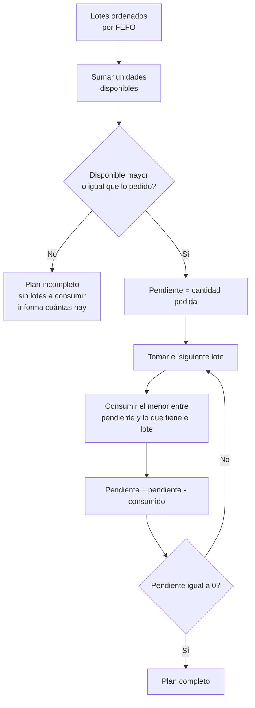
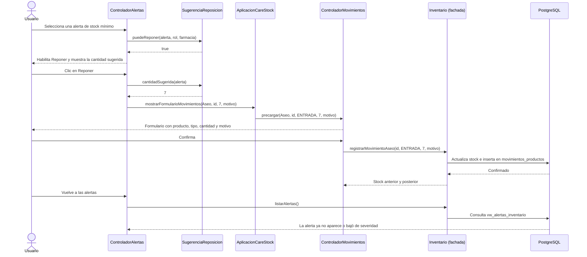

# Proceso integral de inventario: alertas, reposición y dispensación

Este documento explica cómo se conectan en CareStock las alertas del inventario con las dos acciones que las resuelven: **reponer** un producto que se está acabando y **dispensar** un medicamento que está por vencer. Describe el ciclo completo, cómo se arma el plan de dispensación por lote (FEFO), cómo se calcula la cantidad sugerida de reposición, quién puede hacer cada cosa y qué queda registrado.

Las referencias a código usan el formato `Clase.método, L<línea>` y apuntan al código entregado en las historias HU.139 y HU.140.

## 1. El ciclo completo

Todo empieza en una alerta (HU.124). La pantalla de alertas ofrece un botón según el tipo de alerta, el botón abre la pantalla que resuelve el problema y, al guardar, la alerta se recalcula con los datos nuevos.



Dos detalles importantes del ciclo:

- **Dispensar puede crear una alerta nueva.** El stock de un medicamento cuenta solo los lotes disponibles y no vencidos. Si una dispensación deja el total en el mínimo o por debajo, en la siguiente actualización aparece una alerta de stock mínimo y el ciclo continúa con *Reponer*.
- **La alerta no se borra a mano.** Desaparece porque la vista `vw_alertas_inventario` vuelve a calcularse con las existencias reales. Esto ocurre al abrir la pantalla de alertas, cada 60 segundos y al volver al panel de inventario, donde el contador del botón *Alertas* se recarga.

## 2. Dispensar por producto con FEFO

FEFO significa *First Expired, First Out*: se gasta primero el lote que vence antes. Así se reduce la pérdida de medicamentos por vencimiento.

### 2.1 Qué lotes participan

La consulta de lotes (`ServicioDispensacionFefo.leerLotes`, L182) solo trae lotes que cumplen todo esto:

| Condición | Por qué |
|---|---|
| Pertenecen al medicamento elegido | Solo se descuenta del producto pedido |
| `estado_lote = 'DISPONIBLE'` | Un lote retenido, agotado o vencido no se dispensa |
| `cantidad_actual > 0` | Un lote vacío no aporta unidades |
| `fecha_vencimiento > CURRENT_DATE` | Un lote que vence hoy o ya venció no se dispensa |

Antes de leer los lotes, `leerMedicamento` (L147) comprueba que el medicamento exista, esté activo y sea de la farmacia de quien dispensa.

### 2.2 En qué orden se consumen

El orden es `fecha_vencimiento ASC, fecha_ingreso ASC, id_lote ASC`:

1. Primero el que vence antes.
2. Si dos lotes vencen el mismo día, primero el que **entró antes** a la farmacia.
3. Si también empatan en el ingreso, el de menor `id_lote`, para que el resultado sea siempre el mismo.

### 2.3 Cómo se arma el plan

`ServicioDispensacionFefo.construirPlan` (L43) es una función pura: recibe los lotes ya ordenados y devuelve el plan sin tocar la base de datos. Por eso se prueba sin conexión.



### 2.4 Ejemplo

Medicamento *Amoxicilina*, hoy con 24 unidades repartidas en cuatro lotes disponibles. Se piden **12**.

| Lote | Vence en | Entró hace | Disponible | Se consume | Quedará |
|---|---|---|---|---|---|
| L-PRONTO | 10 días | 2 días | 4 | **4** | 0 (AGOTADO) |
| L-EMPATE-A | 40 días | 5 días | 5 | **5** | 0 (AGOTADO) |
| L-EMPATE-B | 40 días | 1 día | 5 | **3** | 2 (DISPONIBLE) |
| L-TARDE | 200 días | 10 días | 10 | 0 | 10 |

`L-EMPATE-A` y `L-EMPATE-B` vencen el mismo día; sale primero `L-EMPATE-A` porque entró antes. `L-TARDE` no se toca porque los tres primeros lotes ya cubren las 12 unidades. Después de dispensar, el stock total queda en 12.

### 2.5 Casos límite

| Situación | Qué ocurre |
|---|---|
| Se piden más unidades de las disponibles (25 de 24) | La pantalla informa cuántas hay y no dispensa nada. Si se intenta igual desde el servicio, falla con `Stock insuficiente: solicitadas 25 unidades y solo hay 24 disponibles` y no se escribe nada |
| Se pide exactamente todo lo disponible | Todos los lotes quedan en 0 y en estado AGOTADO |
| Hay lotes vencidos o retenidos con unidades | No entran al plan, aunque tengan muchas unidades |
| El medicamento es de otra farmacia | Se rechaza con `No puede dispensar medicamentos de otra farmacia` |
| El medicamento está inactivo | Se rechaza con `Medicamento inactivo` |
| La cantidad es cero o negativa | Se rechaza antes de abrir la conexión |
| Dos personas dispensan a la vez | Las filas se bloquean con `FOR UPDATE` (L153 y L183) y la segunda espera a que la primera termine |

### 2.6 Atomicidad

`ServicioDispensacionFefo.dispensarPorProducto` (L77) hace todo en **una sola transacción**:

1. Valida al operador (rol permitido, usuario activo, farmacia activa) con `validarOperador` (L157).
2. Bloquea el medicamento y sus lotes, y arma el plan.
3. Si el plan no es completo, lanza la excepción y revierte.
4. Por cada lote del plan, descuenta la cantidad (`descontarLote`, L98) y registra su SALIDA (`registrarSalida`, L99).
5. Recalcula una sola vez el `stock_total` sumando los lotes (`recalcularStock`, L101). Nunca se suma ni se resta a mano, porque el trigger `trg_actualizar_stock_total` también recalcula y se contaría doble.
6. `commit` (L103). Si algo falla en cualquier paso, `rollback` (L106) deja todo como estaba.

Por eso nunca queda una dispensación a medias: o salen todas las unidades de todos los lotes del plan o no sale ninguna.

### 2.7 Qué hace la pantalla

La pantalla *Dispensar por producto (FEFO)* (`ControladorDispensacion`, `dispensacion-view.fxml`) se abre desde el panel de inventario o desde una alerta de vencimiento. El flujo es:

1. Elegir el medicamento (solo aparecen los de la farmacia con existencias) y escribir la cantidad.
2. **Calcular plan**: la tabla muestra el orden, el lote, la fecha de vencimiento, lo disponible, lo que se dispensa y lo que quedará.
3. **Confirmar dispensación**: se habilita solo cuando el plan está completo. Cambiar el medicamento o la cantidad descarta el plan y obliga a calcularlo de nuevo, para que nunca se confirme un plan viejo.
4. Al terminar, la lista de medicamentos se recarga con el stock nuevo.

La fachada expone `Inventario.planificarDispensacion` (L442) para el cálculo, y `Inventario.dispensarPorProducto` (L455) para confirmar. Esta última pasa por `escribir`, que toma la farmacia del usuario y, tras una escritura confirmada, invalida la caché de la consulta unificada.

## 3. Reposición asistida desde la alerta

### 3.1 Cantidad sugerida

La cantidad sugerida lleva el producto al **doble de su stock mínimo**, y nunca es menor que 1. Está en `SugerenciaReposicion.cantidadSugerida` (L21):

```
sugerida = máximo(1, 2 × stock_mínimo − existencias)
```

| Existencias | Mínimo | Sugerida | Explicación |
|---|---|---|---|
| 3 | 5 | **7** | 10 − 3 |
| 0 | 10 | **20** | 20 − 0 |
| 4 | 5 | **6** | 10 − 4 |
| 5 | 5 | **5** | 10 − 5 |
| 0 | 0 | **1** | El mínimo es 0, pero siempre se sugiere al menos 1 |
| 12 | 5 | **1** | Ya está por encima del doble; se mantiene el mínimo de 1 |

Valores negativos se tratan como cero. La sugerencia es solo un punto de partida: el usuario puede cambiar la cantidad antes de guardar.

### 3.2 Qué abre cada botón

| Alerta | Botón | Qué se abre | Qué llega precargado |
|---|---|---|---|
| Stock mínimo de **aseo** o **maternidad** | Reponer | Formulario de movimientos | Categoría, producto, tipo ENTRADA, cantidad sugerida y motivo `Reposición por alerta` |
| Stock mínimo de **medicamento** | Reponer | Diálogo de nuevo lote | Medicamento, cantidad sugerida y motivo. Número de lote, vencimiento y ubicación los escribe el usuario |
| **Vencimiento** de un lote | Dispensar | Pantalla de dispensación FEFO | El medicamento del lote |

La decisión de qué botón habilitar está en `SugerenciaReposicion.puedeReponer` (L43) y `puedeDispensar` (L54), y la pantalla de alertas la aplica en `ControladorAlertas.actualizarAcciones` (L273). El clic se atiende en `onReponer` (L298) y `onDispensar` (L326).

Como la alerta de vencimiento identifica un **lote** y la pantalla de dispensación trabaja por **medicamento**, `onDispensar` primero consulta a qué medicamento pertenece el lote (`Inventario.medicamentoDeLote`, L469), siempre dentro de la farmacia activa. El plan FEFO empieza por el lote que vence primero, así que el lote que originó la alerta sale antes, salvo que otro venza aún antes.

### 3.3 Secuencia de una reposición



La precarga se aplica cuando la pantalla destino termina de cargar sus productos (`ControladorMovimientos.precargar`, L53; `AplicacionCareStock.mostrarFormularioMovimientos`, L230). Si la sesión no tiene farmacia, no se guarda ninguna precarga y se muestra el aviso de siempre.

### 3.4 Qué registra cada entrada

| Reposición de | Dónde queda registrada | Qué se guarda |
|---|---|---|
| Aseo o maternidad | `movimientos_productos` | Tipo `ENTRADA`, cantidad, stock anterior y posterior, el motivo `Reposición por alerta` y el usuario |
| Medicamento | `lotes` y `log_movimientos` | Un lote nuevo y su `ENTRADA` con el detalle `Reposición por alerta: registro inicial del lote <número>` y el usuario. El `stock_total` se recalcula desde los lotes |

El detalle del medicamento se arma en `ServicioCrudLotes.detalleEntrada` (L385) y se usa en `ServicioCrudLotes.crear` con motivo (L292). Si no se indica motivo, el detalle sigue siendo `Registro inicial del lote <número>`, igual que antes.

## 4. Guía de uso por rol

La tabla muestra qué botón queda habilitado en la pantalla de alertas. Todos los roles necesitan una **farmacia asignada**.

| Acción | SUPER_ADMIN | ADMINISTRADOR | FARMACEUTICO | AUXILIAR |
|---|---|---|---|---|
| Ver alertas de la farmacia | Sí | Sí | Sí | Sí |
| Reponer aseo o maternidad | Sí | Sí | Sí | Sí |
| Reponer medicamento (nuevo lote) | Sí | Sí | Sí | No |
| Dispensar desde una alerta de vencimiento | Según `CARESTOCK_ROLES_DISPENSACION` | Según `CARESTOCK_ROLES_DISPENSACION` | Según `CARESTOCK_ROLES_DISPENSACION` | Según `CARESTOCK_ROLES_DISPENSACION` |

Aclaraciones:

- Reponer medicamentos exige un rol que ya puede gestionar lotes (`ServicioCrudLotes.rolGestor`, L34). Reponer aseo y maternidad sigue las mismas reglas del formulario de movimientos, abierto a cualquier usuario con farmacia.
- El botón *Dispensar* se habilita para cualquier usuario con farmacia, pero el servicio decide si la operación procede: solo pasan los roles listados en la variable de entorno `CARESTOCK_ROLES_DISPENSACION` (identificadores de rol separados por coma, por ejemplo `2,3`). Si la variable no está configurada, la dispensación queda bloqueada con el mensaje `Dispensacion bloqueada: configure CARESTOCK_ROLES_DISPENSACION`.
- Cuando un rol no puede reponer un medicamento, la pantalla lo dice en la línea de ayuda: *Tu rol no puede registrar entradas de medicamentos*.

### Paso a paso

**Reponer un producto de aseo o maternidad**

1. Abrir *Alertas* desde el panel de inventario.
2. Seleccionar la alerta de stock mínimo. Debajo de la tabla aparece la cantidad sugerida.
3. Clic en *Reponer*. Se abre el formulario de movimientos con todo precargado.
4. Revisar la cantidad (se puede cambiar), pulsar *Validar* y confirmar.

**Reponer un medicamento**

1. Seleccionar la alerta de stock mínimo del medicamento y pulsar *Reponer*.
2. En el diálogo, completar número de lote, fecha de vencimiento y ubicación. El medicamento y la cantidad ya vienen cargados.
3. Pulsar *Crear lote*. La pantalla de alertas se refresca sola.

**Dispensar un lote por vencer**

1. Seleccionar la alerta de vencimiento y pulsar *Dispensar*.
2. Escribir la cantidad y pulsar *Calcular plan*.
3. Revisar qué lotes se usarán y pulsar *Confirmar dispensación*.

## 5. Matriz de roles y trazabilidad

| Acción | Quién puede | Qué se valida | Qué queda registrado |
|---|---|---|---|
| Dispensar por producto | Roles de `CARESTOCK_ROLES_DISPENSACION`, usuario activo en farmacia activa | Medicamento activo y de la misma farmacia, lotes disponibles y no vencidos, stock suficiente | Una `SALIDA` en `log_movimientos` por cada lote (lote, cantidad, usuario, detalle `Dispensación FEFO del lote <número>`); en `lotes`, la cantidad nueva, el estado y quién y cuándo lo modificó; `stock_total` recalculado |
| Reponer aseo o maternidad | Usuario con farmacia asignada | Producto activo y de la farmacia, cantidad positiva, motivo obligatorio | Una `ENTRADA` en `movimientos_productos` con motivo, usuario y stock anterior y posterior |
| Reponer medicamento | `SUPER_ADMIN`, `ADMINISTRADOR`, `FARMACEUTICO` con farmacia | Medicamento activo y de la farmacia, ubicación existente, vencimiento futuro, cantidad positiva | Lote nuevo y una `ENTRADA` en `log_movimientos` con motivo y usuario; `stock_total` recalculado |

### Separación por farmacia

Cada operación toma la farmacia de la sesión y no de un dato que escriba el usuario: `Inventario.farmaciaActual` (L111) la consulta en la base y falla si la sesión cambió. Con eso:

- Las alertas y los botones solo muestran productos de la farmacia activa.
- `ServicioDispensacionFefo` rechaza un medicamento de otra farmacia aunque alguien conozca su identificador.
- `ServicioCrudLotes.crear` y `ServicioMovimientosProducto` comprueban de nuevo que el producto pertenezca a la farmacia del usuario.

### Cómo seguir el rastro

Para saber qué pasó con un producto después de una alerta, la pantalla de alertas muestra su último movimiento (columna *Ultimo movimiento*) y el historial de movimientos reúne el detalle completo. Una reposición por alerta se reconoce por el texto `Reposición por alerta`; una dispensación FEFO, por `Dispensación FEFO del lote`.

## 6. Pruebas que respaldan este proceso

| Nivel | Qué cubre | Resultado |
|---|---|---|
| JUnit (HU.139, `ServicioDispensacionFefoTest`) | Plan FEFO, orden por lote, faltante, atomicidad, rol, otra farmacia, medicamento inactivo, parámetros inválidos | 22 pruebas |
| JUnit (HU.140, `SugerenciaReposicionTest`) | Cantidad sugerida, límites y negativos, acciones por tipo de alerta, roles, motivo y detalle de la entrada | 12 pruebas |
| Integración con PostgreSQL | Orden FEFO real con empate por ingreso, rollback sin cambios, estados AGOTADO, stock recalculado, una SALIDA por lote, reposición de aseo y de medicamento con motivo, alerta que desaparece, segregación por farmacia | 18 y 15 comprobaciones |
| Interfaz (entorno gráfico virtual) | Pantalla de dispensación (precarga, plan, faltante, confirmación) y pantalla de alertas (botones por tipo y por rol, sugerencia, precarga del formulario de movimientos) | 12 y 17 comprobaciones |

Las pruebas JUnit no necesitan base de datos y corren con `mvnw clean verify`.

## 7. Límites conocidos

- La dispensación por producto cubre **medicamentos**, que son los que tienen lotes y vencimiento. Aseo y maternidad se mueven con el formulario de movimientos.
- La cantidad sugerida usa solo el mínimo y las existencias; no considera el consumo histórico.
- La precarga cubre producto, tipo, cantidad y motivo. En el caso de un medicamento, el número de lote, el vencimiento y la ubicación los escribe la persona porque dependen de lo que llegó físicamente.
- Al terminar una reposición de aseo o maternidad, el botón *Volver* del formulario de movimientos lleva al panel de inventario, no a las alertas.
