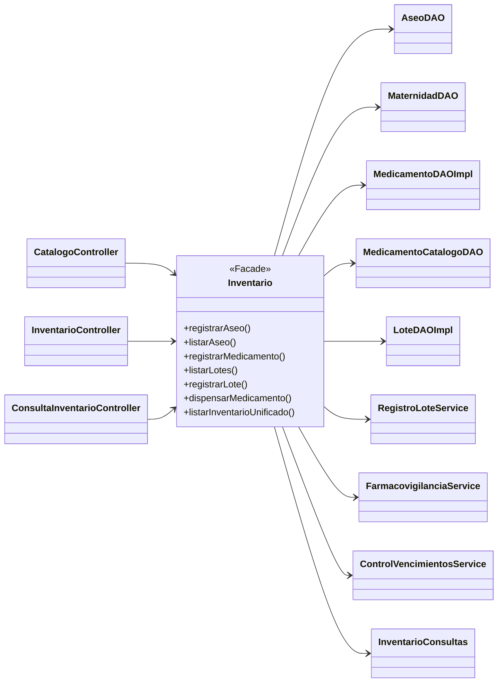

# Patrón Facade: la fachada `Inventario`

Patrón **estructural** de la gestión de productos de CareStock. Código: `src/CareStock/src/main/java/org/example/carestock/` en `main`, con el cambio de la HU.94 (`CatalogoDAO`). Los números de línea corresponden a esa versión.

## 1. Qué problema resuelve

Para gestionar el catálogo hay que hablar con cinco DAO, tres servicios y el proxy de la consulta unificada (aseo, maternidad, medicamentos, lotes, registro de lote, dispensación y control de vencimientos). Si cada pantalla los conociera, repetiría esa lógica y quedaría pegada a todas esas clases.

El patrón **Facade** pone **una sola clase** (`Inventario`) frente a todo ese conjunto. Las pantallas le piden el trabajo a ella y no saben qué hay detrás.

## 2. Estructura

| Papel del patrón | Clase |
|---|---|
| Fachada | `Inventario` |
| Clientes | `CatalogoController`, `InventarioController` y `ConsultaInventarioController` |
| Subsistema | Los DAO, los servicios y el acceso a la consulta unificada |

## 3. Qué hace la fachada con cada pedido

Cada método de `Inventario` recibe el pedido de una pantalla y lo delega en la clase que corresponde.

| La pantalla pide (`Inventario.java`) | La fachada delega en | Línea |
|---|---|---|
| `registrarAseo` (L113) | `AseoDAO.guardar` | 115 |
| `buscarAseo` | `AseoDAO.buscarPorId` | 121 |
| `listarAseo` | `AseoDAO.listarPorFarmacia` | 127 |
| `actualizarAseo` | `AseoDAO.actualizar` | 134 |
| `desactivarAseo` | `AseoDAO.desactivar` | 152 |
| `registrarMaternidad` | `MaternidadDAO.guardar` | 164 |
| `buscarMaternidad` | `MaternidadDAO.buscarPorId` | 170 |
| `listarMaternidad` | `MaternidadDAO.listarPorFarmacia` | 176 |
| `actualizarMaternidad` | `MaternidadDAO.actualizar` | 187 |
| `desactivarMaternidad` | `MaternidadDAO.desactivar` | 209 |
| `registrarMedicamento` | `MedicamentoDAOImpl.guardar` | 259 |
| `listarMedicamentos` | `MedicamentoCatalogoDAO.listarPorFarmacia` | 272 |
| `actualizarMedicamento` | `MedicamentoCatalogoDAO.actualizar` | 292 |
| `desactivarMedicamento` | `MedicamentoCatalogoDAO.desactivar` | 301 |
| `listarLotes` (L343) | Primero `ControlVencimientosService.sincronizar` y luego `LoteDAOImpl.listarPorFarmacia` | 346 y 353 |
| `registrarLote` | `RegistroLoteService.registrarMedicamentoLote` | 359 |
| `dispensarMedicamento` | `FarmacovigilanciaService.dispensarMedicamento` | 371 |
| `listarInventarioUnificado` (L428) | `ConsultaInventario.listarPorFarmacia` (el proxy) | 431 |

Los objetos del subsistema se crean en las líneas 26, 27, 30, 33, 35, 41, 44 y 47; el acceso a la consulta unificada, en la línea 38.

## 4. Qué añade la fachada además de repartir

- **Resuelve la farmacia del usuario** (`farmaciaActual`, L59): comprueba que el usuario de la sesión sea el mismo que creó la fachada (L60) y consulta en la base de datos que usuario y farmacia estén activos (L75). La pantalla nunca decide en qué farmacia se trabaja.
- **Invalida la caché de esa farmacia** después de cada escritura confirmada (`escribir`, L97, con `InventarioConsultas.invalidarFarmacia` en L105). Si la escritura falla, la caché se conserva.
- **Sincroniza los vencimientos** antes de listar los lotes (L346); si hubo lotes actualizados, invalida la caché de la farmacia.

## 5. Dónde se ve

| Dónde | Qué mirar |
|---|---|
| Diagrama de clases | `DIAGRAMA_CLASES_ACTUAL.md`, diagramas 1 y 2: `Inventario` con la marca `<<Facade>>` |
| Diagrama de componentes | `DIAGRAMA_COMPONENTES_GENERAL.md`: flechas 5, 8 y 12 (pantallas hacia la fachada) y 17 a 26 (fachada hacia el subsistema) |
| Código de los clientes | `InventarioController` L72, `CatalogoController` L133 y `ConsultaInventarioController` L86: `new Inventario(...)` |

## 6. Ventajas y límites

Ventajas: las pantallas dependen de una sola clase; un cambio en un DAO no las obliga a cambiar; las reglas comunes (farmacia del usuario, invalidación de caché y sincronización de vencimientos) viven en un solo sitio.

Límite: `Inventario` ya tiene más de 20 operaciones públicas de tres tipos de producto, de lotes y de consulta, y sigue creciendo. Es la clase que más conviene vigilar para que no se convierta en un cajón de todo.
