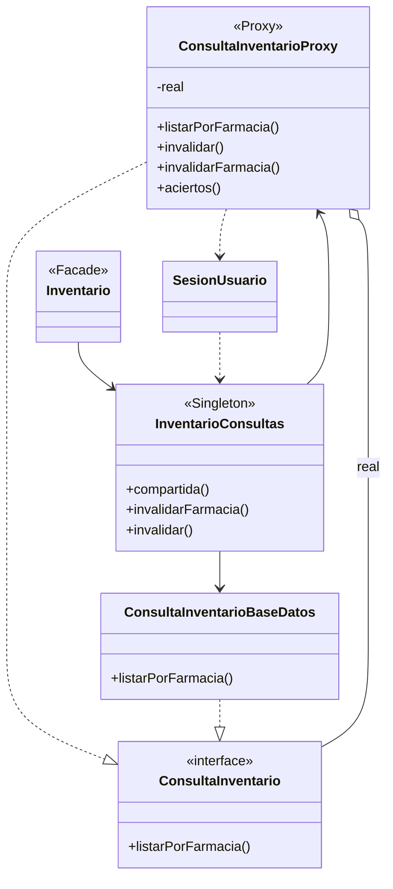

# Patrón Proxy: la consulta de inventario con caché y control de acceso

Patrón **estructural** de la gestión de productos de CareStock, con un **Singleton** que guarda el proxy compartido. Código: `src/CareStock/src/main/java/org/example/carestock/` en `main`, con el cambio de la HU.94 (`CatalogoDao`). Los números de línea corresponden a esa versión.

## 1. Qué problema resuelve

La consulta unificada junta tres tablas (medicamentos, aseo y maternidad) con un `UNION ALL` (`ConsultaInventarioBaseDatos.java` L33). Repetirla cada vez que una pantalla la pide es lento y además cualquier llamador podría pedir los datos de otra farmacia.

El patrón **Proxy** pone un intermediario con la **misma interfaz** que el objeto real. Este intermediario hace tres cosas antes de llegar a la base de datos: comprueba que la farmacia pedida sea la de la sesión, devuelve lo que ya guardó en memoria si todavía no venció, y descarta la consulta si la sesión cambió mientras estaba en curso.

## 2. Estructura

| Papel del patrón | Clase | Archivo y línea |
|---|---|---|
| Interfaz común | `ConsultaInventario` | `proxy/ConsultaInventario.java` L6 |
| Objeto real | `ConsultaInventarioBaseDatos` | `dao/ConsultaInventarioBaseDatos.java` L18 |
| Proxy | `ConsultaInventarioProxy` | `proxy/ConsultaInventarioProxy.java` L28 |
| Quien guarda el proxy | `InventarioConsultas` | `proxy/InventarioConsultas.java` |

## 3. Qué hace el proxy en cada consulta

1. **Controla el acceso** (`verificarAcceso`, L122): lee la farmacia de la sesión (L113) y, si la pedida es otra, lanza `SecurityException` (L130).
2. **Busca en la caché:** si la farmacia ya está guardada y no ha vencido, devuelve lo guardado y cuenta un acierto (L163).
3. **Si no está, consulta de verdad:** llama al objeto real, guardado en el campo `real` (L51), con `real.listarPorFarmacia` (L243), y guarda el resultado en la caché (L260).
4. **Descarta la consulta si la sesión cambió mientras estaba en curso:** el proxy guarda un número de versión de la sesión (L60) y lo compara al terminar (`verificarVersionSesion`, L225); si cambió, lanza `SecurityException`. Cada invalidación global lo aumenta (L340).
5. **Se vacía a petición:** `invalidarFarmacia` (L313) vacía una farmacia e `invalidar` (L338) vacía todo.

## 4. El Singleton que lo guarda

`InventarioConsultas` crea **un solo proxy** con su DAO real (L14 y L15), tiene el constructor privado (L19) y lo entrega con `compartida()` (L48). Así todas las pantallas comparten la misma caché.

El tiempo de vida de lo guardado es de **30 segundos** por defecto (L26) y se puede cambiar con la variable de entorno `CARESTOCK_INVENTARIO_CACHE_TTL_SECONDS`, entre 1 y 3600 segundos (L10).

## 5. Quién llama a quién

| Llamada | Línea |
|---|---|
| `Inventario` toma el proxy compartido | `Inventario.java` L38 |
| `Inventario.listarInventarioUnificado` consulta | `Inventario.java` L431 |
| `SesionUsuario.iniciar` vacía la caché al abrir sesión | `SesionUsuario.java` L47 |
| Cada escritura confirmada de la fachada vacía la caché de su farmacia | `Inventario.java` L105 |
| `ControladorConsultaInventario` lee las estadísticas de la caché | `ControladorConsultaInventario.java` L407 |

## 6. Pruebas que lo respaldan

`ConsultaInventarioProxyTest` tiene siete pruebas automáticas con JUnit:

| Prueba | Qué comprueba |
|---|---|
| `reutilizaResultadosSinRepetirConsultaDao` | La segunda consulta sale de la caché |
| `ttlYListaVaciaSonValidos` | Una lista vacía y los tiempos de vida válidos se aceptan |
| `deniegaOtraFarmaciaAunqueExistaCache` | El control de acceso funciona aunque haya datos guardados |
| `soloInvalidaLaFarmaciaAfectada` | Vaciar una farmacia no toca las demás |
| `erroresNoSeAlmacenanComoDatosVacios` | Un error no se guarda como si fuera una lista vacía |
| `invalidacionDeSesionDescartaCargaPendiente` | La consulta en curso se descarta si la sesión cambia |
| `consultasConcurrentesCompartenLaMismaCarga` | Dos consultas simultáneas comparten una sola carga |

## 7. Dónde se ve

| Dónde | Qué mirar |
|---|---|
| Diagrama de clases | `DIAGRAMA_CLASES_ACTUAL.md`, diagrama 2: `<<Proxy>>` y `<<Singleton>>` |
| Diagrama de componentes | `DIAGRAMA_COMPONENTES_GENERAL.md`: flechas 24, 31, 32 y 33 |

## 8. Ventajas y puntos a vigilar

Ventajas: las pantallas no cambian, porque el proxy y el DAO real tienen la misma interfaz; la consulta pesada se hace una vez por periodo y por farmacia; el control de farmacia queda en un solo punto y tiene pruebas.

Puntos a vigilar:
- La caché guarda datos en memoria, así que puede mostrar información un poco vieja hasta que venza o se invalide. Por eso la fachada la vacía tras cada escritura confirmada.
- Las clases `VistasCache` y `CacheFarmacia` (con `DatosCatalogo` y `DatosLotes`) ofrecen una caché genérica por farmacia, pero **ninguna otra clase las usa todavía**: la caché que funciona hoy es la del propio proxy.
