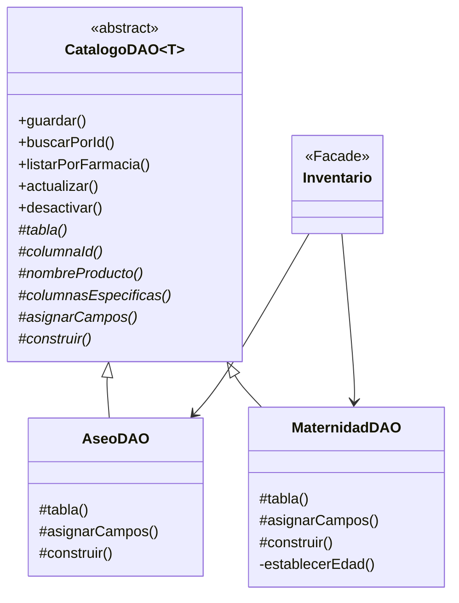

# Patrón Template Method: los DAO del catálogo

Patrón de **comportamiento** de la gestión de productos de CareStock, introducido en la HU.94. Código: `src/CareStock/src/main/java/org/example/carestock/` en `main`, con el cambio de la HU.94 (`CatalogoDAO`). Los números de línea corresponden a esa versión.

## 1. Qué problema resuelve

`AseoDAO` y `MaternidadDAO` hacían lo mismo con dos tablas distintas: guardar, buscar, listar, actualizar y desactivar. Al ignorar el nombre del tipo, **115 de sus líneas eran idénticas**, el 78 %. Lo único que cambiaba era:

- Las columnas del `INSERT` y del `UPDATE`.
- Los valores que se asignan a cada parámetro.
- Cómo se arma el objeto al leer una fila.

El patrón **Template Method** deja el flujo común **una sola vez** en una clase base y obliga a cada subclase a completar solo esas tres piezas.

## 2. Estructura

| Papel del patrón | Qué es | Archivo y línea |
|---|---|---|
| Clase abstracta | `CatalogoDAO<T extends Validable>` | `dao/CatalogoDAO.java` L16 |
| Métodos plantilla (`final`) | `guardar` L30, `buscarPorId` L58, `listarPorFarmacia` L73, `actualizar` L89, `desactivar` L112 | `dao/CatalogoDAO.java` |
| Ganchos (`abstract`) | `tabla`, `columnaId`, `nombreProducto`, `columnasEspecificas`, `asignarCampos` y `construir` | `dao/CatalogoDAO.java` L18 a L28 |
| Clase concreta 1 | `AseoDAO extends CatalogoDAO<Aseo>` | `dao/AseoDAO.java` L12 |
| Clase concreta 2 | `MaternidadDAO extends CatalogoDAO<Maternidad>` | `dao/MaternidadDAO.java` L13 |

## 3. Cómo funciona

Cada método plantilla es `final` en el código (el diagrama no lo marca): las subclases **no pueden cambiar el orden de los pasos**, solo completar los ganchos. Por ejemplo, `guardar`:

1. Comprueba que el producto no sea nulo y llama a `validar()` (L32).
2. Valida la farmacia y el usuario.
3. Arma el `INSERT` con `tabla()`, las columnas comunes y `columnasEspecificas()` (L36).
4. Abre la conexión (L43) y llama al gancho `asignarCampos` (L45).
5. Asigna la farmacia y el usuario y devuelve el id generado con `columnaId()` (L53).

Qué aporta cada subclase:

| Gancho | `AseoDAO` | `MaternidadDAO` |
|---|---|---|
| `tabla()` | `aseo` | `maternidad` |
| `columnaId()` | `id_aseo` | `id_maternidad` |
| `columnasEspecificas()` | `tipo_aseo`, `biodegradable`, `componentes_activos` | `etapa_recomendada`, `hipoalergenico`, `edad_gestacional_sugerida` |
| `asignarCampos()` | Asigna esos tres valores | Igual, y trata la edad cero como vacía con `establecerEdad` |
| `construir()` | Arma el `Aseo` con `AseoBuilder` (L45) | Arma el `Maternidad` con `MaternidadBuilder` (L49) |

El método protegido `asignarCamposComunes` (L128) asigna código, nombre, descripción, precio y stock, que son iguales en los dos tipos.

## 4. Qué se consigue

| Líneas de código, con `import` | Antes | Ahora |
|---|---|---|
| `AseoDAO` | 147 | 48 |
| `MaternidadDAO` | 159 | 56 |
| `CatalogoDAO` | No existía | 139 |
| **Total** | 306 | 243 |

El total baja poco porque hoy solo hay dos tipos. La ventaja real es que **un tipo nuevo cuesta unas 50 líneas** (los seis ganchos) en vez de unas 150 de flujo repetido, y que cualquier corrección del flujo se hace en un solo lugar.

## 5. Qué no cambia

- Los métodos públicos de `AseoDAO` y `MaternidadDAO` conservan su nombre, parámetros y excepciones, así que `Inventario` y las pantallas no se tocan.
- El SQL que se envía es el mismo, así como los mensajes de error.
- Se comprobó con una base de datos simulada que el código anterior y el nuevo dan el mismo SQL, los mismos parámetros, los mismos resultados y los mismos errores en 47 escenarios (guardar, buscar, listar, actualizar y desactivar, con datos válidos e inválidos, para los dos tipos). Esa prueba no forma parte del repositorio.

## 6. Dónde se ve

| Dónde | Qué mirar |
|---|---|
| Diagrama de clases | `DIAGRAMA_CLASES_ACTUAL.md`, diagrama 2: `CatalogoDAO` con la marca `<<abstract>>` y las dos subclases |
| Diagrama de componentes | Dentro del componente "DAO de catálogo" (flechas 17 y 34) |
| Código | `CatalogoDAO.java` (plantilla), `AseoDAO.java` y `MaternidadDAO.java` (ganchos) |
