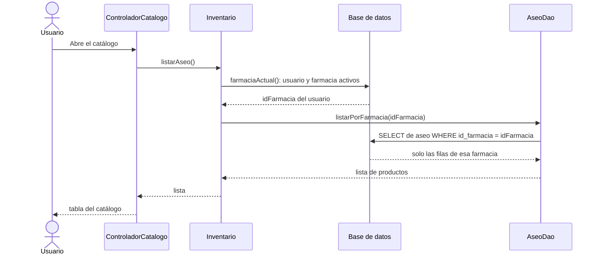

# Segregación por farmacia: cómo se hace cumplir en la aplicación

Qué clases impiden que un usuario vea o modifique datos de otra farmacia. Código: `src/CareStock/src/main/java/org/example/carestock/` en `main`, con el cambio de la HU.94 (`CatalogoDao`). Los números de línea corresponden a esa versión.

## 1. Idea general

La farmacia **no la elige la pantalla**: sale de la sesión del usuario, se vuelve a comprobar en la base de datos en cada operación, y cada consulta la lleva en el `WHERE`. Aparte, solo el rol `ADMINISTRADOR` puede modificar productos.

## 2. Recorrido de una consulta: listar los productos de aseo

## 3. Dónde se hace cumplir

| Capa | Mecanismo | Archivo y línea | Qué impide |
|---|---|---|---|
| Sesión | Al iniciar sesión se lee `id_farmacia` del usuario | `session/SesionUsuario.java` L55 | Que la farmacia dependa de lo que escribe el usuario |
| Fachada | `farmaciaActual` comprueba que la sesión es la del creador (L60) y que usuario y farmacia estén activos (L75) | `facade/Inventario.java` L59 | Operar con una sesión cambiada o con una farmacia inactiva |
| DAO de catálogo | `buscarPorId` filtra por farmacia (L62), `listarPorFarmacia` también (L76), y `actualizar` (L100) y `desactivar` (L118) solo afectan filas de esa farmacia | `dao/CatalogoDao.java` | Ver, editar o desactivar un producto de aseo o maternidad de otra farmacia |
| DAO de medicamentos | `listarPorFarmacia` (L19), `actualizar` (L44) y `desactivar` (L71) filtran por farmacia | `dao/MedicamentoCatalogoDao.java` | Lo mismo para medicamentos |
| DAO de lotes | `listarPorFarmacia` une con `medicamentos` y filtra por su farmacia (L90) | `dao/LoteDaoJdbc.java` L80 | Ver lotes de otra farmacia |
| Consulta unificada | Cada una de las tres partes del `UNION ALL` filtra por farmacia (L31, L43 y L55) | `dao/ConsultaInventarioBaseDatos.java` | Ver inventario de otra farmacia |
| Proxy | `verificarAcceso` rechaza una farmacia distinta a la de la sesión (L122 y L130) y `verificarVersionSesion` descarta una consulta cuya sesión cambió (L225) | `proxy/ConsultaInventarioProxy.java` | Pedir la consulta de otra farmacia, aunque se llame al proxy directamente |
| Control de vencimientos | Bloquea, marca y recalcula solo medicamentos y lotes de la farmacia (L33) | `service/ServicioControlVencimientos.java` L14 | Marcar como vencidos lotes de otra farmacia |
| Dispensación | Rechaza un lote cuya farmacia no coincide (L76 a L78); `validarOperador` (L142) exige que el usuario pertenezca a la farmacia, esté activo y tenga un rol de la lista `CARESTOCK_ROLES_DISPENSACION`; la firma antigua, sin farmacia, está bloqueada (L21 a L25) | `service/ServicioFarmacovigilancia.java` | Dispensar lotes de otra farmacia o sin permiso |
| Registro de lote | Comprueba que el medicamento sea de la farmacia (L27) | `service/ServicioRegistroLote.java` | Registrar lotes sobre medicamentos de otra farmacia |

Además de la farmacia, hay restricciones por **rol**. Solo `ADMINISTRADOR` puede modificar productos; la dispensación exige un rol de la lista configurada en `CARESTOCK_ROLES_DISPENSACION` (L144). Se comprueba al abrir el formulario del catálogo (`AplicacionCareStock.java` L144), al desactivar el panel de edición (`ControladorCatalogo.java` L152) y antes de cada modificación (`validarPermisoEdicion`, L1075). La pregunta la responde `SesionUsuario.esAdministrador` (L99).

## 4. Dónde se ve en los diagramas

| Diagrama | Qué mirar |
|---|---|
| Componentes (`DIAGRAMA_COMPONENTES_GENERAL.md`) | Flechas 25 y 26 (la fachada usa la sesión y la base de datos), 32 (el proxy usa la sesión) y 34 (los DAO usan la conexión); flechas 1, 10 y 14 para el rol |
| Clases (`DIAGRAMA_CLASES_ACTUAL.md`) | `Inventario`, `SesionUsuario`, `ConsultaInventarioProxy` y los DAO del diagrama 2 |

## 5. Qué dice cada capa en palabras sencillas

1. La **sesión** recuerda de qué farmacia es el usuario y de qué rol.
2. La **fachada** vuelve a preguntar la farmacia a la base de datos antes de cada operación, y no confía en lo que le llegue de la pantalla.
3. Los **DAO** solo piden filas de esa farmacia.
4. El **proxy** y los **servicios** vuelven a comprobarlo en los puntos que mueven stock o muestran inventario.
5. Las **pantallas** impiden que quien no es administrador modifique productos.

Así, aunque una capa falle, las demás siguen protegiendo. El permiso por rol es la excepción: solo existe en las pantallas.
