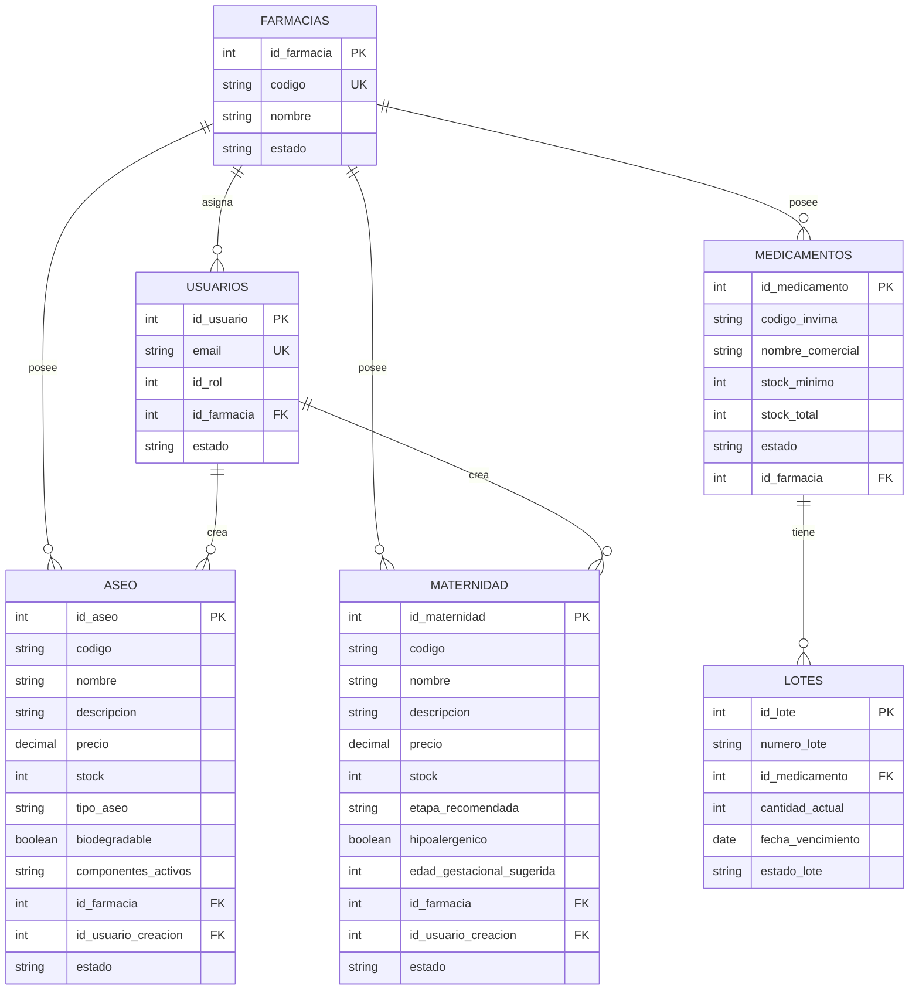

# Segregación por farmacia: modelo de datos

Cómo se separa la información de cada farmacia en la base de datos PostgreSQL de Neon. Fuente de las columnas: los scripts de `src/sql/` y las sentencias SQL del código. Código: `src/CareStock/src/main/java/org/example/carestock/` en `main`, con el cambio de la HU.94 (`CatalogoDao`). Los números de línea corresponden a esa versión.

## 1. Diagrama entidad-relación



Los tipos de `ASEO` y `MATERNIDAD` se infieren de cómo los usa el DAO (por ejemplo, `setBigDecimal` para el precio). Las columnas y la clave foránea se deducen de las sentencias `INSERT`, `UPDATE` y `SELECT` de `CatalogoDao`.

## 2. Cómo se separa cada tabla

| Tabla | Cómo queda ligada a una farmacia | Qué lo garantiza |
|---|---|---|
| `FARMACIAS` | Es el catálogo de sedes | El código es único (`ddl/04_multifarmacia_inventario.sql`) |
| `USUARIOS` | Columna `id_farmacia` | Clave foránea a `FARMACIAS` (`ddl/05_superadmin_jerarquia_usuarios_issue_456.sql`) |
| `MEDICAMENTOS` | Columna `id_farmacia`, obligatoria | `NOT NULL` con clave foránea, y un índice único `(id_farmacia, codigo_invima)` (`ddl/04_multifarmacia_inventario.sql`) |
| `LOTES` | **Indirecta**: pertenece a la farmacia de su medicamento | No tiene `id_farmacia`; las consultas y la sincronización de vencimientos unen con `MEDICAMENTOS` |
| `ASEO` | Columna `id_farmacia` | Las sentencias de `CatalogoDao` la usan siempre en el `WHERE` |
| `MATERNIDAD` | Columna `id_farmacia` | Igual que `ASEO` |

Consecuencia del índice único de `MEDICAMENTOS`: el mismo código INVIMA puede existir en dos farmacias, pero no repetirse dentro de una.

## 3. Lo que este documento no puede afirmar

- Las tablas `aseo` y `maternidad` **no tienen script en el repositorio**. Existen en Neon, pero las restricciones (clave foránea a `farmacias`, `NOT NULL` en `id_farmacia`, unicidad del código por farmacia) no se pueden comprobar leyendo el código.
- `LOTES` no tiene `id_farmacia` propio, así que la separación depende de que toda consulta de lotes pase por `MEDICAMENTOS`.

Para completar el diagrama con la estructura real, se puede consultar en el editor SQL de Neon:

```sql
SELECT table_name, column_name, data_type, is_nullable
FROM information_schema.columns
WHERE table_schema = 'public' AND table_name IN ('aseo', 'maternidad')
ORDER BY table_name, ordinal_position;
```

y las restricciones con:

```sql
SELECT conrelid::regclass AS tabla, conname, pg_get_constraintdef(oid) AS definicion
FROM pg_constraint
WHERE conrelid IN ('aseo'::regclass, 'maternidad'::regclass);
```
