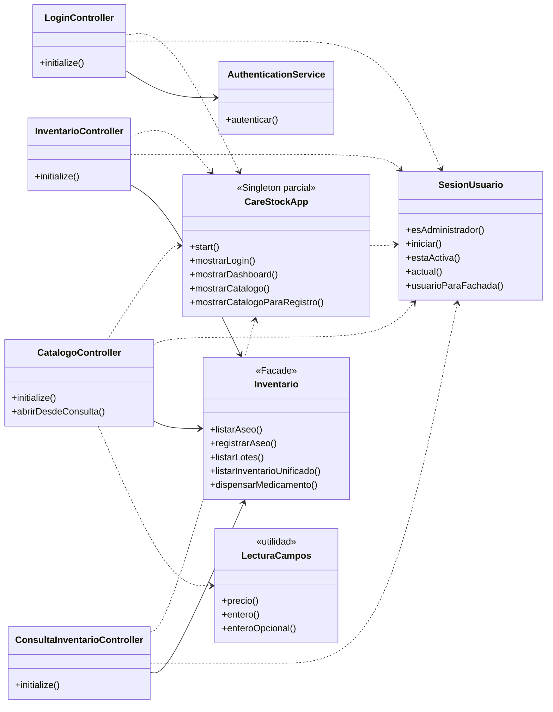
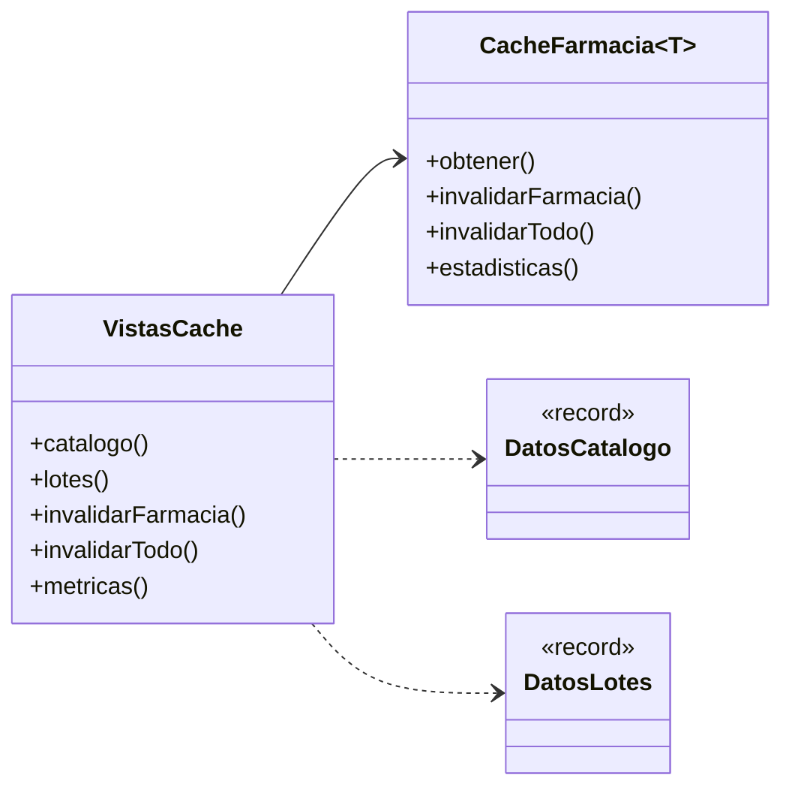

# Diagrama de clases (versión actual) — CareStock

Reemplaza al diagrama de `src/CareStock/src/Diagrama.puml`, que cubre solo 21 de las 41 clases principales. Código: `src/CareStock/src/main/java/org/example/carestock/` en `main`, con el cambio de la HU.94 (`CatalogoDAO`). Los números de línea corresponden a esa versión.

Cómo leerlo: `-->` es "tiene o crea una instancia de"; `..>` es "usa"; `..|>` es "implementa"; `--|>` es "extiende"; `o--` es "contiene una referencia". Los patrones de diseño van marcados entre `<<...>>`.

## 1. Presentación, sesión y fachada

## 2. Fachada, servicios, proxy y acceso a datos

## 3. Dominio y creación de productos

## 4. Cachés genéricas sin uso actual

Estas cuatro clases están en el repositorio, pero ninguna otra clase las usa todavía.

## 5. Dónde está cada patrón

| Patrón | Tipo | Clases | Qué se ve en el código |
|---|---|---|---|
| Builder con Director | Creacional | `Producto`, los 5 `...Builder` y `ProductoDirector` | Cada constructor implementa `Producto` y hace `new` de su entidad; el director recibe un constructor |
| Singleton | Creacional | `InventarioConsultas` | Constructor privado (L19) y un único `PROXY` estático creado en la línea 14 |
| Facade | Estructural | `Inventario` | Las tres pantallas hablan solo con él, y él crea y reparte el trabajo entre DAO y servicios |
| Proxy | Estructural | `ConsultaInventarioProxy` | Implementa `ConsultaInventario`, igual que `ConsultaInventarioDAO`, y guarda el real en el campo `real` (L51) |
| Template Method | Comportamiento | `CatalogoDAO`, `AseoDAO` y `MaternidadDAO` | `CatalogoDAO` define el flujo común en métodos `final` y las subclases completan los ganchos (`tabla`, `asignarCampos`, `construir`...) |

## 6. Relaciones y dónde verlas en el código

Ruta base: `src/CareStock/src/main/java/org/example/carestock/`.

### Presentación → fachada y servicios

| Clase | Archivo | Relación (línea) |
|---|---|---|
| `LoginController` | `controller/LoginController.java` | instancia `AuthenticationService` (L23); usa `SesionUsuario` (L75); usa `CareStockApp` (L78) |
| `InventarioController` | `controller/InventarioController.java` | instancia `Inventario` (L72); usa `SesionUsuario` (L69); usa `CareStockApp` (L224) |
| `CatalogoController` | `controller/CatalogoController.java` | instancia `Inventario` (L133); usa `SesionUsuario` (L134); usa `CareStockApp` (L541); instancia `AseoBuilder` (L774); instancia `MaternidadBuilder` (L801); usa `LecturaCampos` (L725) |
| `ConsultaInventarioController` | `controller/ConsultaInventarioController.java` | instancia `Inventario` (L86); usa `InventarioConsultas` (L407); usa `FiltroProductoInventario` (L178); usa `SesionUsuario` (L60); usa `CareStockApp` (L445) |
| `CareStockApp` | `CareStockApp.java` | usa `SesionUsuario` (L68) |

### Fachada, servicios, proxy y DAO

| Clase | Archivo | Relación (línea) |
|---|---|---|
| `Inventario` | `facade/Inventario.java` | instancia `AseoDAO` (L26); instancia `MaternidadDAO` (L27); instancia `MedicamentoDAOImpl` (L30); instancia `MedicamentoCatalogoDAO` (L33); instancia `LoteDAOImpl` (L35); instancia `RegistroLoteService` (L41); instancia `FarmacovigilanciaService` (L44); instancia `ControlVencimientosService` (L47); usa `InventarioConsultas` (L38); usa `SesionUsuario` (L60); usa `ConexionBD` (L75) |
| `InventarioConsultas` | `proxy/InventarioConsultas.java` | instancia `ConsultaInventarioProxy` (L14); instancia `ConsultaInventarioDAO` (L15) |
| `ConsultaInventarioProxy` | `proxy/ConsultaInventarioProxy.java` | implementa `ConsultaInventario` (L28); usa `SesionUsuario` (L113) |
| `ConsultaInventarioDAO` | `dao/ConsultaInventarioDAO.java` | implementa `ConsultaInventario` (L18); usa `ConexionBD` (L70) |
| `AuthenticationService` | `service/AuthenticationService.java` | instancia `UsuarioDAOImpl` (L14) |
| `SesionUsuario` | `session/SesionUsuario.java` | usa `InventarioConsultas` (L47); usa `ConexionBD` (L68); instancia `Usuario` (L117) |
| `FarmacovigilanciaService` | `service/FarmacovigilanciaService.java` | usa `ConexionBD` (L35) |
| `RegistroLoteService` | `service/RegistroLoteService.java` | usa `ConexionBD` (L23); usa `Lote` (L12) |
| `ControlVencimientosService` | `service/ControlVencimientosService.java` | usa `ConexionBD` (L22) |
| `UsuarioDAOImpl` | `dao/UsuarioDAOImpl.java` | implementa `UsuarioDAO` (L10); usa `ConexionBD` (L17); instancia `Usuario` (L24) |
| `MedicamentoDAOImpl` | `dao/MedicamentoDAOImpl.java` | implementa `MedicamentoDAO` (L13); usa `ConexionBD` (L24); instancia `Medicamento` (L169) |
| `MedicamentoCatalogoDAO` | `dao/MedicamentoCatalogoDAO.java` | usa `ConexionBD` (L22); instancia `Medicamento` (L101) |
| `LoteDAOImpl` | `dao/LoteDAOImpl.java` | usa `ConexionBD` (L19); instancia `Lote` (L141) |
| `CatalogoDAO` | `dao/CatalogoDAO.java` | usa `ConexionBD` (L43) |
| `AseoDAO` | `dao/AseoDAO.java` | extiende `CatalogoDAO` (L12); instancia `AseoBuilder` (L45) |
| `MaternidadDAO` | `dao/MaternidadDAO.java` | extiende `CatalogoDAO` (L13); instancia `MaternidadBuilder` (L49) |

### Dominio y creación

| Clase | Archivo | Relación (línea) |
|---|---|---|
| `Medicamento` | `model/Medicamento.java` | implementa `Validable` (L7); instancia `MedicamentoBuilder` (L81) |
| `Lote` | `model/Lote.java` | implementa `Validable` (L8) |
| `Aseo` | `model/Aseo.java` | implementa `Validable` (L5) |
| `Maternidad` | `model/Maternidad.java` | implementa `Validable` (L5) |
| `Cosmetico` | `model/Cosmetico.java` | implementa `Validable` (L5) |
| `DispositivoMedico` | `model/DispositivoMedico.java` | implementa `Validable` (L7) |
| `MedicamentoBuilder` | `model/MedicamentoBuilder.java` | implementa `Producto` (L4); instancia `Medicamento` (L13) |
| `AseoBuilder` | `model/AseoBuilder.java` | implementa `Producto` (L6); instancia `Aseo` (L16) |
| `MaternidadBuilder` | `model/MaternidadBuilder.java` | implementa `Producto` (L5); instancia `Maternidad` (L15) |
| `CosmeticoBuilder` | `model/CosmeticoBuilder.java` | implementa `Producto` (L4); instancia `Cosmetico` (L11) |
| `DispositivoMedicoBuilder` | `model/DispositivoMedicoBuilder.java` | implementa `Producto` (L3); instancia `DispositivoMedico` (L13) |
| `ProductoDirector` | `model/ProductoDirector.java` | usa `Producto` (L3); usa `AseoBuilder` (L51); usa `MaternidadBuilder` (L75) |

### Cachés genéricas (sin uso actual)

| Clase | Archivo | Relación (línea) |
|---|---|---|
| `VistasCache` | `proxy/VistasCache.java` | usa `CacheFarmacia` (L13); usa `DatosCatalogo` (L13); usa `DatosLotes` (L18) |

## 7. Observaciones

- Hay un patrón de comportamiento explícito (Template Method). La rúbrica pide dos por tipo, y falta un segundo de comportamiento.
- `ReglaNegocioException` y `LoteDAO` están en su carpeta del módulo en este zip; no se dibujan en estos diagramas para no recargarlos.
- `VistasCache` y `CacheFarmacia` aún no tienen llamadores.
