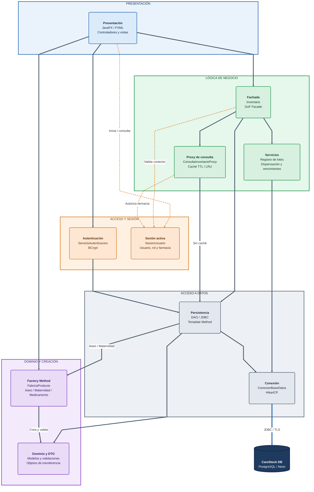

# CareStock - Diagrama de componentes C4 (nivel 3)

**Sistema:** CareStock  
**Contenedor analizado:** aplicación de escritorio JavaFX 21 sobre Java 21  
**Ubicación del código:** `src/CareStock/src/main/java/org/example/carestock/`  
**Alcance:** arquitectura implementada; no representa una API web ni microservicios.

**Nivel 3:** porque hace zoom dentro de un solo contenedor (la aplicación JavaFX) y muestra sus componentes internos y cómo se comunican. La base de datos aparece, pero únicamente como un elemento externo con el que se conecta.

## Objetivo y límites

Identificar los componentes lógicos dentro de la **misma aplicación de escritorio** y sus dependencias.

En C4, un componente representa una agrupación de responsabilidades dentro de un contenedor, no necesariamente una clase individual ni un proceso independiente.

La arquitectura se organiza mediante el patrón **Modelo-Vista-Controlador (MVC)**, complementado con patrones GoF que permiten separar responsabilidades, controlar el acceso a los datos y simplificar la creación de objetos de dominio.

Los patrones implementados y representados son:

- **Factory Method (Creacional):** creación especializada de medicamentos, productos de aseo y maternidad.
- **Facade (Estructural):** centralización de operaciones del inventario mediante la clase `Inventario`.
- **Proxy (Estructural):** optimización de consultas mediante caché TTL y segregación por farmacia.
- **Template Method (Comportamiento):** reutilización del proceso de persistencia en `CatalogoDao`.

**PostgreSQL/Neon está fuera del contenedor JavaFX.** La comunicación se realiza mediante JDBC y el pool de conexiones HikariCP.

## Diagrama de componentes

**Leyenda de conectores:**

- **Gris grueso:** flujo principal de llamadas y dependencias entre componentes.
- **Naranja punteado:** consultas transversales a la sesión activa para identificar al usuario, rol y farmacia.
- **Azul grueso:** acceso final a PostgreSQL mediante JDBC sobre TLS.

## Cómo leer el diagrama

### 1. Presentación

La **presentación JavaFX** constituye el punto de entrada del usuario.

Los controladores gestionan eventos, formularios, validaciones de entrada e interacciones con los componentes internos.

Desde esta capa se invoca:

- `ServicioAutenticacion` para autenticar usuarios.
- `Inventario` para operaciones de negocio.
- Las fábricas del patrón **Factory Method** para construir los objetos correspondientes a cada categoría.

La presentación no debería ejecutar directamente sentencias SQL.

### 2. Factory Method: creación de productos

El patrón creacional **Factory Method reemplaza al anterior Builder** en la creación de productos del catálogo.

Su implementación se concentra en el paquete:

`org.example.carestock.factory`

La clase abstracta `FabricaProducto<T extends Validable>` define el mecanismo de creación, configuración y validación de productos.

Las implementaciones concretas son:

- `FabricaAseo`: crea instancias de `Aseo`.
- `FabricaMaternidad`: crea instancias de `Maternidad`.
- `FabricaMedicamento`: crea instancias de `Medicamento`.

**Flujo de creación desde JavaFX:**

1. El usuario selecciona la categoría del producto.
2. `ControladorCatalogo` recopila los datos del formulario.
3. El controlador utiliza la fábrica correspondiente.
4. La fábrica concreta instancia el modelo de dominio.
5. Se configuran los atributos y se ejecuta la validación mediante `Validable`.
6. El producto creado se entrega a la fachada `Inventario` para completar el proceso de registro.

**Flujo de reconstrucción desde PostgreSQL:**

1. `AseoDao` o `MaternidadDao` ejecuta una consulta.
2. El DAO obtiene los atributos mediante `ResultSet`.
3. Utiliza su fábrica concreta para reconstruir el objeto de dominio.
4. Retorna el producto dentro de `RegistroCatalogo`.

La creación de objetos no sustituye las responsabilidades de persistencia ni autorización de la fachada.

### 3. Fachada de inventario

La clase `Inventario` implementa el patrón estructural **Facade**.

Centraliza las operaciones de:

- Registro, consulta y actualización de productos.
- Gestión de medicamentos, aseo y maternidad.
- Administración de lotes.
- Dispensación de medicamentos.
- Consulta de inventario unificado.
- Invalidación de caché después de modificaciones.

La fachada coordina servicios y DAO, manteniendo el contexto de la farmacia activa.

No representa una API REST ni un componente ejecutable independiente.

### 4. Proxy de consultas

`ConsultaInventarioProxy` implementa el patrón estructural **Proxy** y controla el acceso a consultas del inventario.

Sus responsabilidades principales son:

- Consultar información segregada por farmacia.
- Mantener resultados temporales en caché.
- Aplicar TTL y políticas LRU.
- Evitar consultas simultáneas duplicadas.
- Validar la autorización de farmacia.
- Invalidar resultados después de operaciones que modifican existencias.

Cuando no existe una entrada válida en caché, el proxy delega la consulta al componente real de persistencia.

### 5. Persistencia y Template Method

Los DAO encapsulan la comunicación con PostgreSQL, evitando que los controladores gestionen directamente las consultas SQL.

El componente de persistencia incluye:

- `CatalogoDao`
- `AseoDao`
- `MaternidadDao`
- `MedicamentoDaoJdbc`
- `MedicamentoCatalogoDao`
- `LoteDaoJdbc`
- `UsuarioDaoJdbc`
- `ConsultaInventarioBaseDatos`

El patrón **Template Method** está presente en `CatalogoDao`, que define operaciones comunes y permite que los DAO concretos especialicen los pasos relacionados con cada categoría.

Para productos de aseo y maternidad, los DAO también utilizan las fábricas correspondientes para reconstruir los objetos.

### 6. Conexión a PostgreSQL

La clase `ConexionBaseDatos` administra el acceso a la base de datos.

Utiliza **HikariCP** para proporcionar conexiones reutilizables y reducir el costo de establecer una conexión nueva en cada consulta.

El acceso se realiza mediante:

`DAO / Servicios → ConexionBaseDatos → HikariCP → JDBC/TLS → PostgreSQL/Neon`

En esta arquitectura no existe un backend HTTP intermedio.

### 7. Sesión y autorización

`SesionUsuario` mantiene el contexto del usuario autenticado, incluyendo:

- Identificador del usuario.
- Nombre y correo electrónico.
- Rol.
- Identificador de farmacia.
- Farmacia activa.

El contexto de sesión es consultado por los componentes que necesitan validar identidad o farmacia.

La fachada valida el contexto de las operaciones y el proxy restringe las consultas a la farmacia autorizada.

La sesión no administra directamente el pool de conexiones JDBC.

## Componentes y trazabilidad al código

| Componente C4 | Archivos y paquetes reales | Responsabilidad |
|---|---|---|
| Presentación | `AplicacionCareStock.java`, `controller/*`, recursos FXML | Navegación, formularios y eventos JavaFX |
| Autenticación | `service/ServicioAutenticacion.java`, `dao/UsuarioDaoJdbc.java` | Verificación de credenciales mediante BCrypt |
| Sesión | `session/SesionUsuario.java` | Identidad, rol y farmacia activa |
| Fachada | `facade/Inventario.java` | Centralizar operaciones y validar el contexto de farmacia |
| Proxy | `proxy/ConsultaInventarioProxy.java`, `proxy/InventarioConsultas.java` | Caché por farmacia, TTL, LRU y autorización |
| Servicios | `service/ServicioRegistroLote.java`, `service/ServicioFarmacovigilancia.java`, `service/ServicioControlVencimientos.java` | Operaciones de negocio, dispensación y lotes |
| Factory Method | `factory/FabricaProducto.java`, `factory/FabricaAseo.java`, `factory/FabricaMaternidad.java`, `factory/FabricaMedicamento.java` | Crear, configurar y validar productos especializados |
| Dominio | `model/*` | Entidades y reglas de validación |
| DTO | `dto/*` | Transferencia de información entre componentes y vistas |
| DAO | `dao/*`, incluyendo `CatalogoDao` y `ConsultaInventarioBaseDatos` | SQL, reconstrucción de entidades y persistencia |
| Conexión | `config/ConexionBaseDatos.java` | Administración de conexiones JDBC mediante HikariCP |

## Reglas arquitectónicas que se deben mostrar

### 1. Un solo contenedor ejecutable

CareStock es una aplicación de escritorio desarrollada con JavaFX.

Los componentes de presentación, dominio, servicios, seguridad y persistencia forman parte del mismo contenedor.

No son microservicios independientes.

### 2. Modelo-Vista-Controlador (MVC)

Las vistas FXML presentan información y capturan entradas del usuario.

Los controladores coordinan las interacciones y delegan operaciones a las capas correspondientes.

El dominio representa los productos y sus reglas, mientras que los DAO encapsulan SQL.

### 3. Factory Method

La creación de productos se delega a fábricas especializadas.

La clase abstracta `FabricaProducto` define el Factory Method `crearInstancia()`.

Las fábricas concretas determinan qué modelo se instancia.

Este patrón permite incorporar nuevas categorías mediante nuevas implementaciones, manteniendo una estructura uniforme de creación.

### 4. Facade

`Inventario` constituye una interfaz de aplicación que centraliza las operaciones del inventario.

Su responsabilidad consiste en coordinar los componentes internos y aplicar las reglas relacionadas con el contexto del usuario y la farmacia.

### 5. Proxy

`ConsultaInventarioProxy` controla el acceso a consultas y utiliza caché para optimizar el rendimiento.

Las operaciones deben respetar la segregación por farmacia.

La invalidación permite evitar que se mantengan datos obsoletos después de modificaciones.

### 6. Template Method

`CatalogoDao` define una secuencia común de operaciones de persistencia.

Los DAO especializados implementan los pasos variables sin duplicar completamente el algoritmo.

### 7. Acceso a datos

La aplicación accede a PostgreSQL/Neon mediante conexiones proporcionadas por `ConexionBaseDatos`.

HikariCP administra el pool y JDBC ejecuta las operaciones SQL.

La base de datos se representa fuera del contenedor JavaFX.

### 8. Seguridad y segregación por farmacia

La autenticación identifica al usuario y establece el contexto de sesión.

La fachada y los componentes responsables de consultas deben validar las restricciones aplicables a la farmacia.

La presencia de `SesionUsuario` no implica por sí sola que todas las operaciones estén autorizadas.

## Relación entre los patrones GoF implementados

Los patrones implementados desempeñan responsabilidades complementarias:

| Patrón | Categoría | Componente principal | Responsabilidad |
|---|---|---|---|
| Factory Method | Creacional | `FabricaProducto` y fábricas concretas | Creación y validación de productos |
| Facade | Estructural | `Inventario` | Coordinación de operaciones de negocio |
| Proxy | Estructural | `ConsultaInventarioProxy` | Caché y control de acceso a consultas |
| Template Method | Comportamiento | `CatalogoDao` | Reutilización de algoritmos de persistencia |

Estos patrones colaboran sin reemplazar la arquitectura MVC.

## Flujo de registro de productos

El registro de un producto desde JavaFX sigue conceptualmente esta secuencia:

1. El usuario autenticado abre el catálogo.
2. Selecciona medicamentos, aseo o maternidad.
3. Completa los campos del formulario.
4. `ControladorCatalogo` selecciona la fábrica correspondiente.
5. Factory Method crea y valida el objeto de dominio.
6. El controlador entrega el objeto a `Inventario`.
7. La fachada utiliza la farmacia activa del usuario.
8. Se ejecuta la operación de persistencia mediante el DAO correspondiente.
9. El sistema invalida las entradas de caché afectadas por el cambio.
10. La interfaz actualiza la información presentada al usuario.

Este flujo permite separar la creación de objetos, las reglas de negocio, la persistencia y la presentación.

## Notas arquitectónicas

- El patrón Builder fue reemplazado por Factory Method en el catálogo de productos.
- Las fábricas pertenecen al paquete `factory`, aunque en el diagrama se agrupan visualmente con el dominio debido a su responsabilidad de creación.
- Factory Method no reemplaza la fachada ni los DAO.
- Template Method continúa definiendo las operaciones comunes de persistencia en `CatalogoDao`.
- El Proxy administra consultas y caché; no se encarga de crear productos.
- La sesión mantiene información del usuario y farmacia, pero no administra conexiones JDBC.
- La representación de componentes es lógica: todas estas responsabilidades se ejecutan dentro de la misma aplicación JavaFX.
- `InventarioConsultas` administra una instancia compartida del proxy. Esta característica no debe confundirse con el Factory Method de creación de productos.

**Diagrama previo y trazabilidad detallada:** [DIAGRAMA_COMPONENTES_GENERAL.md](DIAGRAMA_COMPONENTES_GENERAL.md).
