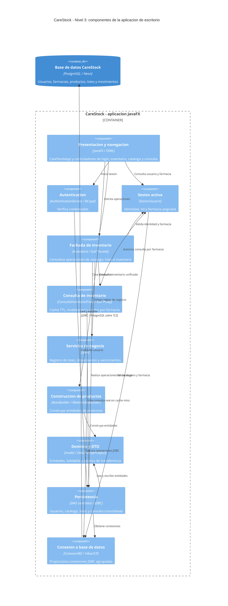

# CareStock - Diagrama de componentes C4 (nivel 3)

**Sistema:** CareStock  
**Contenedor analizado:** aplicación de escritorio JavaFX 21 sobre Java 21  
**Ubicación del código:** `src/CareStock/src/main/java/org/example/carestock/`  
**Alcance:** arquitectura implementada; no representa una API web ni microservicios.

## Objetivo y límites

Identificar los componentes lógicos dentro de la **misma aplicación de escritorio** y sus dependencias. En C4, un componente es una agrupación de responsabilidades dentro de un contenedor, no necesariamente una clase individual ni un proceso separado. **PostgreSQL/Neon está fuera** del contenedor JavaFX.

## Diagrama C4

## Componentes y trazabilidad al código

| Componente C4 | Archivos y paquetes reales | Responsabilidad |
|---|---|---|
| Presentación | `CareStockApp.java`, `controller/*`, recursos FXML | Navegación, eventos y formularios JavaFX |
| Autenticación | `service/AuthenticationService.java`, `dao/UsuarioDAOImpl.java` | Validar contraseñas BCrypt |
| Sesión | `session/SesionUsuario.java` | Identidad del usuario, rol y farmacia activa |
| Fachada | `facade/Inventario.java` | Centralizar operaciones y verificar contexto de farmacia |
| Proxy | `proxy/ConsultaInventarioProxy.java`, `proxy/InventarioConsultas.java` | Caché de inventario por farmacia e invalidación |
| Servicios | `service/RegistroLoteService.java`, `service/FarmacovigilanciaService.java`, `service/ControlVencimientosService.java` | Reglas y procesos transaccionales |
| Builder | `model/AseoBuilder.java`, `model/MaternidadBuilder.java` | Construcción de productos desde el catálogo |
| Dominio/DTO | `model/*`, `DataTransferObject/*` | Entidades, validaciones y datos transferidos |
| DAO | `dao/*` (incluye `CatalogoDAO`, `ConsultaInventarioDAO`, `LoteDAOImpl`) | SQL, mapeo de filas y persistencia |
| Conexión | `config/ConexionBD.java` | Pool HikariCP y conexiones JDBC |

## Reglas arquitectónicas que se deben mostrar

1. **Un solo contenedor ejecutable:** JavaFX reúne interfaz, negocio y persistencia; los componentes no son microservicios.
2. **MVC:** las vistas FXML y controladores interactúan con el dominio y la fachada; los DAO encapsulan SQL.
3. **Facade:** `Inventario` coordina servicios y DAO, pero no es una API REST.
4. **Proxy:** `ConsultaInventarioProxy` usa el DAO real al faltar caché, aplica TTL y autorización por farmacia.
5. **Builder:** los builders de aseo y maternidad participan en la creación de productos del catálogo.
6. **Datos:** la aplicación llega a Neon mediante `ConexionBD`, HikariCP, JDBC y PostgreSQL; no existe un backend HTTP intermedio.
7. **Seguridad:** el contexto de farmacia se verifica en la sesión/fachada y en las consultas; no debe interpretarse como autorización universal para todas las operaciones.

**Nota:** El proyecto también contiene `ProductoDirector`, otros builders y tipos de caché. Su existencia no significa que todos participen en los flujos de las pantallas actuales. Esta vista prioriza los componentes integrados.

**Diagrama previo y trazabilidad detallada:** [DIAGRAMA_COMPONENTES_GENERAL.md](DIAGRAMA_COMPONENTES_GENERAL.md).
