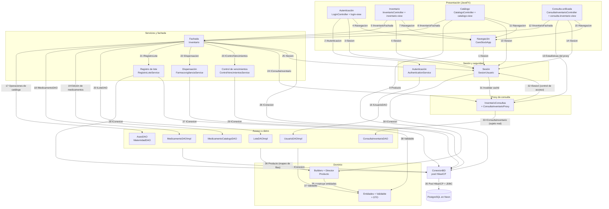

# Diagrama de componentes general — CareStock (versión actual)

Actualiza el diagrama anterior con el código vigente de `main`. Código: `src/CareStock/src/main/java/org/example/carestock/` en `main`, con el cambio de la HU.94 (`CatalogoDAO`). Los números de línea corresponden a esa versión.

Cada flecha lleva un número. La tabla de la sección 2 dice, para cada número, **en qué archivo y línea del código se ve esa conexión**.

## 1. Diagrama

Cómo leerlo: un rectángulo es un componente; una flecha va del componente que **usa** al que **provee**, y su rótulo es la interfaz o el servicio que se pide.

## 2. Cada conexión y dónde verla en el código

Ruta base: `src/CareStock/src/main/java/org/example/carestock/`.

| N.º | De → a | Interfaz o servicio | Archivo | Línea | Qué se ve ahí |
|---|---|---|---|---|---|
| 1 | Navegación → Sesión | ISesion | `CareStockApp.java` | 68 | `SesionUsuario.cerrar()` en `mostrarLogin()`; `estaActiva()` protege las pantallas (L83, L101, L143) y `esAdministrador()` el formulario de catálogo (L144) |
| 2 | Autenticación (UI) → Servicio de autenticación | IAutenticacion | `controller/LoginController.java` | 23 | `this.authService = new AuthenticationService()` en el constructor |
| 3 | Autenticación (UI) → Sesión | ISesion | `controller/LoginController.java` | 75 | `SesionUsuario.iniciar(usuarioValido)` |
| 4 | Autenticación (UI) → Navegación | INavegacion | `controller/LoginController.java` | 78 | `CareStockApp.getInstance().mostrarDashboard()` |
| 5 | Inventario (UI) → Fachada | IInventarioFachada | `controller/InventarioController.java` | 72 | `inventario = new Inventario(SesionUsuario.usuarioParaFachada())` |
| 6 | Inventario (UI) → Sesión | ISesion | `controller/InventarioController.java` | 69 | `SesionUsuario.estaActiva()`, antes de crear la fachada (L72) |
| 7 | Inventario (UI) → Navegación | INavegacion | `controller/InventarioController.java` | 224 | `CareStockApp.getInstance().mostrarCatalogo()` |
| 8 | Catálogo (UI) → Fachada | IInventarioFachada | `controller/CatalogoController.java` | 133 | `inventario = new Inventario(...)` |
| 9 | Catálogo (UI) → Creación de productos | Producto | `controller/CatalogoController.java` | 774 | `new AseoBuilder()` y `new MaternidadBuilder()` (L801) |
| 10 | Catálogo (UI) → Sesión | ISesion | `controller/CatalogoController.java` | 134 | `SesionUsuario.usuarioParaFachada()`; `esAdministrador()` decide si se puede editar (L152) |
| 11 | Catálogo (UI) → Navegación | INavegacion | `controller/CatalogoController.java` | 542 | `mostrarConsultaUnificada()` |
| 12 | Consulta unificada (UI) → Fachada | IInventarioFachada | `controller/ConsultaInventarioController.java` | 86 | `inventario = new Inventario(...)`; consulta con `listarInventarioUnificado()` (L329) |
| 13 | Consulta unificada (UI) → Proxy de consulta | Estadísticas del proxy | `controller/ConsultaInventarioController.java` | 407 | `InventarioConsultas.compartida()` para leer las estadísticas de la caché |
| 14 | Consulta unificada (UI) → Sesión | ISesion | `controller/ConsultaInventarioController.java` | 60 | Guarda un `SesionUsuario.DatosUsuario` (`sesionVista`) y usa `esAdministrador()` (L199) |
| 15 | Consulta unificada (UI) → Navegación | INavegacion | `controller/ConsultaInventarioController.java` | 446 | `mostrarCatalogoParaRegistro` y `mostrarCatalogoParaEditar` (L468) |
| 16 | Servicio de autenticación → DAO de usuarios | IUsuarioDAO | `service/AuthenticationService.java` | 14 | `new UsuarioDAOImpl()`; `buscarPorEmail` en L22 y `BCrypt.checkpw` en L31 |
| 17 | Fachada → DAO de catálogo | Operaciones de catálogo | `facade/Inventario.java` | 26 | `new AseoDAO()` y `new MaternidadDAO()` (L27) |
| 18 | Fachada → DAO de medicamentos | IMedicamentoDAO | `facade/Inventario.java` | 30 | `new MedicamentoDAOImpl()` |
| 19 | Fachada → DAO de edición de medicamentos | Edición de medicamentos | `facade/Inventario.java` | 33 | `new MedicamentoCatalogoDAO()` |
| 20 | Fachada → DAO de lotes | ILoteDAO | `facade/Inventario.java` | 35 | `new LoteDAOImpl()`; se usa en L353 |
| 21 | Fachada → Registro de lote | IRegistroLote | `facade/Inventario.java` | 41 | `new RegistroLoteService()` |
| 22 | Fachada → Dispensación | IDispensacion | `facade/Inventario.java` | 44 | `new FarmacovigilanciaService()` |
| 23 | Fachada → Control de vencimientos | IControlVencimientos | `facade/Inventario.java` | 47 | `new ControlVencimientosService()`; `sincronizar` se llama al listar los lotes (L346) |
| 24 | Fachada → Proxy de consulta | IConsultaInventario | `facade/Inventario.java` | 38 | Campo `consulta = InventarioConsultas.compartida()`; se usa en `listarInventarioUnificado` (L431) |
| 25 | Fachada → Sesión | ISesion | `facade/Inventario.java` | 60 | Compara `SesionUsuario.actual().id()` con el usuario de la operación |
| 26 | Fachada → ConexionBD | IConexion | `facade/Inventario.java` | 75 | Abre una conexión para resolver la farmacia del usuario |
| 27 | Dispensación → ConexionBD | IConexion | `service/FarmacovigilanciaService.java` | 35 | SQL propio dentro de una transacción |
| 28 | Registro de lote → ConexionBD | IConexion | `service/RegistroLoteService.java` | 23 | SQL propio dentro de una transacción |
| 29 | Control de vencimientos → ConexionBD | IConexion | `service/ControlVencimientosService.java` | 22 | SQL propio dentro de una transacción (`commit` en L57) |
| 30 | Sesión → ConexionBD | IConexion | `session/SesionUsuario.java` | 68 | Consulta `usuarios` unido con `farmacias` |
| 31 | Sesión → Proxy de consulta | Invalidar caché | `session/SesionUsuario.java` | 47 | `InventarioConsultas.invalidar()` al iniciar sesión |
| 32 | Proxy de consulta → Sesión | ISesion (control de acceso) | `proxy/ConsultaInventarioProxy.java` | 113 | Lee `SesionUsuario.actual().idFarmacia()` para autorizar el acceso |
| 33 | Proxy de consulta → DAO de consulta | IConsultaInventario (sujeto real) | `proxy/InventarioConsultas.java` | 14 | `new ConsultaInventarioProxy(new ConsultaInventarioDAO(), ttl)`; el proxy guarda el real en el campo `real` (`ConsultaInventarioProxy` L51) |
| 34 | Acceso a datos → ConexionBD | IConexion | `los 7 DAO` | varias | `LoteDAOImpl` L19, `MedicamentoDAOImpl` L24, `UsuarioDAOImpl` L17, `CatalogoDAO` L43 (la usan `AseoDAO` y `MaternidadDAO`), `MedicamentoCatalogoDAO` L22, `ConsultaInventarioDAO` L70 |
| 35 | ConexionBD → PostgreSQL | Pool HikariCP + JDBC | `config/ConexionBD.java` | 26 | `getConexion()` entrega conexiones de un pool `HikariDataSource` (L21) |
| 36 | Acceso a datos → Creación de productos | Producto (mapeo de filas) | `dao/AseoDAO.java y dao/MaternidadDAO.java` | 45 | `new AseoBuilder()` en `AseoDAO` L45 y `new MaternidadBuilder()` en `MaternidadDAO` L49 |
| 37 | Acceso a datos → Dominio | Validable | `los DAO` | varias | `validar()` en `MedicamentoDAOImpl` L17, `CatalogoDAO` L32 y `LoteDAOImpl` L14 |
| 38 | Registro de lote → Dominio | Validable | `service/RegistroLoteService.java` | 21 | `lote.validar()` antes de registrar |
| 39 | Creación de productos → Dominio | construye entidades | `los 5 constructores` | varias | Cada `...Builder` hace `new` de su entidad: `AseoBuilder` L16, `MaternidadBuilder` L15, `MedicamentoBuilder` L13, `CosmeticoBuilder` L11, `DispositivoMedicoBuilder` L13 |

## 3. Qué cambió frente a la versión anterior

| Antes | Ahora |
|---|---|
| `InventarioController` llamaba a los DAO directamente | Usa la fachada `Inventario` (flecha 5) |
| No existía el proxy | `InventarioConsultas` y `ConsultaInventarioProxy` guardan en caché la consulta por farmacia y verifican la sesión (flechas 24, 31, 32 y 33) |
| Al listar lotes solo se leían | La fachada llama antes a `ControlVencimientosService.sincronizar`, que marca como `VENCIDO` los lotes disponibles de la farmacia cuya fecha ya pasó y recalcula el stock de esos medicamentos (flechas 23 y 29) |
| La conexión se abría con `DriverManager` | `ConexionBD` usa un pool de conexiones HikariCP (flecha 35) |
| Cualquier usuario podía abrir el formulario del catálogo | Solo el rol `ADMINISTRADOR` puede modificar productos (flechas 1, 10 y 14) |
| La pantalla de consulta unificada no tenía FXML | Ya existe `consulta-inventario-view.fxml` |
| Había 3 DAO de catálogo con flujo repetido | `AseoDAO` y `MaternidadDAO` extienden `CatalogoDAO` (patrón Template Method) |

## 4. Patrones que se ven en este diagrama

| Patrón | Tipo | Componente | Flechas |
|---|---|---|---|
| Facade | Estructural | `Inventario` | 5, 8 y 12 (las pantallas hablan con la fachada) y 17 a 26 (la fachada reparte el trabajo) |
| Proxy | Estructural | `ConsultaInventarioProxy` | 24, 32 y 33 |
| Builder con Director | Creacional | `Producto` y los 5 `...Builder` | 9, 36 y 39 |
| Singleton | Creacional | `InventarioConsultas` | 13, 24 y 31 |
| Template Method | Comportamiento | `AseoDAO` y `MaternidadDAO` sobre `CatalogoDAO` | Dentro del componente "DAO de catálogo" (flechas 17 y 34) |

## 5. Puntos que conviene conocer antes de exponer

- Las clases `VistasCache` y `CacheFarmacia` (con `DatosCatalogo` y `DatosLotes`) existen en `proxy/` y `DataTransferObject/`, pero **ninguna otra clase las usa todavía**; por eso no aparecen en el diagrama. La caché que sí funciona es la del propio `ConsultaInventarioProxy`.
- La restricción por rol `ADMINISTRADOR` se comprueba en las pantallas (`CareStockApp` L144, `CatalogoController` L1075); la fachada `Inventario` no la comprueba.
- En este zip `ReglaNegocioException` y `LoteDAO` están en su carpeta del módulo (`exception/` y `dao/`). Si en GitHub siguen en `src/test/java`, hay que moverlas para que el módulo compile.
- Ya hay dos pruebas con JUnit (`ConsultaInventarioProxyTest` y `FiltroProductoInventarioTest`); no hay pruebas de los DAO ni de la fachada.
