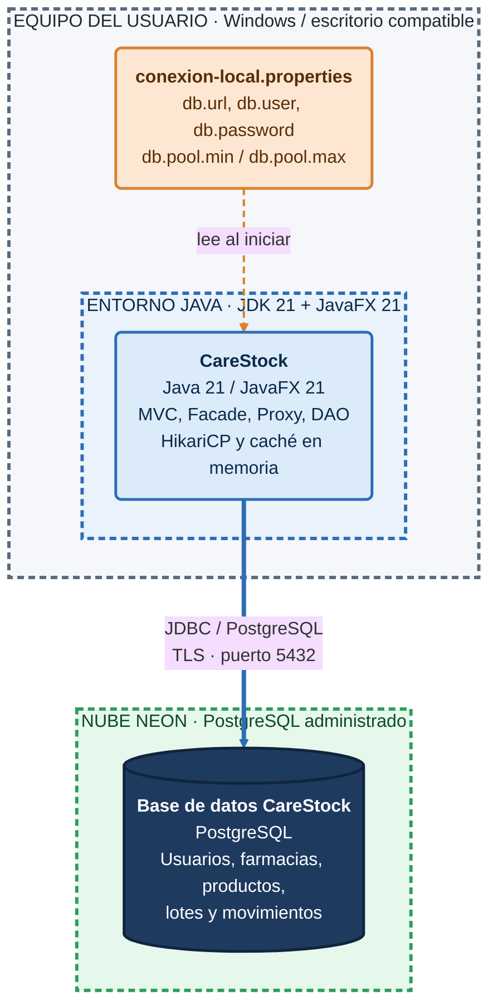
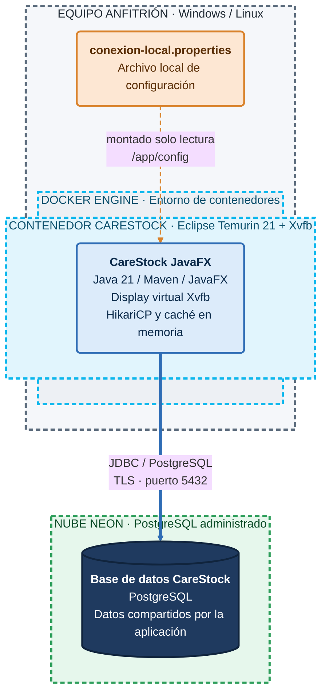

# CareStock - Diagrama de despliegue C4

**Tipo:** diagrama de despliegue (vista complementaria al C4 estático)  
**Sistema:** CareStock, aplicación JavaFX 21 / Java 21  
**Escenarios:** ejecución local habitual y ejecución Docker opcional.

## Alcance

Se muestran **instancias ejecutadas** y los nodos que las alojan. No se presenta GitHub, Maven ni GitHub Actions como servidores de producción: pertenecen al proceso de construcción y entrega. Neon aloja la base PostgreSQL y **no** ejecuta una API de CareStock.

**Leyenda de los diagramas:**

- **Cajas grandes con borde punteado:** nodos de despliegue (equipo, JVM, Docker, nube). Los nodos anidados se ejecutan dentro del que los contiene.
- **Recuadros redondeados:** software que se ejecuta (la aplicación CareStock).
- **Cilindro:** base de datos.
- **Flecha azul gruesa:** conexión de datos por JDBC sobre TLS.
- **Flecha naranja punteada:** lectura de la configuración local.

## Escenario A - Ejecución local del sistema

**Recorrido:** el usuario interactúa con ventanas JavaFX en su equipo. La JVM ejecuta el código de CareStock, lee la configuración local y abre conexiones con Neon a través de HikariCP/JDBC. No hay navegador, SPA ni API HTTP intermedia en la arquitectura actual.

## Escenario B - Ejecución Docker opcional

**Importante:** el `Dockerfile` ejecuta JavaFX mediante `xvfb-run`; esto **no publica una interfaz web** ni implica que se pueda ver la GUI automáticamente desde un navegador. Docker es una opción de empaquetado y ejecución, no el contenedor lógico C4 del nivel 2.

## Nodos, tecnología y artefactos

| Nodo | Tecnología | Qué contiene o ejecuta |
|---|---|---|
| Equipo del usuario | Sistema operativo con Java 21 y JavaFX 21 | Aplicación de escritorio CareStock |
| JVM | Java 21 | Controladores, servicios, modelos, DAO, HikariCP y caché en memoria |
| Nube Neon | PostgreSQL administrado | Base de datos persistente |
| Docker Engine (opcional) | Docker / Compose | Contenedor construido desde `src/CareStock/Dockerfile` |
| Contenedor Docker (opcional) | Eclipse Temurin 21, Xvfb | Ejecución JavaFX sobre display virtual |

## Conexiones y configuración

- **Aplicación a Neon:** JDBC con protocolo PostgreSQL, puerto típico **5432**, con TLS exigido mediante `sslmode=require` en la URL de ejemplo.
- **Credenciales y parámetros:** archivo local `src/CareStock/config/conexion-local.properties`, leído por `ConexionBD.java`. Las claves son `db.url`, `db.user`, `db.password`, `db.pool.max` y `db.pool.min`.
- **Configuración de referencia:** `src/CareStock/config/conexion-local.properties.example`. Nunca versionar credenciales reales.
- **Docker Compose:** `compose.yaml` monta el archivo `conexion-local.properties` en `/app/config/conexion-local.properties` en modo solo lectura.
- **Rendimiento:** HikariCP administra el pool de conexiones; el Proxy mantiene su caché en memoria dentro del proceso Java.

## Alcances que NO deben aparecer como hechos implementados

- No existe servidor HTTP, API REST, Spring Boot, microservicios, balanceador, Kubernetes o Redis operando en la arquitectura actual.
- No se ejecuta una aplicación web o móvil para los usuarios finales.
- GitHub Actions ayuda a construir y comprobar software; no es un nodo que hospeda permanentemente la aplicación.
- Docker no es obligatorio para la instalación local ni equivale al nivel de contenedores C4.

## Evidencia en el repositorio

- `src/CareStock/pom.xml`: Java 21, dependencias JavaFX y Maven.
- `src/CareStock/src/main/java/org/example/carestock/CareStockApp.java`: entrada JavaFX.
- `src/CareStock/src/main/java/org/example/carestock/config/ConexionBD.java`: JDBC y HikariCP con configuración local.
- `src/CareStock/config/conexion-local.properties.example`: configuración de base de datos.
- `src/CareStock/Dockerfile` y `compose.yaml`: ejecución Docker opcional.

**Diagrama histórico:** [DIAGRAMA_DESPLIEGUE.md](DIAGRAMA_DESPLIEGUE.md).
