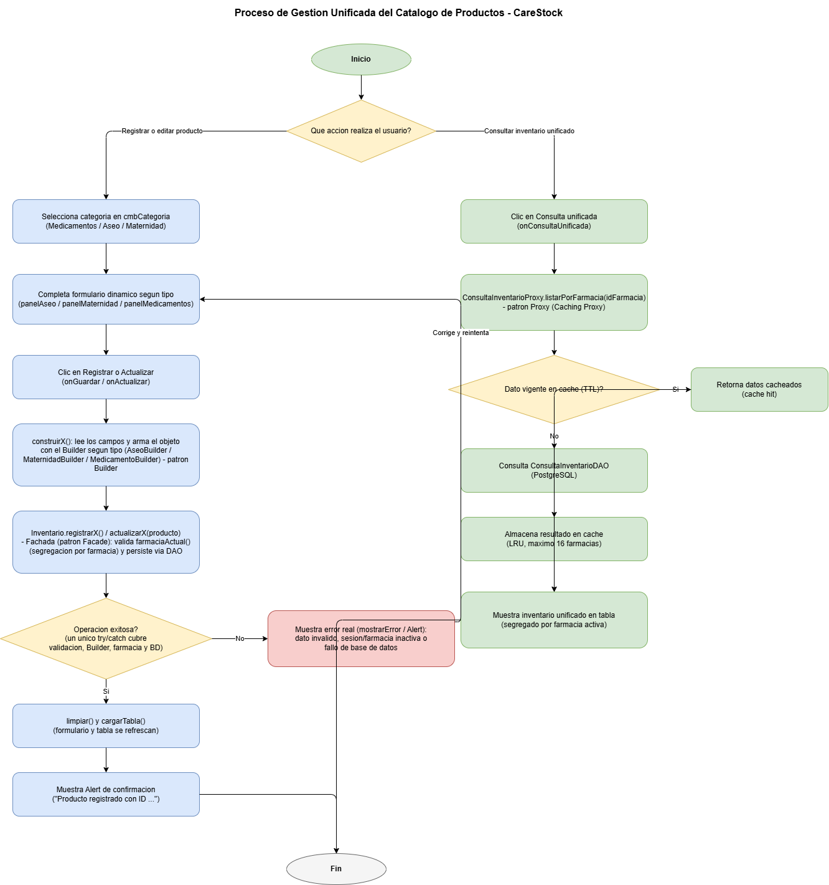

# Proceso de Gestión Unificada del Catálogo (HU-103)

Diagrama de procesos del catálogo — Issue padre #692 (HU-103). Código fuente: `src/CareStock/src/main/java/org/example/carestock/` en `main`.

## 1. Diagrama

El archivo editable está disponible en `PROCESO_CATALOGO_UNIFICADO.drawio` dentro de esta misma carpeta.

## 2. Descripción general

El diagrama modela dos procesos reales del catálogo de productos:

1. **Registrar o editar un producto**, iniciado desde `CatalogoController`.
2. **Consultar el inventario unificado**, iniciado desde `ConsultaInventarioController`.

Ambos procesos parten de la misma pantalla de catálogo y conviven en la misma vista, pero siguen caminos distintos una vez el usuario decide qué acción realizar.

## 3. Flujo 1: Registrar o editar un producto

| Paso en el diagrama | Clase / método real |
| :--- | :--- |
| Selecciona categoría | `cmbCategoria` en `catalogo-view.fxml` |
| Completa formulario dinámico | `panelAseo` / `panelMaternidad` / `panelMedicamentos` |
| Clic en Registrar o Actualizar | `CatalogoController.onGuardar()` / `onActualizar()` |
| Construye el objeto con el Builder | `construirAseo()` / `construirMaternidad()` / `construirMedicamento()` |
| Llama a la Fachada | `Inventario.registrarX()` / `actualizarX()` |
| Valida sesión y farmacia activa | `Inventario.farmaciaActual()` |
| Persiste el registro | DAO correspondiente (`AseoDAO`, `MaternidadDAO`, `MedicamentoDAOImpl`) |
| Único punto de error | el `catch (Exception e)` de `onGuardar()` cubre validación, Builder, farmacia y base de datos a la vez — no hay rutas de error separadas en el código real |
| Confirmación | `limpiar()` + `cargarTabla()` + `Alert` de información |

**Nota importante de fidelidad:** el código real envuelve la construcción del objeto, la llamada a la Fachada y la persistencia dentro de un único bloque `try`, con un único `catch` genérico. Por eso el diagrama muestra una sola decisión de éxito/error en este flujo, no dos como en un primer borrador.

## 4. Flujo 2: Consulta unificada del inventario

| Paso en el diagrama | Clase / método real |
| :--- | :--- |
| Clic en "Consulta unificada" | `CatalogoController.onConsultaUnificada()` |
| Solicita datos por farmacia | `ConsultaInventarioProxy.listarPorFarmacia(idFarmacia)` |
| Evalúa vigencia de caché (TTL) | `ConsultaInventarioProxy` (caché LRU, máximo 16 farmacias) |
| Si hay acierto de caché | retorna los datos ya almacenados (cache hit) |
| Si no hay acierto | `ConsultaInventarioDAO` consulta PostgreSQL y el resultado se guarda en caché |
| Muestra resultado | tabla de `ConsultaInventarioController`, siempre segregada por la farmacia activa de la sesión |

## 5. Trazabilidad a patrones GoF

| Patrón GoF | Clase que lo implementa | Rol en el proceso |
| :--- | :--- | :--- |
| **Facade** | `Inventario` | Unifica el acceso a los DAO de Aseo, Maternidad y Medicamentos, y centraliza la validación de farmacia activa |
| **Builder** | `AseoBuilder`, `MaternidadBuilder`, `MedicamentoBuilder` | Construye el objeto de dominio correspondiente según el tipo de producto elegido en el formulario |
| **Proxy (Caching Proxy)** | `ConsultaInventarioProxy` | Intercepta las consultas de inventario unificado, evita golpear la base de datos si el resultado sigue vigente en caché |

## 6. Referencias de código

- `org.example.carestock.controller.CatalogoController`
- `org.example.carestock.controller.ConsultaInventarioController`
- `org.example.carestock.facade.Inventario`
- `org.example.carestock.model.AseoBuilder`, `MaternidadBuilder`, `MedicamentoBuilder`
- `org.example.carestock.proxy.ConsultaInventarioProxy`, `InventarioConsultas`
