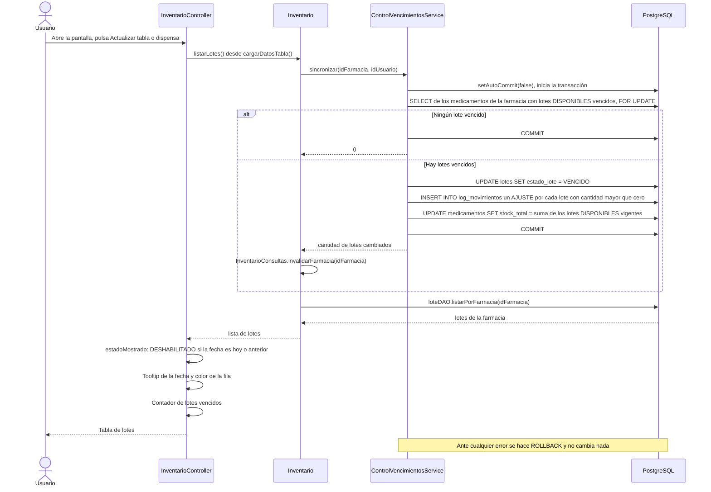

# Flujo del estado de un lote por vencimiento

Cómo cambia el estado de un lote cuando llega su fecha de vencimiento: quién lo detecta, qué escribe en la base de datos y cómo lo muestra la pantalla de inventario. Verificado sobre el código del repositorio en el commit `e89a0fa` (19 de octubre de 2026).

---

## 1. Diagrama de secuencia

Un lote vencido es el que tiene fecha de vencimiento **hoy o anterior**. La interfaz pinta de rojo su fila, pone un tooltip en la fecha ("Vence en N días", "Vence hoy" o "Vencido hace N días") y pinta de naranja las filas de los lotes que no están `DISPONIBLE`.

---

## 2. Qué queda registrado

| Situación | ¿Queda registro en `log_movimientos`? |
|---|---|
| Lote que pasa a `VENCIDO` con cantidad mayor que cero | **Sí.** Un `AJUSTE` con la cantidad del lote, el detalle "Deshabilitacion automatica por vencimiento" y el usuario que cargó los lotes |
| Lote que pasa a `VENCIDO` con cantidad 0 | **No.** El cambio queda solo en el lote, en `id_usuario_modificacion` y `fecha_modificacion` |
| Recálculo del stock del medicamento | **No** |
| Lote próximo a vencer que todavía no vence | **No.** No cambia nada |
| Mostrar el estado, el tooltip, el color o el contador | **No** |

---

## 3. Cuándo ocurre

- **No es un proceso diario.** La sincronización solo se ejecuta cuando `InventarioController` carga los lotes con `cargarDatosTabla()`: al abrir la pantalla, al pulsar "Actualizar tabla" y después de dispensar. Ninguna otra clase la invoca y no hay ningún temporizador.
- **Un lote vencido sigue `DISPONIBLE` en la base de datos** hasta que alguien carga los lotes de esa farmacia.
- **Solo procesa la farmacia del usuario**, y el `AJUSTE` queda a nombre de ese usuario, no de un usuario del sistema.
