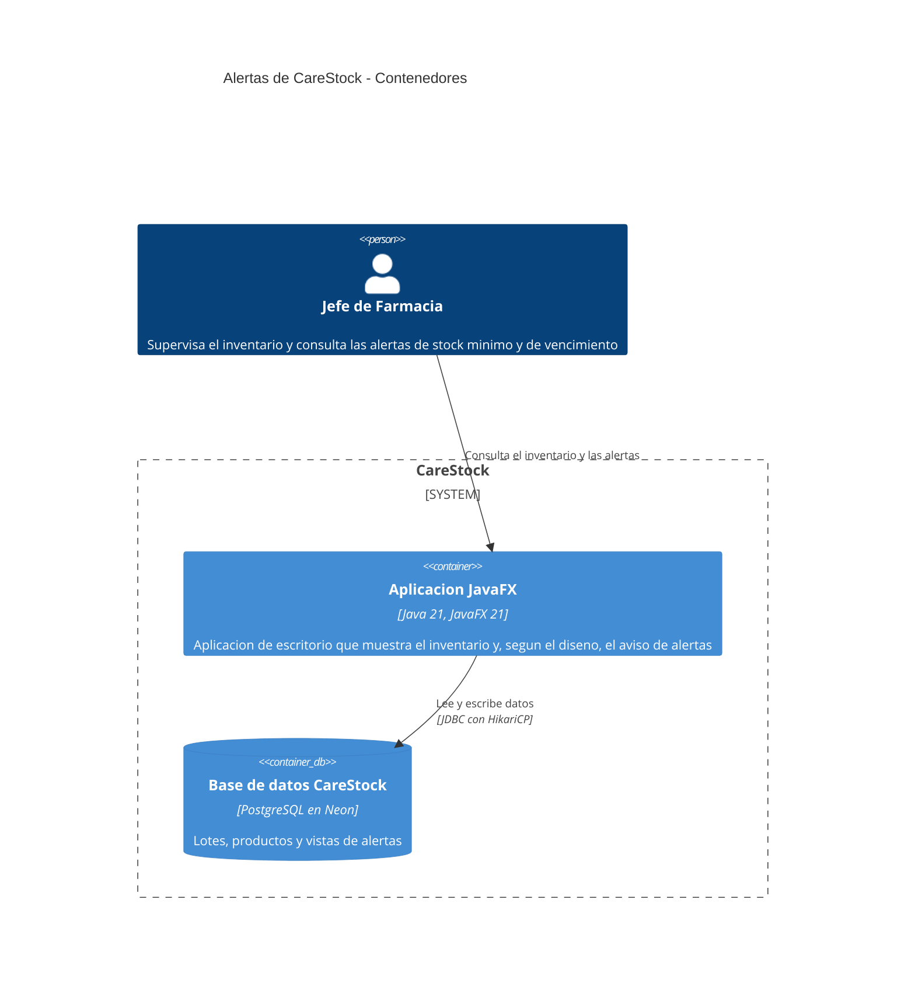

# Diagrama C4 de contenedores: alertas de CareStock

Nivel 2 de C4 (contenedores) para el sistema de alertas de CareStock: quién las consulta, qué aplicación las muestra y dónde viven los datos. Verificado sobre el código, los scripts y los documentos del repositorio en el commit `e89a0fa` (19 de octubre de 2026). Complementa el [diagrama de componentes](../DIAGRAMA_COMPONENTES_C4.md) y el [diagrama de despliegue](../DIAGRAMA_DESPLIEGUE_C4.md).

---

## 1. Diagrama de contenedores

---

## 2. Qué hace cada elemento

| Elemento | Qué es | Qué hace en las alertas |
|---|---|---|
| Jefe de Farmacia | Persona. Perfil de supervisión que describe la documentación de roles (HU59); en la base de datos los roles son `SUPER_ADMIN`, `ADMINISTRADOR` y `FARMACEUTICO` | Supervisa el inventario y, según HU59, configura el stock mínimo y parametriza las alertas de vencimiento |
| Aplicación JavaFX | Aplicación de escritorio en Java 21 y JavaFX 21 | Muestra el inventario de la farmacia y, según el diseño, el aviso de alertas |
| Base de datos CareStock | PostgreSQL administrado en Neon | Guarda lotes, medicamentos, productos de aseo y de maternidad, y las vistas de alertas `vw_alertas_vencimiento` y `vw_resumen_farmacias` |

La aplicación se conecta por JDBC con un pool de conexiones HikariCP, y la plantilla de configuración pide TLS (`sslmode=require`).

---

## 3. Estado actual

- **La aplicación no consulta hoy las vistas de alertas.** Están definidas en `src/sql/`, pero ninguna clase Java las usa; la pantalla de inventario calcula por su cuenta el estado de los lotes y un contador de lotes vencidos. El diagrama muestra dónde viven los datos de las alertas.
- **No hay más contenedores.** No existe un servidor de aplicaciones ni un servicio de notificaciones: `ARQUITECTURA_FUTURA.md` marca ese servicio como propuesto.
