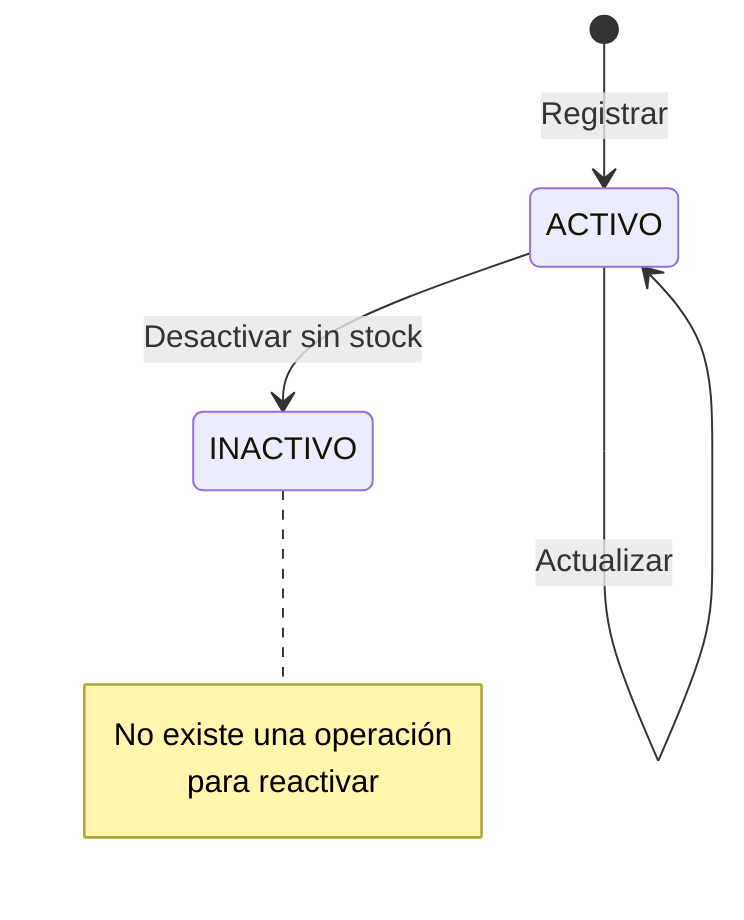

# Verificación de farmacia y ciclo de estado de un producto

Cómo se garantiza que editar o desactivar un producto solo afecte a los de la farmacia del usuario, y cómo cambia su estado. El flujo de editar un medicamento está en [`Diagrama-editar-medicamento.md`](../HU98/Diagrama-editar-medicamento.md) y el registro en [`FORMULARIO_UNICO_REGISTRO.md`](FORMULARIO_UNICO_REGISTRO.md).

---

## 1. La farmacia se verifica dentro de la consulta

La fachada `Inventario` (ver [`FACHADA_INVENTARIO.md`](FACHADA_INVENTARIO.md)) obtiene la farmacia del usuario autenticado y se la pasa al DAO. Cada `UPDATE` incluye `id_farmacia = ?` en su `WHERE`, así que un producto de otra farmacia no coincide y no se modifica. No hay una verificación previa aparte.

| Operación | Condiciones del `WHERE` |
|---|---|
| Editar medicamento | Id del medicamento, `id_farmacia` y `estado = 'ACTIVO'` |
| Desactivar medicamento | Las anteriores, más `stock_total = 0` y ningún lote con `cantidad_actual > 0` |
| Editar aseo o maternidad | Id del producto, `id_farmacia` y `estado = 'ACTIVO'` |
| Desactivar aseo o maternidad | Las mismas tres; además la fachada rechaza la operación si el producto tiene stock |

---

## 2. Ciclo de estado

---

## 3. Qué ve el usuario

| Situación | Mensaje |
|---|---|
| Actualizar un producto inexistente, inactivo o de otra farmacia | Registro inexistente, inactivo o de otra farmacia |
| Desactivar sin efecto (producto de otra farmacia o ya inactivo; en medicamentos, también con existencias) | No se pudo desactivar. Revise estado, farmacia y stock. |
| Desactivar un producto de aseo o maternidad con stock | No se pudo desactivar: No se puede desactivar un producto con stock. |

---

## 4. Estado de los casos a validar

| Caso | Estado | Evidencia |
|---|---|---|
| Producto propio: los cambios se guardan y se ven en la tabla | **Cumplido** | `Inventario.actualizarMedicamento` llama a `MedicamentoCatalogoDAO.actualizar`; `onActualizar` recarga la tabla |
| Producto de otra farmacia: se rechaza y no se modifica | **Cumplido** | El `WHERE` con `id_farmacia` no coincide y el controlador muestra la advertencia |
| Cambio de estado entre `ACTIVO` e `INACTIVO` | **Parcial** | Solo existe Desactivar; no hay forma de volver a `ACTIVO` |

---

## 5. Observaciones

Verificadas en el código:

1. **`MedicamentoDAOImpl.actualizarEstado` no filtra por farmacia.** Su `WHERE` solo usa el id del medicamento. Ninguna clase lo invoca hoy, pero usarlo desde la aplicación permitiría modificar productos de otra farmacia.
2. **Los listados incluyen los productos inactivos.** Filtran solo por farmacia. Si se selecciona uno inactivo y se pulsa Actualizar, la operación no encuentra ninguna fila activa y muestra la advertencia.
3. **`CatalogoService` no existe.** La fachada `Inventario` cumple ese papel.
