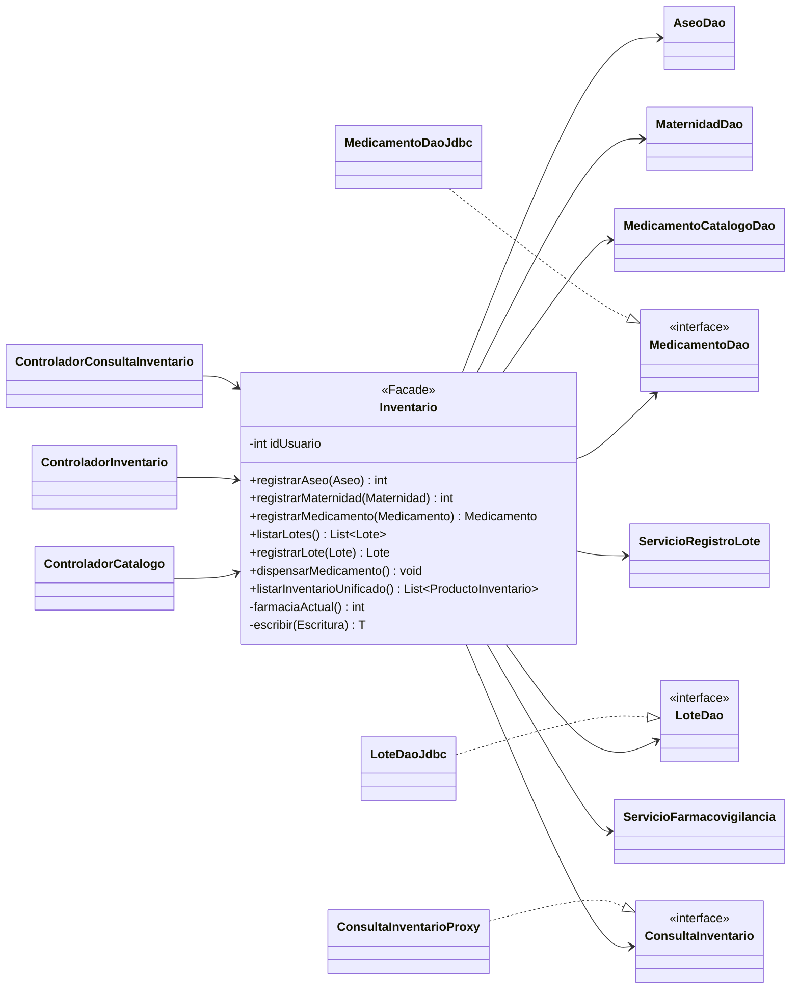

# Patrón Facade en el catálogo y el inventario (`Inventario`)

Documentación del patrón estructural **Facade** aplicado en la clase `Inventario` (`facade/Inventario.java`), que ofrece a las pantallas una única entrada para consultar y modificar el catálogo, los lotes y el inventario unificado de una farmacia.

Código fuente: `src/CareStock/src/main/java/org/example/carestock/`.

---

## 1. Problema que resuelve

Antes de la fachada, el controlador de inventario conocía y coordinaba los DAO por su cuenta. En el commit `4f5403b` (9 de octubre de 2026), `ControladorInventario`:

- creaba `new LoteDaoJdbc()` y `new MedicamentoDaoJdbc()`;
- llamaba `loteDAO.listarTodos()`, `medicamentoDAO.categoriaPorMedicamento()` y `medicamentoDAO.listarCategorias()`;
- armaba por su cuenta los datos que necesitaba la pantalla.

Esto generaba **alto acoplamiento** (la interfaz conocía DAO concretos) y **lógica de datos dentro del controlador**. Además, cada pantalla habría tenido que repetir la resolución de la farmacia del usuario autenticado.

Desde el commit `b6ac38d` (10 de octubre de 2026), `ControladorInventario` crea una instancia de `Inventario` y ya no referencia ningún DAO. Hoy no hay referencias a clases DAO en el paquete `controller/`.

---

## 2. Roles del patrón

| Rol | Clases |
|---|---|
| **Facade** | `Inventario` |
| **Subsistema** | `AseoDao`, `MaternidadDao`, `MedicamentoDao` (implementada por `MedicamentoDaoJdbc`), `MedicamentoCatalogoDao`, `LoteDao` (implementada por `LoteDaoJdbc`), `ConsultaInventario` (obtenida con `InventarioConsultas.compartida()`), `ServicioRegistroLote` y `ServicioFarmacovigilancia` |
| **Cliente** | `ControladorCatalogo`, `ControladorInventario` y `ControladorConsultaInventario` |

Cada cliente crea la fachada con el usuario de la sesión: `new Inventario(SesionUsuario.usuarioParaFachada())`.

---

## 3. Diagrama de clases

---

## 4. Qué oculta la fachada

| Responsabilidad | Cómo la resuelve | Método |
|---|---|---|
| Farmacia del usuario | Consulta la farmacia activa del usuario de la sesión y rechaza la operación si la sesión cambió o el usuario no tiene farmacia activa | `farmaciaActual()` |
| Escritura con caché | Ejecuta la operación con la farmacia resuelta e invalida la caché de la consulta unificada en un bloque `finally`, incluso si la operación falla | `escribir(...)` |
| Selección del DAO por categoría | Cada operación llama al DAO de su categoría (aseo, maternidad o medicamento) | `registrar*`, `listar*`, `actualizar*`, `desactivar*` |
| Reglas del medicamento | Asigna farmacia y usuario, fija el stock total en 0 y exige categoría y principio activo | `registrarMedicamento` |
| Consulta unificada | Delega en la consulta con caché por farmacia | `listarInventarioUnificado`, `actualizarInventarioUnificado` |
| Lotes y dispensación | Delega en `LoteDao`, `ServicioRegistroLote` y `ServicioFarmacovigilancia` | `listarLotes`, `registrarLote`, `dispensarMedicamento` |

---

## 5. Operaciones públicas

La fachada tiene 22 métodos públicos, además del constructor:

| Grupo | Métodos |
|---|---|
| Aseo | `registrarAseo`, `buscarAseo`, `listarAseo`, `actualizarAseo`, `desactivarAseo` |
| Maternidad | `registrarMaternidad`, `buscarMaternidad`, `listarMaternidad`, `actualizarMaternidad`, `desactivarMaternidad` |
| Medicamento | `registrarMedicamento`, `listarMedicamentos`, `actualizarMedicamento`, `desactivarMedicamento`, `listarCategoriasMedicamento`, `categoriaPorMedicamento` |
| Lotes y dispensación | `listarLotes`, `registrarLote`, `dispensarMedicamento`, `contarPorCategoria` |
| Consulta unificada | `listarInventarioUnificado`, `actualizarInventarioUnificado` |

La consulta unificada devuelve objetos `ProductoInventario` con id, categoría, código, nombre, presentación, existencia y estado.

---

## 6. Validación de los criterios

| Criterio | Resultado | Evidencia |
|---|---|---|
| El controlador obtiene el inventario con una sola llamada | **Parcial** | La consulta unificada sí: `listarInventarioUnificado()`. La pantalla de lotes hace dos llamadas: `listarLotes()` y `categoriaPorMedicamento()` |
| La consulta devuelve solo productos de la farmacia indicada | **Sí** | Las consultas y escrituras de la fachada obtienen la farmacia con `farmaciaActual()` |
| El controlador ya no crea ni usa DAO | **Sí** | No hay referencias a DAO en `controller/` |

---

## 7. Observaciones

Verificadas en el código:

1. **La pantalla de lotes combina dos llamadas.** `ControladorInventario.cargarDatosTabla` llama `listarLotes()` y `categoriaPorMedicamento()`, y esta última consulta internamente las categorías y los medicamentos de la farmacia.
2. **Existe un DTO sin uso para ese caso.** `DatosLotes` agrupa lotes, categorías y conteos, y `VistasCache` ofrece una caché para él, pero la fachada no los usa. Además, `InventarioConsultas.invalidar()` solo invalida el proxy de la consulta unificada, no `VistasCache`.
3. **La fachada es ancha.** Tiene 441 líneas y concentra catálogo, lotes, dispensación y consulta unificada.
4. **Una clase de prueba sigue usando un DAO directamente.** `PruebaConexion` llama `loteDAO.listarTodos()` fuera de la fachada. No pertenece a la interfaz gráfica.
5. **La caché se invalida siempre al escribir.** El bloque `finally` de `escribir` invalida la caché aunque la operación falle.

---

## 8. Historial

| Commit | Fecha | Cambio |
|---|---|---|
| `4f5403b` | 2026-10-09 | `ControladorInventario` crea los DAO y arma los mapas (situación previa) |
| `ab2d892` | 2026-10-10 | Se crea `Inventario` con el catálogo de aseo y maternidad (#613) |
| `b6ac38d` | 2026-10-10 | `ControladorInventario` pasa a usar la fachada; se agrega la consulta unificada por farmacia |
| `52c1611` | 2026-10-13 | Se optimiza la caché de inventario por farmacia (#712) |

---

## 9. Referencias de código

| Elemento | Ubicación |
|---|---|
| Fachada | `facade/Inventario.java` |
| Clientes | `controller/ControladorCatalogo.java`, `controller/ControladorInventario.java`, `controller/ControladorConsultaInventario.java` |
| Subsistema | `dao/`, `service/ServicioRegistroLote.java`, `service/ServicioFarmacovigilancia.java`, `proxy/ConsultaInventario.java` |
| Sesión | `session/SesionUsuario.java` |
