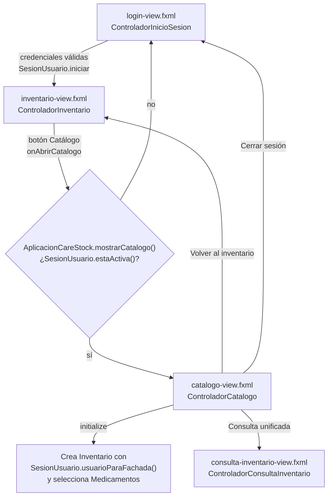
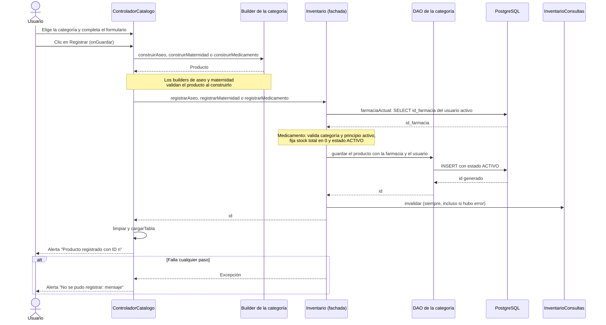

# Formulario único de registro de productos (HU-92)

Documentación de la pantalla de catálogo (`catalogo-view.fxml` y `ControladorCatalogo`), con la que se registran, editan y desactivan medicamentos, productos de aseo y productos de maternidad desde un solo formulario.

Este documento describe la **pantalla**: acceso, campos, reglas y mensajes. El proceso general del catálogo está en [`HU-103/PROCESO_CATALOGO_UNIFICADO.md`](../HU-103/PROCESO_CATALOGO_UNIFICADO.md) y la edición de un medicamento en [`HU98/Diagrama-editar-medicamento.md`](../HU98/Diagrama-editar-medicamento.md).

Código fuente: `src/CareStock/src/main/java/org/example/carestock/`.

---

## 1. Acceso a la pantalla

La ventana del catálogo se abre con un tamaño de 1150 x 760. La consulta unificada también puede volver al catálogo.

---

## 2. Estructura de la pantalla

| Zona | Contenido |
|---|---|
| **Barra superior** | Títulos "CareStock" y "Catálogo de productos", y los botones **Consulta unificada**, **Volver al inventario** y **Cerrar sesión** |
| **Panel izquierdo** | Selector **Categoría** (`cmbCategoria`), botón **Actualizar lista**, tabla `tablaProductos` y la línea de estado `lblEstado` (inicia con "Listo") |
| **Panel derecho** | Título del formulario `lblSeleccion`, campos comunes, un panel de campos propio de cada categoría y los botones **Nuevo**, **Registrar**, **Actualizar** y **Desactivar** |

**Tabla de productos:** columnas ID, Código / INVIMA, Nombre, Descripción / P. activo, Precio, Stock y Estado.

**Título del formulario:** muestra "Nuevo producto" cuando no hay fila seleccionada y "Editando registro #id" cuando se selecciona una fila, en cuyo caso el formulario se llena con sus datos.

---

## 3. Cambio de categoría

El selector tiene tres valores: `Medicamentos` (el predeterminado), `Aseo` y `Maternidad`. Al cambiarlo, `configurarCategorias` ajusta la pantalla:

| Elemento | Medicamentos | Aseo | Maternidad |
|---|---|---|---|
| Panel de campos propios | `panelMedicamentos` | `panelAseo` | `panelMaternidad` |
| Descripción y Precio / Stock | Ocultos | Visibles | Visibles |
| Etiqueta del código | Registro INVIMA | Codigo | Codigo |
| Etiqueta del nombre | Nombre comercial | Nombre | Nombre |

Además, el formulario se limpia y la tabla se recarga con los productos de la categoría. En medicamentos también se recargan las categorías farmacológicas.

---

## 4. Campos por categoría

### 4.1 Aseo

| Campo | Obligatorio | Regla |
|---|---|---|
| Código | Sí | No puede estar vacío |
| Nombre | Sí | No puede estar vacío |
| Descripción | Sí | No puede estar vacía |
| Precio | Sí | Número no negativo |
| Stock | Sí | Entero mayor o igual a cero |
| Tipo de aseo | No | Sin validación |
| Componentes activos | No | Sin validación |
| Biodegradable | No | Casilla de verificación |

### 4.2 Maternidad

| Campo | Obligatorio | Regla |
|---|---|---|
| Código | Sí | No puede estar vacío |
| Nombre | Sí | No puede estar vacío |
| Descripción | Sí | No puede estar vacía |
| Precio | Sí | Número no negativo |
| Stock | Sí | Entero mayor o igual a cero |
| Etapa recomendada | No | Sin validación |
| Edad gestacional sugerida | No | Entero no negativo; si se deja vacío se guarda como 0 |
| Hipoalergénico | No | Casilla de verificación |

### 4.3 Medicamentos

| Campo | Obligatorio | Regla |
|---|---|---|
| Registro INVIMA | Sí | No puede estar vacío |
| Nombre comercial | Sí | No puede estar vacío |
| Principio activo | Sí | No puede estar vacío |
| Categoría farmacológica | Sí | Se elige de una lista cargada desde la base de datos |
| Stock mínimo | Sí | Entero mayor o igual a cero |
| Precio de venta (COP) | No | Si se escribe: no negativo, con máximo dos decimales y 10 dígitos enteros |
| Concentración | No | Sin validación |
| Forma farmacéutica | No | Sin validación |
| Presentación | No | Sin validación |
| Stock total | Solo lectura | Se muestra "0 (gestionado mediante lotes)" |

Todos los productos se registran con estado `ACTIVO`.

---

## 5. Acciones

| Botón | Método | Qué hace |
|---|---|---|
| **Nuevo** | `onNuevo` | Limpia el formulario y quita la selección de la tabla |
| **Registrar** | `onGuardar` | Construye el producto de la categoría, lo guarda con la fachada `Inventario`, limpia el formulario, recarga la tabla y muestra "Producto registrado con ID n" |
| **Actualizar** | `onActualizar` | Requiere una fila seleccionada; guarda los cambios y muestra "Producto actualizado correctamente." en la línea de estado |
| **Desactivar** | `onDesactivar` | Requiere una fila seleccionada; pide confirmación "¿Desactivar producto #id?" y, si se acepta, desactiva el producto |
| **Actualizar lista** | `onRefrescar` | Recarga la tabla (y las categorías farmacológicas en medicamentos) |

Al cargar la tabla, la línea de estado muestra "Se cargaron n registros de categoría."

---

## 6. Flujo de registro

El producto queda en la farmacia del usuario autenticado: la fachada la obtiene de la base de datos y no la escribe el usuario en el formulario.

---

## 7. Validaciones y mensajes

### 7.1 Mensajes de validación

| Mensaje | Origen |
|---|---|
| El codigo del producto de aseo es obligatorio. | `Aseo.validar` |
| El nombre del producto de aseo es obligatorio. | `Aseo.validar` |
| La descripcion del producto de aseo es obligatoria. | `Aseo.validar` |
| El codigo del producto de maternidad es obligatorio. | `Maternidad.validar` |
| El nombre del producto de maternidad es obligatorio. | `Maternidad.validar` |
| La descripcion del producto de maternidad es obligatoria. | `Maternidad.validar` |
| La edad gestacional sugerida no puede ser negativa. | `Maternidad.validar` |
| El nombre comercial del medicamento es obligatorio. | `Medicamento.validar` |
| El código/registro INVIMA es obligatorio. | `Medicamento.validar` |
| Principio activo obligatorio | `Inventario.registrarMedicamento` |
| Categoria obligatoria para medicamento | `Inventario.registrarMedicamento` |
| Seleccione una categoria farmacologica | `ControladorCatalogo.construirMedicamento` |
| El precio debe ser no negativo | `ControladorCatalogo.leerPrecio` |
| El stock no puede ser negativo | `ControladorCatalogo.leerStock` |
| Precio invalido. Use: 15000.00 | `ControladorCatalogo.leerPrecioMedicamento` |

### 7.2 Mensajes de la pantalla

| Situación | Mensaje |
|---|---|
| Registro correcto | Producto registrado con ID n |
| Falla al registrar, actualizar o desactivar | No se pudo registrar / No se pudo actualizar / No se pudo desactivar, seguido de `: ` y el detalle |
| Actualizar sin selección | Seleccione un producto para actualizar |
| Desactivar sin selección | Seleccione un producto |
| Actualizar un registro que no existe, está inactivo o es de otra farmacia | Registro inexistente, inactivo o de otra farmacia |
| Desactivación sin efecto | No se pudo desactivar. Revise estado, farmacia y stock. |
| Desactivación correcta | Producto desactivado. |
| Sesión distinta a la de la vista | La sesion ha cambiado. Abra nuevamente la vista. |
| Usuario sin farmacia activa | Usuario inactivo o sin farmacia activa asignada |

---

## 8. Observaciones

Verificadas en el código:

1. **El catálogo no se restringe por rol.** `mostrarCatalogo` solo comprueba que haya una sesión activa. El rol del usuario se muestra en la pantalla de inventario (`lblRolSesion`), pero ningún control del formulario lo consulta.
2. **Algunos errores de conversión muestran el texto técnico de Java.** Si el precio de aseo o maternidad, el stock, la edad gestacional o el stock mínimo no son numéricos, el usuario ve mensajes como `No se pudo registrar: For input string: "abc"` o `empty String`. Solo el precio de medicamento tiene un mensaje propio.
3. **El stock de un medicamento no se captura en el formulario.** Se registra en 0 y se gestiona mediante lotes.
4. **El controlador decide por categoría con un `switch`.** El texto del selector se evalúa con `switch` al cargar la tabla, registrar, actualizar y desactivar, y cada rama llama al builder y a la operación de la fachada de su categoría.
5. **La caché del inventario se invalida siempre.** `Inventario.escribir` llama a `InventarioConsultas.invalidar()` en un bloque `finally`, de modo que se descarta también cuando la operación falla.

---

## 9. Referencias de código

| Elemento | Ubicación |
|---|---|
| Vista | `src/main/resources/org/example/carestock/catalogo-view.fxml` |
| Controlador | `controller/ControladorCatalogo.java` |
| Navegación | `AplicacionCareStock.java` (`mostrarCatalogo`, `mostrarDashboard`, `mostrarConsultaUnificada`) |
| Sesión | `session/SesionUsuario.java` |
| Fachada | `facade/Inventario.java` |
| Builders | `model/AseoBuilder.java`, `model/MaternidadBuilder.java`, `Medicamento.builder()` |
| Validación | `model/Aseo.java`, `model/Maternidad.java`, `model/Medicamento.java` (método `validar`) |
