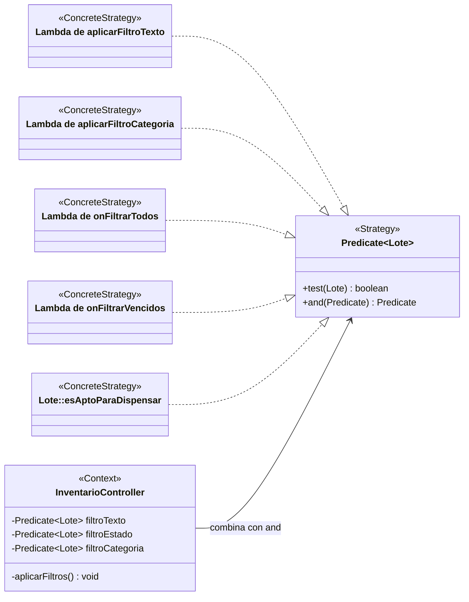

# Patrón Strategy en los filtros del inventario

Documentación del patrón comportamental **Strategy**, aplicado en su forma funcional con `java.util.function.Predicate`, en los filtros de la pantalla de inventario (`InventarioController` e `inventario-view.fxml`).

---

## 1. Problema y decisión de diseño

La tabla de lotes se filtra por texto, por estado y por categoría, y las tres reglas se combinan y cambian mientras el usuario usa la pantalla. En el commit `4f5403b` (9 de octubre de 2026, #622) se resolvió con la forma funcional de Strategy: cada regla es un `Predicate<Lote>` intercambiable y el controlador las combina, sin crear una interfaz y una clase por cada regla.

---

## 2. Roles del patrón

| Rol | Elemento |
|---|---|
| **Strategy** | `Predicate<Lote>` |
| **ConcreteStrategy** | Las lambdas asignadas en `aplicarFiltroTexto`, `aplicarFiltroCategoria`, `onFiltrarTodos`, `onFiltrarVencidos` y `onFiltrarDisponibles` (esta usa `Lote::esAptoParaDispensar`) |
| **Context** | `InventarioController`, que guarda las estrategias activas en `filtroTexto`, `filtroEstado` y `filtroCategoria` y las combina en `aplicarFiltros` |

---

## 3. Diagrama de clases

---

## 4. Estrategias disponibles

| Filtro | Se activa con | Un lote se muestra si |
|---|---|---|
| **Texto** | Escribir en el buscador | El texto está vacío o aparece en el número de lote, en el id del medicamento o en el estado del lote (sin distinguir mayúsculas) |
| **Categoría** | Elegir una categoría | Se eligió "Todas" o la categoría de su medicamento coincide con la elegida |
| **Estado: todos** | Botón "Ver todos" | Siempre; además vacía la búsqueda y restablece la categoría |
| **Estado: vencidos** | Botón "Ver vencidos" | Su fecha de vencimiento existe y es anterior a hoy |
| **Estado: aptos** | Botón "Ver aptos" | `esAptoParaDispensar()`: vence después de hoy, tiene cantidad mayor que cero y su estado es `DISPONIBLE` |

Los tres filtros se combinan con **AND** en `aplicarFiltros`, que aplica el resultado a la tabla con `setPredicate`. Si ningún lote cumple, la tabla muestra "No hay datos disponibles para los filtros seleccionados."

---

## 5. Observaciones

Verificadas en el código:

1. **Las estrategias están dentro del controlador**, como lambdas, así que para probarlas hay que instanciarlo. La consulta unificada, en cambio, filtra con una clase aparte, `FiltroProductoInventario.coincide`, descrita en su código como comprobable sin JavaFX.
2. **El filtro de categoría depende de un mapa del controlador**, `categoriaPorMedicamento`, que se recarga con `inventario.categoriaPorMedicamento()`.
3. **Los botones de estado no se comportan igual:** "Ver todos" restablece los tres filtros, mientras que "Ver vencidos" y "Ver aptos" solo reemplazan el de estado.
