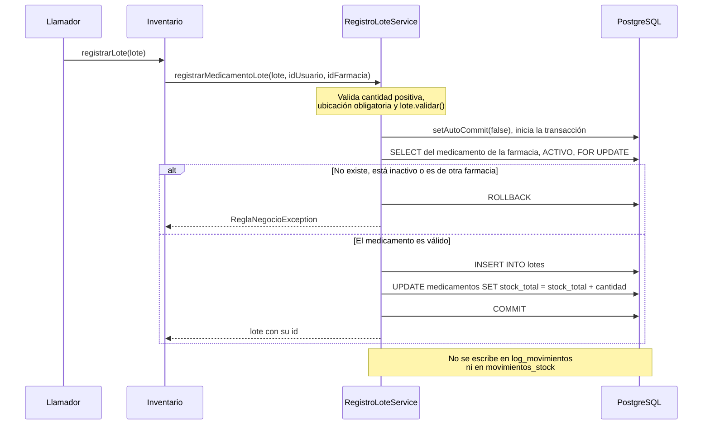
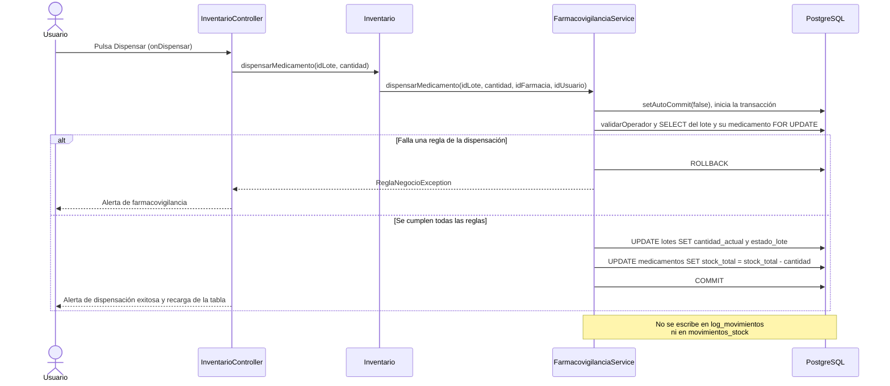

# Entrada y salida de un lote: ingreso y dispensación

Flujo del ingreso de un lote y de la dispensación, y si cada uno registra un movimiento de inventario. Verificado sobre el código del repositorio en el commit `e89a0fa` (19 de octubre de 2026). Ambos servicios ejecutan su propia transacción con SQL directo sobre `lotes` y `medicamentos`, sin pasar por `LoteDAOImpl`.

---

## 1. Ingreso de un lote

**¿Registra un movimiento?** No. Además, ninguna clase llama hoy a `Inventario.registrarLote`.

---

## 2. Dispensación

**¿Registra un movimiento?** No.

---

## 3. Funciones SQL que sí registran el movimiento

`fn_registrar_lote` inserta una `ENTRADA` en `log_movimientos` y `fn_despachar_lote` inserta una `SALIDA`, pero **ninguna clase Java las invoca**.
