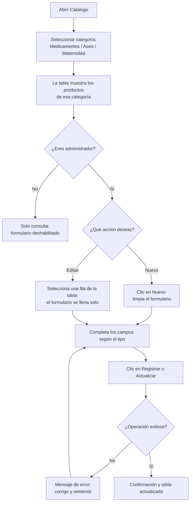

# Guía de usuario — Catálogo unificado de productos (CareStock)

Guía de uso de la pantalla de catálogo (`catalogo-view.fxml` / `ControladorCatalogo`) para consultar, registrar, editar y desactivar medicamentos, productos de aseo y productos de maternidad.

## 1. Quién puede hacer qué

| Rol | Consultar catálogo | Registrar / actualizar / desactivar |
| :--- | :---: | :---: |
| ADMINISTRADOR | ✅ | ✅ |
| FARMACEUTICO | ✅ | ❌ (modo consulta) |

Si inicias sesión con un rol distinto de ADMINISTRADOR (hoy, FARMACEUTICO), el formulario aparece deshabilitado y la barra de estado muestra: *"Modo consulta: solo ADMINISTRADOR puede modificar productos."*

## 2. Flujo general

## 3. Campos por tipo de producto

| Tipo | Campos obligatorios | Campos adicionales |
| :--- | :--- | :--- |
| **Aseo** | Código, Nombre, Descripción, Precio, Stock | Tipo de aseo, Componentes activos, Biodegradable (casilla) |
| **Maternidad** | Código, Nombre, Descripción, Precio, Stock | Etapa recomendada, Edad gestacional sugerida (número entero, no negativo), Hipoalergénico (casilla) |
| **Medicamentos** | Código/INVIMA, Nombre, Principio activo, Categoría farmacológica, Stock mínimo | Concentración, Forma farmacéutica, Presentación, Precio de venta (opcional; si se deja vacío el medicamento queda sin precio) |

En medicamentos el stock total es de solo lectura: se gestiona mediante lotes.

## 4. Acciones disponibles

- **Actualizar lista:** refresca la tabla con los datos más recientes de la categoría seleccionada.
- **Nuevo:** limpia el formulario para capturar un producto desde cero.
- **Registrar:** guarda un producto nuevo. Muestra un mensaje de confirmación que se cierra solo a los pocos segundos.
- **Actualizar:** guarda los cambios del producto seleccionado en la tabla. También muestra una confirmación que se cierra sola.
- **Desactivar:** da de baja el producto seleccionado (no lo elimina).
- **Consulta unificada:** abre el inventario que combina los 3 tipos de producto, filtrado por la farmacia asignada al usuario.
- **Volver al inventario / Cerrar sesión:** navegación y salida segura.

## 6. Validación

Guía revisada por: Valentina Carrillo Peñuela — 17/10/2026. Siguió los pasos sin ayuda adicional y confirmó que los campos coinciden con el formulario real.

